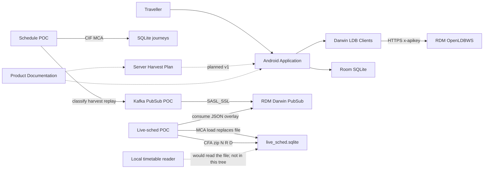
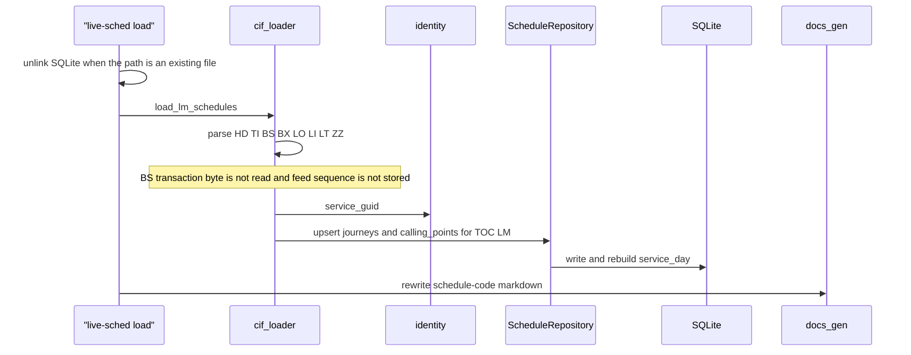
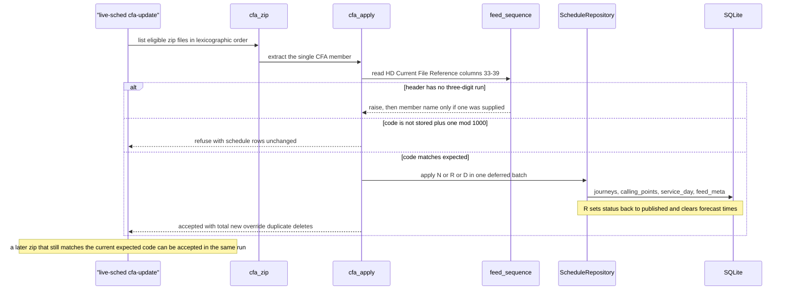
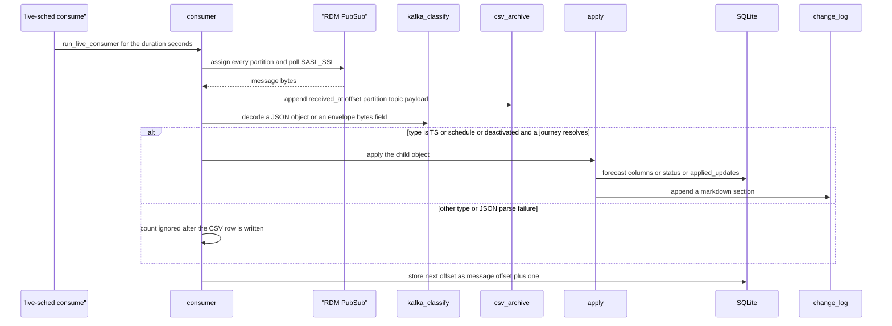
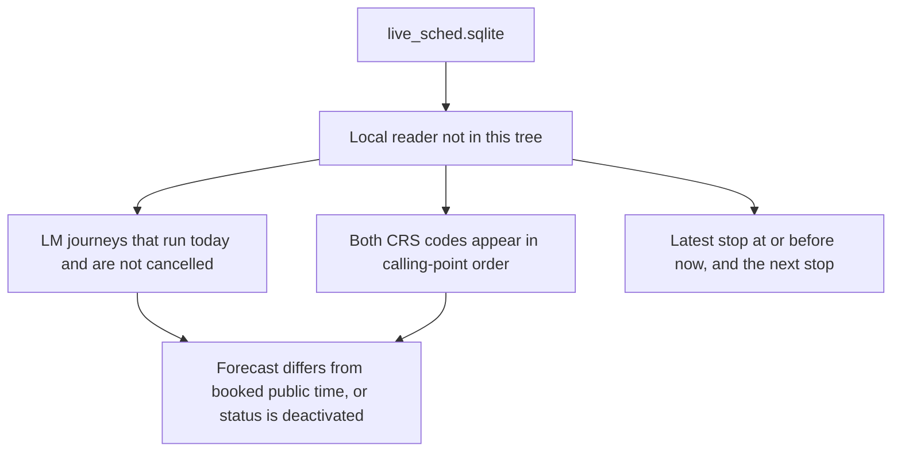
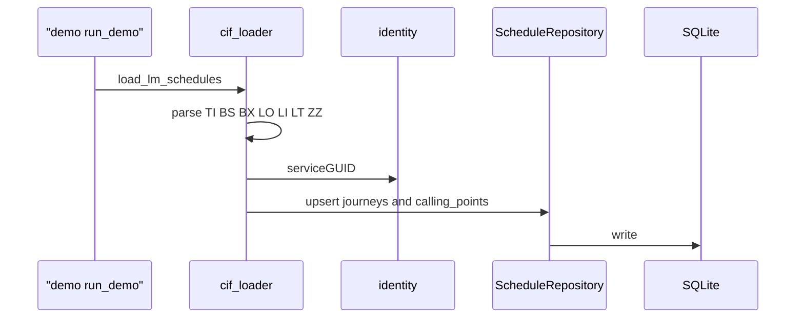

# Architecture — uk-rail-tracker

## Architecture Analysis

### System Overview

Polyglot brownfield: a **Kotlin Android modular client** consuming Darwin OpenLDBWS, plus **local Python POCs** under `server/poc/` for CIF timetable load and Kafka Push Port experiments. No first-party HTTP API process exists. Product docs describe a future AWS harvester and `serviceGUID` bridge (`server/PLAN.md`); runtime today is the client plus local POCs.

**Focused update (2026-10-25):** `server/poc/live-sched/` is a sibling of Schedule POC. It stream-loads an LM MCA into SQLite, applies a daily CFA zip through a 3-digit sequence gate, and overlays a duration-bounded Kafka JSON consumer. Raw intake stays on disk (MCA path, zip left in the watch folder, Kafka CSV). Queryable state is the SQLite tables. The package does not import `schedule_poc`. There is no S3, Glue, or Athena client in this tree.

The local timetable page (`docs/future-intents/local-timetable.md`) will read that SQLite file. Its server and UI are not in this tree. A successor package must not import `schedule_poc`. This synthesis did not open `server/poc/schedule`.

### Architectural Style

**Hybrid modular client + exploratory backend POCs** (not microservices, not serverless). Evidence: single `:app` Gradle module; schedule and live-sched as importable libraries plus a CLI or demo; kafka as sibling scripts; planned `server/{api,ingest,infra}` trees absent. Live-sched is one process and one SQLite file, with three CLI entry points over that file. The later local reader is a separate process in the future-intents page. It is not a fourth entry point in this package.

### Constraints

- Do not import `schedule_poc` from `live-sched` or from a successor package that follows the live-sched ideas. This run did not open that package.
- Kafka credentials stay in the environment. This architecture does not list them. Setting names are in `api-documentation.md`.

### Component Relationships

**Text fallback.** A traveller uses the Android application, which calls Darwin LDB clients over HTTPS and stores session state in Room. The Schedule POC loads a CIF MCA into its own SQLite file and can use the Kafka PubSub POC, which talks to Darwin PubSub. The Live-sched POC is separate: MCA load replaces its SQLite file, a CFA zip applies N/R/D into that same file, and consume overlays JSON from Darwin PubSub. A local timetable reader would read that file and is not in this tree. The server harvest plan and product docs describe future or surrounding behaviour. They are not running services.

### Data Flow

1. **Boards / details** (prior scan): UI → OkHttp OpenLDBWS → DTO/repo → Room/UI state.
2. **CIF baseline (schedule POC)** (prior scan, tree not opened this run): MCA stream → `cif_loader` (TOC `LM`) → `ScheduleRepository` / SQLite.
3. **CIF baseline (live-sched):** MCA stream from `--mca` or `SCHEDULE_DIR`/`SCHEDULE_FILE` → `cif_loader.load_lm_schedules`. Only TOC `LM` is persisted. The CLI deletes the SQLite file first when the path is an existing file. `HANDLED_CODES` are `HD`, `TI`, `BS`, `BX`, `LO`, `LI`, `LT`, `ZZ`. The BS transaction byte is not read. Feed sequence is not written on this path.
4. **CFA daily (live-sched):** one-shot listing of `*.zip` → exactly one CFA member → HD Current File Reference columns 33–39 (member name only if that field has no three-digit run; zip basename ignored) → N/R/D in one deferred batch → `service_day` rebuilt for touched UIDs → sequence stored in the same batch. A refuse does not change schedule rows. Later zips in the same run are still attempted. Zips are not moved or marked. An accepted `R` sets journey status back to `published` and clears forecast times on that journey.
5. **Live overlay (live-sched):** Kafka poll → CSV append → JSON classify → apply `TS` / `schedule` / `deactivated` when the journey already exists → `applied_updates` plus `output/db-changes.md`. `TS` writes forecast columns only. `deactivated` sets journey status. `schedule` stores the child and leaves booked times as loaded.
6. **Live overlay (schedule POC)** (prior scan): harvest / replay patterns on the sibling stack.
7. **Planned server** (prior scan): PLAN.md AWS harvest → `serviceGUID` API → Android. Not implemented. No object-store layout exists in the analyzed tree.
8. **Local timetable read** (not implemented): the three views in `docs/future-intents/local-timetable.md` would read the file after steps 3–5. There is no query method for them. See `api-documentation.md`.

Scale signal from the checked-in summary of one full MCA pass, recorded on 2026-10-20 and not re-opened this run: 15,724 LM journeys persisted; 9,064,174 records counted; 7,102,336 of those are `LI`; about 439,000 basic schedules in the full file before the LM filter. `AA` (6,344) and `CR` (97,900) were counted and not applied. The calendar read uses `service_day` `(train_uid, calendar_date)` after STP resolution (`C` cancels, else `O`, else `P`, else `N`), so that read does not walk every schedule window again. Lookup keys are specified in `api-documentation.md`.

A daily CFA has schedule records and no TI extract in the case the tests lock. Origin and destination CRS are filled from calling points the MCA load already stored. `load` removing the file also removes that CRS map, the feed sequence, and Kafka offsets.

### Key Design Decisions

Each decision below is what the live-sched tree does today. Security notes the exposure of that choice. Alternatives Rejected are the other shapes the same package could have taken.

#### Sibling package, no import of schedule_poc

- **Context.** A project rule requires `live_sched` not to import `schedule_poc`. The full-load and daily paths both parse CIF fixed-width records. The local timetable reader is a successor in the same sense.
- **Decision.** `live-sched` is its own setuptools package. It does not import `schedule_poc`. CIF schedule parsing in `cfa_apply.py` is a copy of the loader rules, not a shared module. This synthesis did not open `server/poc/schedule`.
- **Consequences.** The package installs and tests without the sibling on `PYTHONPATH`. Column-offset fixes must be applied in more than one file or the two paths diverge. A third copy lives in `scripts/compare_mca_to_db.py`.
- **Alternatives Rejected.** Import `schedule_poc.cif_loader` and call it from both commands. Extract one column-layout module inside `live_sched` and use it from `cif_loader`, `cfa_apply`, and the compare script. Both were set aside so the MCA replace path and the incremental path stay independent for this proof of concept.
- **Security.** The process does not load sibling package code. Kafka credentials stay in the environment loaded by `config.py` (`override=False`) and are not a column in the CSV archive. This text does not list those settings. The integrity exposure is parser drift: the same CIF bytes can be stored differently on the full-load path and the daily path. The full-load parser ignores the BS transaction byte; the CFA parser implements `N` / `R` / `D`.

#### Feed sequence from the HD Current File Reference

- **Context.** Daily zips must be applied in order. A renamed file in the watch folder must not choose the sequence.
- **Decision.** The actual code is the three-digit run in HD columns 33–39 (slice `[32:39]`). Expected value is the stored code plus one, modulo 1000, zero-padded (`999` wraps to `000`). Empty store seeds `990`. The zip basename is ignored. If the header has no three-digit run, the code raises; only then, when a member name was supplied, the code is taken from that inner name.
- **Consequences.** A mismatch raises before `begin_batch`, so schedule rows and the stored code stay unchanged (`test_refuse_wrong_sequence_leaves_db`, prior-scan name; this run confirmed the refuse path in `tests/test_cfa_apply.py`). An accepted code is written inside the same batch as the N/R/D writes, so a later error rolls the sequence back too. A second run of an already accepted zip refuses it, because the file is left in the folder and the stored code has moved on. This run confirmed the member-name path: a zip named `timetable_update_991.zip` can still yield `991` from the inner member when the HD field has no digits (`test_member_name_sequence_when_hd_has_no_digits`).
- **Alternatives Rejected.** Take the three digits from the zip basename. Refuse whenever columns 33–39 contain no three-digit run, with no member-name fallback. The basename alternative is rejected by the project rule and by the code. The member-name fallback is narrower than a hard refuse: it runs only after the header itself has no three digits, and it still ignores the zip basename.
- **Security.** Renaming the zip cannot advance the sequence. A CFA member whose HD lacks digits can still present a code from the inner filename, which is a weaker check than refusing that header. Sequence refusal does not stop the rest of the lexicographic list, so a later well-formed zip can still commit in the same process. Bytes are decoded as UTF-8 with replacement characters, so a bad byte becomes U+FFFD rather than failing the zip closed.

#### One SQLite file for plan, calendar, live state, and cursors

- **Context.** The proof of concept queries journeys, stops, and "what runs on this date" on one machine, and it must resume Kafka and the feed code across CLI invocations. The local timetable page reads this same file.
- **Decision.** `db.py` holds seven tables in one file: `journeys`, `calling_points`, `service_day`, `service_aliases`, `feed_meta`, `kafka_offsets`, `applied_updates`. `init_schema` is `CREATE TABLE IF NOT EXISTS` plus four indexes. There is no schema version.
- **Consequences.** `load` deletes an existing file and clears plan, live overlays, offsets, and feed sequence together. `cfa-update` does not delete the file and will not alter an older file's columns. `applied_updates.service_guid` has no `ON DELETE CASCADE`. `delete_journey` deletes the journey row only. With foreign keys on, a journey that already has `applied_updates` rows cannot be deleted. CFA `D`, and `R` when the new `service_guid` differs, call `delete_journey` inside the zip batch. Keys and the missing reader queries are in `api-documentation.md`.
- **Alternatives Rejected.** Separate files for the timetable plan, the feed cursor, and the Kafka cursor, so a full MCA replace cannot drop resume state. A migration table with an explicit schema version, instead of create-if-not-exists. The single file is the implemented choice.
- **Security.** The file is local and gitignored. This package does not describe encryption at rest. Foreign keys are on. A journey delete can fail while apply history still points at the journey. That path is not covered by the tests this run opened.

#### Archive every Kafka value, then apply a JSON subset

- **Context.** The consumer must keep a local copy of what arrived and must resume after a restart, including Ctrl+C.
- **Decision.** `csv_archive` appends every message first. Decode and apply run after that append. Only `TS`, `schedule`, and `deactivated` that resolve to an existing journey mutate live columns. The consumer assigns partitions itself and stores `message.offset + 1`. `enable.auto.commit` is false.
- **Consequences.** Undecodable text is still on disk. XML and Avro `--format` values select a topic and then pass bytes through the JSON decoder, so those messages are archived and ignored. `schedule` is stored as JSON and does not rewrite booked times. `TS` writes forecast columns and leaves booked public times. `deactivated` sets `journeys.status` to `deactivated`.
- **Alternatives Rejected.** Apply without retaining the raw value. Commit offsets through the broker group instead of `kafka_offsets`. The local CSV plus manual assign is the implemented choice.
- **Security.** The CSV header is `received_at`, `offset`, `partition`, `topic`, `payload`. The payload can hold Push Port operational content on local disk; it is gitignored and not encrypted by this package. Kafka credentials stay in the environment. They are not CSV columns. This architecture does not list them. There is no inbound HTTP listener on this package.

#### The SQLite file is the read model; the local reader does not exist yet

- **Context.** `docs/future-intents/local-timetable.md` describes a Dockerised database, server, and UI on one machine. The database is the live-sched SQLite file. The server and UI are new. They are not in this tree.
- **Decision.** This store documents the existing writer. It does not add a server or UI component. The three views (LM trains today, a station pair, and where the train is) are requirements on a later reader of this file.
- **Consequences.** `ScheduleRepository` can fetch one journey, one service day, calling points, an alias, and the LM UID set. It cannot list every service for one calendar date, and it cannot find a journey by an ordered pair of CRS codes. `connect` creates a missing database file. `get_feed_sequence` commits seed `990` when the key is absent. A read path that calls those helpers writes. `load` deletes an existing file, so a reader must tolerate the database disappearing. An accepted CFA `R` resets status to `published` and drops forecast times.
- **Alternatives Rejected.** Add the three views as new methods inside `live_sched` during this scan. The page asks for a new reader, and this stage only records the proof of concept. Importing `schedule_poc` to reuse a query layer is rejected by the project rule.
- **Security.** The page describes one reader on this machine, with no accounts and no hosted deployment. Credentials are not columns in the SQLite file. A reader must not print them. This architecture does not list them.

### Improvement Opportunities

- The raw-versus-query split is already the shape a later reader has to keep: MCA bytes and the zip remain the intake, the Kafka CSV remains the live intake, and `journeys` / `calling_points` / `service_day` are the reads. The local timetable page needs calendar-day and station-pair reads that this package does not have. Detail is in `api-documentation.md`. Do not treat the `list_journeys()` UID fallback in `apply.py` as a read pattern; it scans every journey and can bind a `rid` to the wrong STP row. Detail is in `code-quality-assessment.md`.
- Parser copies can drift. The project rule keeps them independent for this proof of concept; a shared layout test is the check that does not collapse the packages.
- `server/{api,ingest,infra}` from PLAN.md are still absent. Android still centres on ephemeral Darwin `serviceID`. The local timetable server and UI are also absent.

## Interaction Diagrams

### CIF MCA load (live-sched)

**Text fallback.** `live-sched load` deletes the SQLite file when that path is an existing file. `cif_loader` parses HD, TI, BS, BX, LO, LI, LT, and ZZ. It does not read the BS transaction byte and it does not store the feed sequence. `identity` builds `service_guid`. The repository upserts journeys and calling points for TOC LM, writes them, and rebuilds `service_day`. The CLI then rewrites the schedule-code markdown.

### CFA daily apply (live-sched)

**Text fallback.** `live-sched cfa-update` lists eligible zips in lexicographic order. `cfa_zip` extracts the single CFA member. `feed_sequence` reads HD Current File Reference columns 33–39. If that field has no three-digit run, the code raises and then may take the inner member name. The zip basename is ignored. If the code is not the stored code plus one, modulo 1000, the zip is refused and schedule rows stay unchanged. If the code matches, N, R, or D run in one deferred batch against journeys, calling points, `service_day`, and `feed_meta`. R sets status back to `published` and clears forecast times. The CLI prints accepted with the new, override, duplicate, and delete totals. A later zip in the same run can still be accepted when it matches the expected code that remains.

### Kafka consume overlay (live-sched)

**Text fallback.** `live-sched consume` runs the consumer for the duration. The consumer assigns every partition and polls Darwin PubSub. Each message is appended to the CSV first (`received_at`, offset, partition, topic, payload). Classification decodes a JSON object or an envelope `bytes` field. When the type is `TS`, `schedule`, or `deactivated` and a journey resolves, apply writes forecast columns, status, or `applied_updates`, and appends a markdown section. Any other type, or a JSON parse failure, is counted as ignored after the CSV row exists. The consumer then stores the next offset as the message offset plus one.

### Intended local timetable read (not in this tree)

**Text fallback.** The SQLite file would feed a local reader that is not in this tree. That reader would list LM journeys that run today and are not cancelled, find journeys whose calling points include both chosen CRS codes in order, and name the latest stop at or before now plus the next stop. A deviation is a forecast that differs from the booked public time, or a journey status of `deactivated`. No module in `server/poc/live-sched` performs this read.

### CIF load and identity (schedule POC — preserved)

This diagram is the prior store's picture of `server/poc/schedule/`. This run did not open that tree.

**Text fallback.** On the Schedule POC, which this run did not open, the demo calls `load_lm_schedules`. The loader parses TI, BS, BX, LO, LI, LT, and ZZ, asks `identity` for `serviceGUID`, and upserts journeys and calling points through the repository into SQLite.

## Cross-references

- Inventory → `component-inventory.md`
- CLI contract and the seven-table lookup keys → `api-documentation.md`
- Stack and package edges → `technology-stack.md`, `dependencies.md`
- Parser drift, UID scan, and test gaps → `code-quality-assessment.md`
