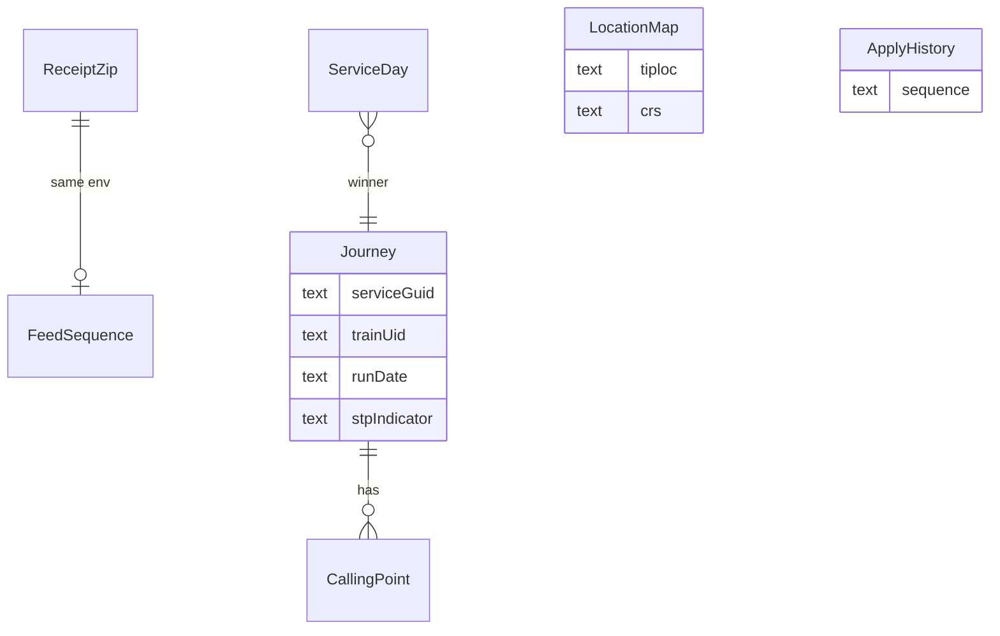

# Functional spec — cfa-receipt-apply

Behaviour for the CFA chapter and file shell of `docs/athena-timetable-lake.md`. This spec is the source of truth for workflows and state machines. Entity shapes live in `entities.md`. Decision logic lives in `rules.md`.

## Workflows

### W1 — File shell (US1.1, US6.1, US7.x Deferred)

1. The product path is `docs/athena-timetable-lake.md`.
2. Title, overview diagram (with text fallback), and Environments name `{env}` in `{dev, staging, prod}` for every logical S3, Glue, and Athena object. Example strings are author choice, not a lock. Resources are named not created. No credentials.
3. Heading map is the mockups list (BR1.5). This Bolt may edit Environments, CFA receipt → validate → apply, TOC extension, Later package layering, Deferred, and that title/diagram shell only (BR7.1).
4. Later package layering names the sibling `server/` package, three later services (CfaIntake, KafkaOverlay, PlanQuery), fail-closed CFA / fail-open overlay, and forbids `schedule_poc` and clients inside parsers.
5. Deferred lists US7.1–US7.5 items (BR1.6).

### W2 — Receipt, classify, validate

1. Supplier drops one zip into the env-qualified receipt location. Raw zip stays for replay on every outcome.
2. Classify members: MCA present → full-update path (MCA wins if CFA also present). Else exactly one CFA member. Else neither → error, plan unchanged, FeedSequence unchanged, ReceiptZip status `failed` or `nothing` as fits empty/unreadable (BR2.8).
3. CFA path only: read HD Current File Reference columns 33–39. No three digits → refuse. Zip basename is never the sequence. Member-name fallback is forbidden.
4. Expected CFA code is stored previous plus one, modulo 1000, zero-padded. Empty store seeds `990`. Mismatch → refuse, record expected and actual, plan unchanged (BR2.3).
5. MCA path does not run those sequence checks.

### W3 — Refuse

Fail-closed. Words in the chapter: refuse, unchanged, reason, raw zip stays. Entity status: `refused` (or `failed`/`nothing` when there is no CFA/MCA to refuse). No PlanQuery entity writes. FeedSequence unchanged.

### W4 — Shape and accept

1. Shape CIF/CFA into Journey, CallingPoint booked times, ServiceDay. `service_guid` = `SVC-` + `{train_uid}-{run_date}-{stp_indicator}`. STP winner on ServiceDay is C then O then P then N.
2. LM persist: skip non-delete drafts whose TOC is not `LM`. Deletes follow identity, not TOC.
3. CFA accept applies incremental N/R/D. MCA full update replaces booked identity, booked times, and ServiceDay, and writes LocationMap. Empty-lake identities and CRS/TIPLOC map enter on MCA; CFA-only silence on first identities is forbidden.
4. One atomic PlanQuery persist of the named publish set (CfaIntake table in `components.md`). Mid-apply failure → previous plan queryable, no partial grain (BR2.7). Overlay is not in this transaction.
5. ApplyHistory appends counts and CIF-triple identities changed (BR2.6). CFA accept advances FeedSequence. MCA accept clears FeedSequence.

### W5 — TOC extension

Same receipt, HD sequence, CIF identity, calendar/STP, refuse/accept. No new door (BR5.1).

## State machines

### ReceiptZip.status

```text
arrived → classified
classified → accepted   (CFA or MCA accept publish succeeded)
classified → refused    (sequence or member-rule refuse)
classified → failed     (neither MCA nor CFA, or unreadable)
classified → nothing    (no applicable member / empty outcome)
```

Refuse and failed leave the current plan unchanged. Accepted is the only path that mutates PlanQuery grains.

### FeedSequence.currentCode

```text
empty → seed 990 on next CFA validate
CFA accept → advance modulo 1000
MCA accept → clear (next CFA seeds 990)
refuse / failed / nothing → unchanged
```

## Entity relationship (derived from entities.md)



Text fallback: ReceiptZip and FeedSequence are keyed by env. A Journey has many CallingPoints. A ServiceDay names one winning Journey. LocationMap and ApplyHistory have no required relationship to ReceiptZip.

## Rules summary (derived from rules.md)

Document shell BR1.1–BR1.6. Intake BR2.1–BR2.10. TOC BR5.1. Layering BR6.1–BR6.3. This Bolt’s heading lock BR7.1.

## Integration

- C1 consumer (U2) may bind rid via service_aliases (U2 writes aliases) and `(train_uid, calendar date)` via service_day. This unit must not invent a second identity or allow a UID-wide scan.
- C2 consumer (U3) authors partition keys and projected columns; this unit authors grain identifiers and Glue names listed in C2.
- Later CfaIntake → PlanQuery call shape is deferred.

## Sources

- `docs/athena-timetable-lake.md`
- `entities.md`, `rules.md`
- `contract-summary.md` — C1 C2
- `unit-of-work.md` — U1
- `functional-design-questions.md`
