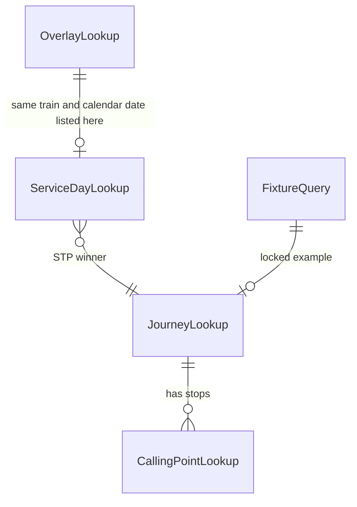

# Functional spec — cheap-lookups

Behaviour for the Cheap lookups chapter of `docs/athena-timetable-lake.md`. This spec is the source of truth for workflows and state machines. Entity shapes live in `entities.md`. Decision logic lives in `rules.md`.

## Workflows

### W1 — Heading lock (US3.1)

1. This Bolt edits only Cheap lookups (BR3.8). Keep the current heading as the lock (Q1 A).
2. File layout already named: Parquet under the env-qualified curated prefix; one Glue table per grain. Columnar format is not story done (BR3.1).
3. Glue names this heading consumes: `journey`, `calling_points`, `service_day` from C2; `overlay` from C3. `apply_history`, `service_aliases`, and `location_map` stay listed as lake tables and are not cheapest-scan targets.

### W2 — Four cheap lookups (US3.1 / AC3.1.1–AC3.1.3)

1. CIF identity / `service_guid` — JourneyLookup. Keys `toc`, `run_date`. Prefix `curated/journey/toc=…/run_date=…/`. Columns as BR3.1.
2. Stop sequence — CallingPointLookup. Identity `(service_guid, seq)`. Keys `toc`, `run_date`. Prefix `curated/calling_points/toc=…/run_date=…/`. Booked times only (BR3.2).
3. Service day — ServiceDayLookup. Identity `(train_uid, calendar_date)` after STP. Winner C then O then P then N. Keys `toc`, `calendar_date`. Prefix `curated/service_day/toc=…/calendar_date=…/` (BR3.3).
4. Live overlay — listed here; keys, columns, and worked example stay in Kafka archive/overlay (BR3.4).

Station-plus-time-window is not a cheapest-scan target.

### W3 — Worked example and fixture (US3.1 / AC3.1.2, AC3.1.4)

Locked example: TOC `LM`, `train_uid` `C12345`, `run_date` / `calendar_date` `261020`, `stp_indicator` `P`, `service_guid` `SVC-C12345-261020-P` (BR3.6).

A later query-contract test for that train on that date reads only the `toc=LM` + date partitions above, plus the overlay partition in the Kafka chapter. It must not scan every journey file group or every Kafka archive object (BR3.5).

## State machines

Lookups are reads. They do not change grain state.

```text
Athena request
  → skip unrelated toc / date partitions
  → project named columns
  → return zero or one journey / one service-day row / ordered calling points
```

Overlay type skip is column projection on the Kafka-specified overlay row, not a type partition. This heading does not author that row.

## Entity relationship (derived from entities.md)



Text fallback: Calling points belong to one journey. A service-day row names the STP-winning journey. Overlay is listed against the same train and date and is specified in the Kafka chapter. The fixture query uses the locked LM / C12345 / 261020 example.

## Rules summary (derived from rules.md)

Journey BR3.1. Stops BR3.2. Service day BR3.3. Four-item list BR3.4. Fixture BR3.5. Example BR3.6. Names BR3.7. Heading lock BR3.8.

## Integration

- C2 provider (U1) names grain identifiers, STP winner, and Glue names for plan grains. This unit authors partition keys and projected columns for items 1–3.
- C3 provider (U2) names overlay identity and columns. This unit lists live overlay as item 4 and may point at that heading.
- Units review R-01 (accepted): lookup keys are authored here; grain identifiers stay with U1.

## Sources

- `docs/athena-timetable-lake.md`
- `entities.md`, `rules.md`
- `unit-of-work.md`, `unit-of-work-story-map.md` — U3 / US3.1
- `contract-summary.md` — C2 C3
- `functional-design-questions.md`
