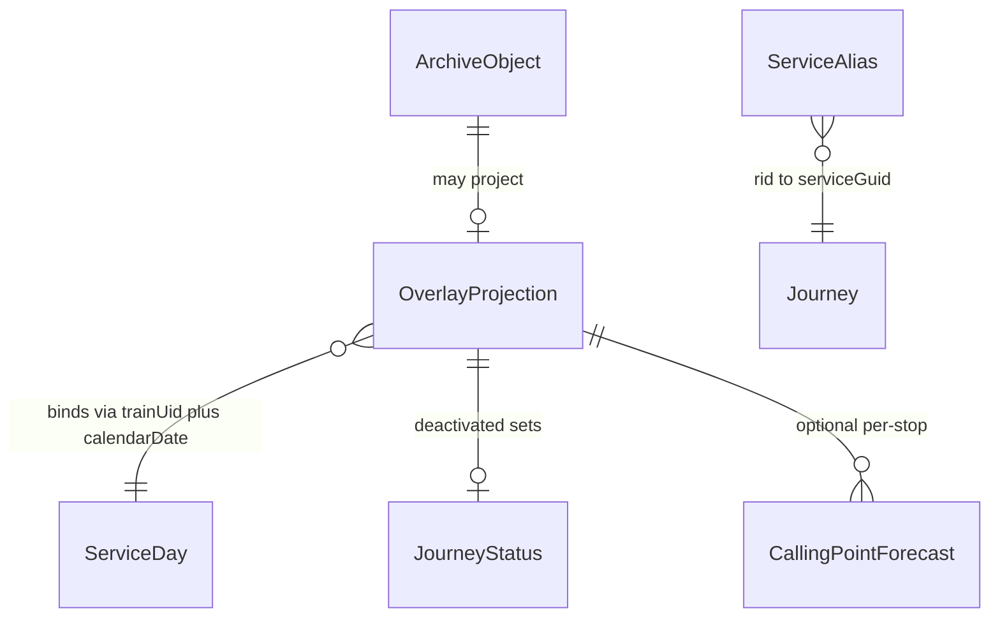

# Functional spec — kafka-archive-overlay

Behaviour for the Kafka archive/overlay chapter of `docs/athena-timetable-lake.md`. This spec is the source of truth for workflows and state machines. Entity shapes live in `entities.md`. Decision logic lives in `rules.md`.

## Workflows

### W1 — Archive-before-classify (US4.1 / AC4.1.1)

1. Every Kafka message, including undecodable payload, writes an env-qualified ArchiveObject first.
2. Exact bucket strings stay an architecture choice. CFA receipt and Kafka archive are separate locations.
3. Classify and overlay apply run after that write. A later failure does not erase the object (BR4.1).
4. Fail-open: classify or overlay persist failure is logged; consuming continues; no overlay row is required for that message (BR4.7). Overlay is outside the CfaIntake transaction (BR4.8).

### W2 — Bind (US4.1 / AC4.1.4)

1. Try Darwin `rid` via `service_aliases` first.
2. If `rid` is missing, bind via `service_day` `(train_uid, scheduled start date)`.
3. Log when the fallback is used and when both miss.
4. Miss: keep the archive, create no journey, leave booked times unchanged. Forbid a UID-wide `list_journeys()` scan (BR4.4).
5. When a message carries `rid` and bind succeeds (rid hit or service_day fallback), write ServiceAlias so later messages can bind rid-first.

### W3 — Overlay apply (US4.1 / AC4.1.2)

1. Project only when the message binds to a journey that already exists.
2. `TS` updates forecast arrival and departure on OverlayProjection (and matching calling-point forecast columns if the message has per-stop times). Booked times unchanged.
3. `schedule` writes `schedule_payload` on the same row. Does not rewrite booked rows.
4. `deactivated` sets overlay `deactivated` and Journey.status. Booked times unchanged.
5. Queryable overlay is one current row per `(train_uid, calendar_date)`. Last successful persist wins on matching columns (BR4.6). `overlayType` is not an identity or partition key.

### W4 — Reserved types (US4.1 / AC4.1.3)

Archived, not queryable overlay, not dropped: `association`, `scheduleFormations`, `formationLoading`, `serviceLoading`, `trainOrder`, `OW`, `trainAlert`, `trackingID`, `alarm`, `stationInformation` (BR4.3).

### W5 — Overlay cheap lookup (US4.1 / AC4.1.5)

Partition keys, projected columns, and one worked example stay in this Kafka heading (BR4.5). Cheap-lookups lists live overlay as item 4 and may point here. Keys: `toc`, `calendar_date`. Prefix: `curated/overlay/toc=…/calendar_date=…/`. Columns: `train_uid`, `calendar_date`, `forecast_arrival`, `forecast_departure`, `deactivated`, `schedule_payload`. Cheapest overlay lookup is this row, not a rescan of calling points.

### W6 — This Bolt’s heading lock

Edits only Kafka archive/overlay, including Overlay cheap lookup and the overlay worked example (BR4.10). Does not rename C1/C3 names (BR4.9).

## State machines

### ArchiveObject

```text
message arrived → archived (success line)
archived → classified
classified → overlay persisted   (bound TS / schedule / deactivated)
classified → reserved kept       (named reserved types)
classified → bind miss kept      (archive stays; no journey; no overlay row required)
classified → classify/apply logged failure   (archive stays; consuming continues)
```

The archived state is never undone.

### OverlayProjection

```text
no row → current row   (first successful bound persist)
current row → current row   (later bound persist replaces matching columns)
```

No event-time reorder. First-write-wins is forbidden.

## Entity relationship (derived from entities.md)



Text fallback: Every message becomes an ArchiveObject. A bound TS, schedule, or deactivated message may update OverlayProjection, which binds through ServiceDay and may write ServiceAlias to a Journey. Deactivated sets Journey.status. Per-stop forecasts are optional and are not the cheap lookup.

## Rules summary (derived from rules.md)

Archive BR4.1. Overlay apply BR4.2. Reserved BR4.3. Bind BR4.4. Lookup BR4.5. Last persist BR4.6. Fail-open BR4.7. Transaction BR4.8. Names BR4.9. Heading lock BR4.10.

## Integration

- C1 provider (U1) names `service_guid`, `service_day`, and bind keys. This unit must not invent a second identity or scan all journeys.
- C3 consumer (U3) lists live overlay as the fourth lookup and may project these columns. Overlay worked example stays here.
- Later KafkaOverlay → PlanQuery call shape is deferred.

## Sources

- `docs/athena-timetable-lake.md`
- `entities.md`, `rules.md`
- `contract-summary.md` — C1 C3
- `unit-of-work.md` — U2
- `functional-design-questions.md`
