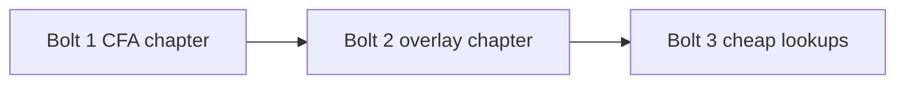

# Bolt Plan

A Bolt is one build pass over a piece of `docs/athena-timetable-lake.md`, ending in a document check of the assigned chapter(s). Remaining Construction after this plan is Functional Design only: each Bolt locks its chapter in place against that unit's boundaries and the shared-schema contracts (C1–C3). Walking skeleton is off — no Bolt is a running intake-to-query slice.

Order follows the unit graph in `unit-of-work-dependency.md`. Overlay cannot lock before the CFA chapter; cheap lookups cannot lock before both.

Text fallback: Bolt 1 (CFA receipt → validate → apply) then Bolt 2 (Kafka archive/overlay) then Bolt 3 (cheap lookups). Serial. No parallel Bolts.

## Sequence

| # | Bolt | Units | Walking skeleton |
|---|------|-------|------------------|
| 1 | CFA receipt → validate → apply | U1 `cfa-receipt-apply` | No |
| 2 | Kafka archive/overlay | U2 `kafka-archive-overlay` | No |
| 3 | Cheap lookups | U3 `cheap-lookups` | No |

## Bolt 1 — CFA receipt → validate → apply

**Units.** U1 `cfa-receipt-apply` (`u1-cfa-receipt-apply`).

**Walking skeleton.** No. Practices skip a running lake slice; this Bolt locks the CFA chapter and the shared file shell.

**Owned headings** (from `mockups.md`, created by U1): Environments; CFA receipt → validate → apply; TOC extension; Later package layering; Deferred / not in this document; plus the heading map / file shell.

**Stories.** US1.1, US2.1, US5.1, US6.1, US7.1–US7.5 as mapped in `unit-of-work-story-map.md`.

**Contracts provided.** C1 and C2 in `contract-summary.md` (current-plan names overlay bind and cheap lookups may consume).

**Definition of Done.** The assigned headings in `docs/athena-timetable-lake.md` match U1 boundaries and C1–C2. A Later Implementer can check US1.1, US2.1, US5.1, US6.1, and the Deferred list (US7.1–US7.5) by reading those headings. Edits are in place on those headings only; the overlay and cheap-lookups headings are not rewritten here.

**Confidence hypothesis.** Shipping this Bolt proves overlay bind and lookups cannot invent a second identity: `service_guid`, journey / calling_points / service_day grains, `{env}`, and the file path are locked before later chapters consume them.

**Expected demo.** Open the CFA, Environments, TOC extension, Later package layering, and Deferred headings and read them against C1/C2. No live zip, broker, or AWS account.

## Bolt 2 — Kafka archive/overlay

**Units.** U2 `kafka-archive-overlay` (`u2-kafka-archive-overlay`). Depends on Bolt 1.

**Walking skeleton.** No.

**Owned headings.** Kafka archive/overlay.

**Stories.** US4.1.

**Contracts.** Consumes C1 (bind keys, grains, forbidden UID-wide scan). Provides C3 (overlay row, `service_aliases`, overlay columns for the fourth cheap lookup).

**Definition of Done.** The Kafka archive/overlay heading matches U2 boundaries, C1 (consumer) and C3 (provider). US4.1 can be checked by reading that heading. Overlay bind uses C1 names only. Booked grains are not rewritten. Edits are in place on this heading only.

**Confidence hypothesis.** Shipping this Bolt proves archive-before-classify and rid-then-service_day bind can be specified against the locked CFA names, with fail-open after the archive object exists, without a second identity.

**Expected demo.** Open the Kafka archive/overlay heading and read bind keys, overlay columns, and reserved types against C1 and C3.

## Bolt 3 — Cheap lookups

**Units.** U3 `cheap-lookups` (`u3-cheap-lookups`). Depends on Bolts 1 and 2.

**Walking skeleton.** No.

**Owned headings.** Cheap lookups.

**Stories.** US3.1.

**Contracts.** Consumes C2 (plan grains, STP winner, partition-key authorship on this unit) and C3 (overlay columns). Provides no provider spec.

**Definition of Done.** The cheap-lookups heading matches U3 boundaries and C2/C3 consumer duties. US3.1 can be checked by reading that heading: four cheap lookups named, station-plus-time-window not a cheapest-scan target, fixture query for one train on one calendar date does not scan every journey. Edits are in place on this heading only.

**Confidence hypothesis.** Shipping this Bolt proves the four Athena lookups can be specified from the locked plan grains and overlay columns without a full journey or Kafka-object scan.

**Expected demo.** Open the cheap-lookups heading and read partition keys, projected columns, and the fixture query against C2 and C3. Units review R-01 (accepted): this Bolt is where lookup partition keys are authored.

## Sources

- `requirements.md` — FR1–FR6 document-only product
- `stories.md`, `unit-of-work-story-map.md` — US1.1–US7.5
- `mockups.md` — heading map
- `components.md` — CfaIntake, KafkaOverlay, PlanQuery (named, not built)
- `unit-of-work.md`, `unit-of-work-dependency.md` — U1 → U2 → U3
- `contract-summary.md` — C1–C3
- `team-practices.md` — walking skeleton off; serial Construction; no deploy in this intent
- `delivery-planning-questions.md` — Q1 A, Q2 A, Q3 A, Q4 A (sample data/PDFs on hand if questions arise), Q5 A, Q6 A
