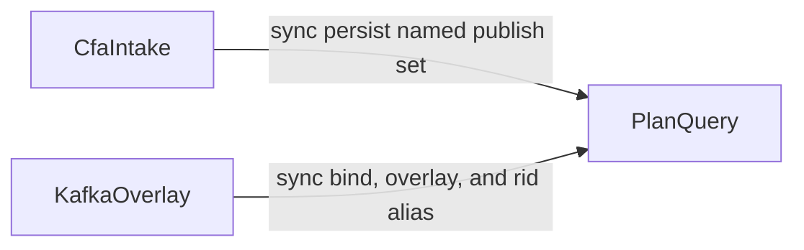

# Components

Logical building blocks for the later sibling lake package under `server/`. These are code you write. S3, Glue, and Athena are dependencies, not components. This intent still writes `docs/athena-timetable-lake.md` only.

Upstream: `requirements.md`, `stories.md`, CodeKB `architecture.md`, `component-inventory.md`, `team-practices.md`, `mockups.md`.

```yaml
components:
  - name: CfaIntake
    summary: Classify a supplier zip as MCA full update or CFA incremental apply, and refuse anything else without changing the current plan
    behaviour: >
      Reads zips from the env-qualified receipt bucket shared with the external
      CFA supply system. Owns the CIF/CFA-to-grain transform and the STP winner
      C then O then P then N on service_day; PlanQuery only persists the
      already-shaped rows. If the zip contains an MCA member, full-update
      publish replaces Journey booked identity columns, CallingPoint booked
      times, and ServiceDay, writes LocationMap, appends ApplyHistory, and
      clears FeedSequence so the next CFA uses the empty-store seed 990.
      OverlayProjection, ServiceAlias, Journey.status, and CallingPoint
      forecastArrival / forecastDeparture are merge-preserved on that publish
      (not replaced). Else expect exactly one CFA member: sequence from HD
      columns 33-39, empty store seeds 990, apply incremental N/R/D for TOC LM
      only. CFA sequence rules run only on this non-MCA path. CFA accept
      publish updates Journey booked identity columns, CallingPoint booked
      times, and ServiceDay, appends ApplyHistory, and advances FeedSequence.
      LocationMap stays intact. OverlayProjection, ServiceAlias, Journey.status,
      and CallingPoint forecast columns are merge-preserved. Refuse paths (bad
      sequence, bad member count, HD without three digits, neither MCA nor CFA)
      call PlanQuery with no entity writes; ReceiptZip is recorded refused;
      FeedSequence is unchanged. Zip basename is never the sequence.
      Member-name sequence fallback is forbidden. Accept publish of the named
      grains plus history is one atomic call into PlanQuery. Does not import
      schedule_poc. Object-store clients stay out of CIF parsers.
    responsibilities:
      - Classify receipt zips as MCA full update, CFA incremental, or error
      - Validate CFA sequence and member rules; clear FeedSequence on MCA
      - Shape CIF/CFA records into journey, calling-point, and service_day grains
      - Apply LM persist rules and STP winner C then O then P then N
      - Record apply history counts and identities changed
      - Name TOC extension as the same intake without a new sequence mechanism
    depends_on:
      - component: PlanQuery
        interaction: Atomic persist of the named accept publish set after MCA or CFA accept; no entity writes on refuse
        style: sync
    dependents: []
    external_dependencies:
      - name: S3 receipt bucket
        kind: object-store
        purpose: Env-qualified drop zone shared with the external CFA supply system; raw zip stays for replay
    entities:
      - name: ReceiptZip
        identifier: objectKey
        attributes: [objectKey, env, memberKind, sequence, status, reason]
        references: []
      - name: FeedSequence
        identifier: env
        attributes: [env, currentCode]
        references: []

  - name: KafkaOverlay
    summary: Archive every Kafka message, then project TS, schedule, and deactivated onto journeys that already exist
    behaviour: >
      Writes every message, including undecodable payload, to the env-qualified
      archive bucket before classify or apply. Classify failure does not erase
      the archive object. Overlay is not in the CfaIntake transaction.
      Bind tries Darwin rid alias first; if missing, (train_uid, scheduled start
      date) via service_day. Log when the fallback is used and when both miss.
      A miss keeps the archive object, creates no journey, and leaves booked
      times unchanged. When a message carries Darwin rid and bind succeeds
      (rid hit or service_day fallback), KafkaOverlay writes ServiceAlias so
      later messages can bind rid-first. TS updates forecast arrival and
      departure columns on the single OverlayProjection row for that
      (trainUid, calendarDate) and the matching CallingPoint forecast columns.
      schedule writes schedulePayload on that same row and does not rewrite
      booked rows. deactivated writes the deactivated column and Journey.status.
      Reserved types stay in the archive only. Forbids a UID-wide list_journeys
      scan. Fail-open after the archive object exists.
    responsibilities:
      - Archive-before-classify
      - Bind overlay to an existing PlanQuery journey
      - Write ServiceAlias when a message carries Darwin rid and bind succeeds
      - Project only TS, schedule, deactivated onto the single overlay row
      - Keep reserved types in the archive
    depends_on:
      - component: PlanQuery
        interaction: Resolve rid or service_day bind; persist overlay columns and rid aliases; log bind fallback or miss
        style: sync
    dependents: []
    external_dependencies:
      - name: S3 archive bucket
        kind: object-store
        purpose: Separate env-qualified bucket from CFA receipt; every Kafka payload lands here first
    entities:
      - name: ArchiveObject
        identifier: objectKey
        attributes: [objectKey, env, classifyStatus, updateType, bindResult]
        references: []

  - name: PlanQuery
    summary: Own the current-plan and overlay grains as Parquet plus Glue tables for the four cheap Athena lookups
    behaviour: >
      Sole writer of curated Parquet. Persists grains CfaIntake and KafkaOverlay
      already shaped; does not apply the CIF/CFA-to-grain transform or STP
      winner. One Glue table per grain: journey, calling_points, service_day,
      overlay, apply_history, service_aliases, location_map. Partition keys skip
      unrelated dates and TOCs. Overlay types are skipped by column projection
      on the single overlay row (forecast, deactivated, schedulePayload), not
      by partitioning on overlayType. service_guid is SVC- plus a stable
      function of CIF identity (train_uid, run_date, stp_indicator), not the
      live-sched origin/dest/time string. Overlay inherits the same Parquet
      layout. ServiceAlias and LocationMap are first-class Glue tables, not
      nested Parquet or non-Athena state. Athena fixture query for one train
      on one calendar date must not scan every journey or every Kafka object.
      Does not live inside live_sched.
    responsibilities:
      - Mint and store service_guid
      - Persist journey, calling point, service day, overlay, apply history, rid alias, CRS/TIPLOC map
      - Merge-preserve overlay, aliases, journey status, and forecast columns on CfaIntake publish
      - Expose the four cheapest lookups
    depends_on: []
    dependents:
      - component: CfaIntake
        interaction: Receives accepted plan and history publishes
      - component: KafkaOverlay
        interaction: Resolves bind keys and accepts overlay projections and rid aliases
    external_dependencies:
      - name: S3 curated prefix
        kind: object-store
        purpose: Env-qualified Parquet for all query grains
      - name: Glue catalog
        kind: other
        purpose: One table per grain; names follow the grains
      - name: Athena workgroup
        kind: other
        purpose: Cheap lookups; named per env; not created in this intent
    entities:
      - name: Journey
        identifier: serviceGuid
        attributes: [serviceGuid, trainUid, runDate, stpIndicator, toc, originCrs, destCrs, status]
        references: []
      - name: CallingPoint
        identifier: serviceGuidPlusSeq
        attributes: [serviceGuid, seq, crs, bookedArrival, bookedDeparture, forecastArrival, forecastDeparture]
        references:
          - entity: Journey
            owned_by: PlanQuery
            relationship: each calling point belongs to one journey
      - name: ServiceDay
        identifier: trainUidPlusCalendarDate
        attributes: [trainUid, calendarDate, serviceGuid, cancelled]
        references:
          - entity: Journey
            owned_by: PlanQuery
            relationship: each service day names the winning journey for that train and calendar date
      - name: OverlayProjection
        identifier: trainUidPlusCalendarDate
        attributes: [trainUid, calendarDate, forecastArrival, forecastDeparture, deactivated, schedulePayload]
        references:
          - entity: ServiceDay
            owned_by: PlanQuery
            relationship: one current overlay row per train per calendar day
      - name: ApplyHistory
        identifier: sequence
        attributes: [sequence, total, newCount, overrideCount, duplicateCount, deleteCount, identitiesChanged]
        references: []
      - name: ServiceAlias
        identifier: aliasTypePlusValue
        attributes: [aliasType, aliasValue, serviceGuid]
        references:
          - entity: Journey
            owned_by: PlanQuery
            relationship: each rid alias points at one journey
      - name: LocationMap
        identifier: tiploc
        attributes: [tiploc, crs]
        references: []
```

## Component Diagram



Text fallback: CfaIntake and KafkaOverlay each call PlanQuery. They do not call each other. PlanQuery calls no other component.

## Component Summary

| Component | Purpose | Depends On | Dependents | Entities Owned |
|-----------|---------|------------|------------|----------------|
| CfaIntake | MCA full update or CFA incremental apply from the supplier receipt bucket | PlanQuery | — | ReceiptZip, FeedSequence |
| KafkaOverlay | Archive every message; project three overlay types; write rid aliases | PlanQuery | — | ArchiveObject |
| PlanQuery | Current-plan and overlay grains; Parquet / Glue / Athena | — | CfaIntake, KafkaOverlay | Journey, CallingPoint, ServiceDay, OverlayProjection, ApplyHistory, ServiceAlias, LocationMap |

## Entity Ownership

| Entity | Owning Component | Identifier | Attributes | References |
|--------|------------------|------------|------------|------------|
| ReceiptZip | CfaIntake | objectKey | objectKey, env, memberKind, sequence, status, reason | — |
| FeedSequence | CfaIntake | env | env, currentCode | — |
| ArchiveObject | KafkaOverlay | objectKey | objectKey, env, classifyStatus, updateType, bindResult | — |
| Journey | PlanQuery | serviceGuid | serviceGuid, trainUid, runDate, stpIndicator, toc, originCrs, destCrs, status | — |
| CallingPoint | PlanQuery | serviceGuidPlusSeq | serviceGuid, seq, crs, bookedArrival, bookedDeparture, forecastArrival, forecastDeparture | Journey (PlanQuery) |
| ServiceDay | PlanQuery | trainUidPlusCalendarDate | trainUid, calendarDate, serviceGuid, cancelled | Journey (PlanQuery) |
| OverlayProjection | PlanQuery | trainUidPlusCalendarDate | trainUid, calendarDate, forecastArrival, forecastDeparture, deactivated, schedulePayload | ServiceDay (PlanQuery) |
| ApplyHistory | PlanQuery | sequence | sequence, total, newCount, overrideCount, duplicateCount, deleteCount, identitiesChanged | — |
| ServiceAlias | PlanQuery | aliasTypePlusValue | aliasType, aliasValue, serviceGuid | Journey (PlanQuery) |
| LocationMap | PlanQuery | tiploc | tiploc, crs | — |

## CfaIntake publish set

Named PlanQuery entities on each CfaIntake path. KafkaOverlay writes stay outside this transaction.

| Path | Journey booked identity | CallingPoint booked times | ServiceDay | ApplyHistory | LocationMap | OverlayProjection | ServiceAlias | Journey.status | CallingPoint forecast columns | FeedSequence |
|------|-------------------------|---------------------------|------------|--------------|-------------|-------------------|--------------|----------------|-------------------------------|--------------|
| Refuse | unchanged | unchanged | unchanged | unchanged | unchanged | unchanged | unchanged | unchanged | unchanged | unchanged |
| CFA accept | replace | replace | replace | append | intact | merge-preserve | merge-preserve | merge-preserve | merge-preserve | advance |
| MCA full update | replace | replace | replace | append | write | merge-preserve | merge-preserve | merge-preserve | merge-preserve | clear (next CFA seeds 990) |

## External Dependencies

| Component | Dependency | Kind | Purpose |
|-----------|------------|------|---------|
| CfaIntake | S3 receipt bucket | object-store | Shared with the external CFA supply system; raw zip stays |
| KafkaOverlay | S3 archive bucket | object-store | Separate from receipt; archive-before-classify |
| PlanQuery | S3 curated prefix | object-store | Parquet for all grains |
| PlanQuery | Glue catalog | other | One table per grain |
| PlanQuery | Athena workgroup | other | Named per `{env}`; not created here |

Exact bucket strings stay an author choice in `docs/athena-timetable-lake.md`. The sharing pick is decided: receipt and archive are **separate** buckets. Receipt is the supplier drop zone.

Glue table names follow the grains: `journey`, `calling_points`, `service_day`, `overlay`, `apply_history`, `service_aliases`, `location_map`. `ServiceAlias` and `LocationMap` are those last two Glue tables, not nested Parquet columns and not non-Athena PlanQuery state.

## Rationale

| Component | Why it is separate | Alternatives rejected |
|-----------|--------------------|------------------------|
| CfaIntake | Ordered, fail-closed zip intake with its own sequence lifecycle. MCA full update and CFA incremental share this door. Owns CIF/CFA-to-grain and STP winner so those rules have one writer. | Two-component TimetablePlan (Q1 B) would mix grain ownership with intake. One TimetableLake (Q1 C) would hide the overlay fail-open boundary. |
| KafkaOverlay | Fail-open after archive; must not share the CFA apply transaction (NFR4). Writes rid aliases when Darwin rid is present. | Folding overlay into CfaIntake would couple sequence refuse with live bind misses. |
| PlanQuery | Sole persist of curated Parquet so Athena grains have one owner. Overlay inherits the same layout (mockups R-02). Does not reshape CIF. | Letting each intake write its own tables would duplicate Glue names and partition rules. Letting PlanQuery also transform CIF would split STP and identity from CfaIntake. |

Live-sched today is one SQLite file (CodeKB). The lake keeps that as three code blocks over shared grains, not three deployables. Units Generation decides packaging.

## Design note

The Later Implementer still enters `docs/athena-timetable-lake.md` by the mockups heading map: CfaIntake under CFA receipt → validate → apply, KafkaOverlay under Kafka archive/overlay, PlanQuery under Cheap lookups. Environments names the three buckets/prefixes. No traveller or lake-operator screens.

## Platform note

Receipt bucket is shared with the external CFA supply system, so it is not the archive bucket and not the curated prefix. Parquet plus one Glue table per grain is the cheapest-scan layout (NFR1). Overlay-type skip is column projection on one overlay row, not a type partition. Cloud controls stay Deferred.

## Sources

- `requirements.md` — FR2–FR6, NFR1, NFR4, Open questions
- `stories.md` — US1.1–US6.1, Deferred US7
- CodeKB `architecture.md`, `component-inventory.md` — live-sched grains and overlay bind gap
- `team-practices.md` — sibling package, fail-closed / fail-open
- `mockups.md` — heading map and accepted layout slots
- `domain-design-questions.md` — Q1 A, Q2 B, Q3 X, Q4 A, Q5 B, Q6 A
- Domain Design review-01 — R-01 publish set, R-02 overlay grain, R-03 alias and map store, R-04 FeedSequence after MCA, R-05 YAML refs, R-06 transform owner

## Assumptions & Open Questions

- Exact receipt, archive, and curated bucket strings are filled when `docs/athena-timetable-lake.md` is written.
- The `SVC-` suffix algorithm (hash versus concatenated CIF triple) is specified in Functional Design; the identity inputs are locked here.
- If a zip contains both MCA and CFA, MCA wins (Q3).
- None.
