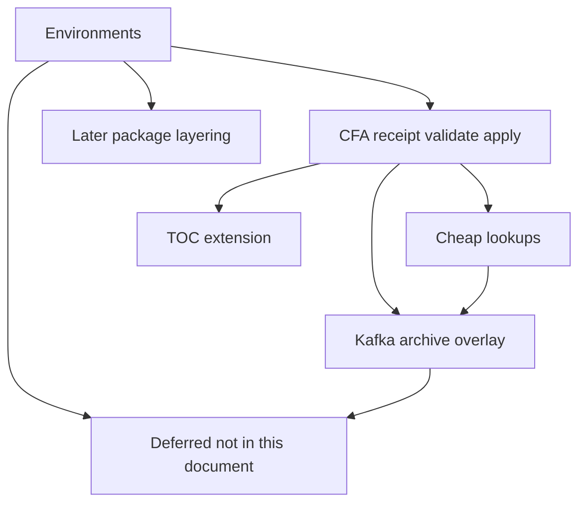

# Mockups

Information architecture of `docs/athena-timetable-lake.md` only (refined-mockups Q1 A). There is no traveller UI, no lake-operator console, and no Ideation `wireframes` or `user-flow` (classic skip). The Later Implementer (P1 in `personas.md`) enters one markdown file.

Upstream: `stories.md`, `requirements.md`, `team-practices.md`. Rough-mockups artifacts are absent by design.

## Product note

Must Have is first ingest plus first cheap lookup including the three overlay types (US1.1–US4.1). Should Have is TOC extension and later package layering (US5.1, US6.1). Won’t Have stays under Deferred (US7.1–US7.5). Acceptance for this intent remains a document check, not a running lake.

Stories left file layout, Glue names, and exact bucket strings as architecture choices. Requirements Open questions say the later architecture file must still make those picks. These mockups reserve heading slots for the picks; they do not invent the strings.

## Heading map

Stable top-level headings required by US1.1 / AC1.1.5. Use these exact H2 titles in `docs/athena-timetable-lake.md`.

```text
# Athena timetable lake

## Environments
## CFA receipt → validate → apply
## Cheap lookups
## Kafka archive/overlay
## TOC extension
## Later package layering
## Deferred / not in this document
```

Scan order is top to bottom for a first read; re-entry is by heading for a later task.



Text fallback: Environments names `dev` / `staging` / `prod` and every logical S3 / Glue / Athena object. CFA receipt → validate → apply is the ingest chapter. Cheap lookups is the current-plan query chapter. Kafka archive/overlay is archive-every-message plus the three apply types. TOC extension and Later package layering are Should Have. Deferred / not in this document lists what this file does not specify.

## Story-to-heading table

Q2 A: each story points at one primary heading. Cross-reads are listed so a reviewer does not hunt.

| Story | Priority | Primary heading | Also read |
|-------|----------|-----------------|-----------|
| US1.1 | Must Have | Environments | Deferred / not in this document (AC1.1.6) |
| US2.1 | Must Have | CFA receipt → validate → apply | Environments (receipt location is env-qualified) |
| US3.1 | Must Have | Cheap lookups | CFA receipt → validate → apply (grains already exist) |
| US4.1 | Must Have | Kafka archive/overlay | Cheap lookups (fourth lookup); Deferred (reserved types) |
| US5.1 | Should Have | TOC extension | CFA receipt → validate → apply (LM persist rules) |
| US6.1 | Should Have | Later package layering | Environments (sibling package under `server/`) |
| US7.1–US7.5 | Won’t Have | Deferred / not in this document | — |

## Per-section sketches

Each sketch is what the Later Implementer must find under that H2. Values in `{braces}` are slots Domain Design / the architecture file must fill. Status words are written as text: accept, refuse, skip, reserved.

### Environments

- Purpose: name the three tiers and the `{env}` pattern (FR1.3, NFR2, AC1.1.2–AC1.1.4).
- Must include:
  - `dev`, `staging`, `prod` as `{env}` on every logical S3 prefix, Glue catalog or database, and Athena workgroup.
  - A named pick: shared versus separate buckets for CFA receipt and Kafka archive (requirements Open question; stories review R-02 accepted risk).
  - Env-qualified example strings for those locations (the strings are the author’s choice; the heading must not omit them).
  - Promote cadence: merge to `main` may roll staging; production needs a separate human approval and a named rollback-path obligation.
  - Explicit “these resources do not exist yet.”
- Must not include: credentials, Kafka keys, Darwin keys, long-lived AWS access keys (AC1.1.3, NFR3).

### CFA receipt → validate → apply

- Purpose: first ingest slice (US2.1, FR2).
- Subheads (H3, in this order):
  1. Receipt location — env-qualified S3 object landing for one CFA zip; raw zip stays as replay source.
  2. Validate — exactly one CFA member; sequence from HD Current File Reference columns 33–39; zip basename is never the sequence; expected = previous + 1 modulo 1000, zero-padded; empty store seeds `990`; how first journey identities and the CRS/TIPLOC map enter (supporting MCA baseline into the same grains, or another named path — not CFA-only silence).
  3. Refuse — sequence mismatch, zero members, more than one member, HD field with no three-digit run. Each: current plan unchanged; reason recorded (expected and actual codes when sequence); raw zip stays; member-name and zip-basename fallbacks forbidden.
  4. Accept / apply — incremental `N` / `R` / `D` for TOC `LM` only on CIF identity `(train_uid, run_date, stp_indicator)`.
  5. Apply history — sequence, total / new / override / duplicate / delete counts, identities changed; not a full versioned copy of every journey row.
  6. Publish and failure — one atomic published current-plan plus history update; mid-apply failure leaves the previous plan queryable (NFR4).
- Empty-lake: the validate subhead states the identity bootstrap. Do not leave it implied.

### Cheap lookups

- Purpose: first query slice (US3.1, FR3, NFR1).
- Exact four-item list (no station + time-window):
  1. Journey by CIF identity `(train_uid, run_date, stp_indicator)` or `service_guid`
  2. Calling points `(service_guid, seq)`
  3. Service day after STP resolution `(train_uid, calendar_date)` — winner order `C` then `O` then `P` then `N`
  4. Live overlay — columns specified under Kafka archive/overlay
- Must name, for each of 1–3: partition keys, prefix/grain, projected columns, Glue table name, and file layout (choose a columnar format; the choice of value is open, the heading is not).
- Partition keys must skip unrelated dates, TOCs, and overlay types (NFR1; stories review R-03).
- One worked example: one train, one calendar date, keys and projected columns for each plan lookup.
- `service_guid` assignment rule stated in prose (stories review R-04).
- Later query-contract: a fixture query for that one train / date must not require a full-table scan of every journey or every Kafka object.

### Kafka archive/overlay

- Purpose: archive every message; project only `TS`, `schedule`, `deactivated` (US4.1, FR4).
- Subheads:
  1. Archive-before-classify — every message, including undecodable payload, writes an env-qualified archive object first; later failure does not erase it.
  2. Overlay apply — bind to a journey already in the current plan; `TS` updates forecast arrival/departure only; booked public times stay; `schedule` is overlay payload and does not rewrite booked rows; `deactivated` sets journey status; overlay is not in the CFA apply transaction.
  3. Bind keys — at least one of: Darwin `rid` alias; `(train_uid, scheduled start date)` via `service_day`. State how `rid` attaches. Forbid a UID-wide `list_journeys()` scan. A miss keeps the archive object, creates no journey, leaves booked times unchanged.
  4. Reserved types — `association`, `scheduleFormations`, `formationLoading`, `serviceLoading`, `trainOrder`, `OW`, `trainAlert`, `trackingID`, `alarm`, `stationInformation`: archived, not queryable overlay, not dropped.
  5. Overlay cheap lookup — partition keys and projected columns for forecast versus booked and deactivated status on `(train_uid, calendar_date)`; one worked example.

### TOC extension

- Purpose: LM first; other TOCs later without a new receipt or sequence mechanism (US5.1, FR5).
- Restate in prose (not FR-number-only): persist rules (non-delete non-`LM` skipped; deletes follow identity), CIF identity, calendar / STP winner, HD sequence. Same receipt location.

### Later package layering

- Purpose: where later code lives (US6.1, FR6, `team-practices.md` Code Style).
- Sibling package under `server/` with its own `pyproject.toml` and tests.
- No Athena / S3 clients inside `live_sched`. No `schedule_poc` import.
- Object-store and query-engine clients stay out of CIF parsers and the repository layer.
- Fail-closed on CFA / sequence intake; fail-open on Kafka overlay after the archive object exists.

### Deferred / not in this document

Required list (AC1.1.6, US7.1–US7.5):

- KMS, bucket policies, workgroup encryption (later NFR / infrastructure; not created here)
- Reserved Kafka types as queryable overlay
- Station + time-window as a cheapest scan
- Versioned journey history after every CFA
- Runtime ingest, Glue jobs, buckets, or CI in this piece of work
- Android / OpenLDBWS changes or a pointer from `docs/architecture.md`

## Scan paths

Document scan paths, not screens. Each path is how P1 finds the story done.

### Scan: name the file and the three environments (US1.1)

1. Open the repo → file exists at `docs/athena-timetable-lake.md`.
2. Jump to Environments → `{env}` on every logical object; strings named; shared-versus-separate picked; no “already exists”; no secrets; staging/prod cadence and rollback obligation.
3. Scan H2 titles → the seven headings above.
4. Jump to Deferred / not in this document → the deferred list is present.
5. Any diagram → text fallback immediately below.

Success: those headings and obligations are present. Fail: missing H2, colour-only refuse/accept, secrets, or a claim that buckets already exist.

### Scan: first ingest (US2.1)

1. Environments → receipt location is env-qualified.
2. CFA receipt → validate → apply → Receipt, Validate (including empty-lake bootstrap), Refuse, Accept / apply, Apply history, Publish and failure.
3. Confirm refuse words are the words refuse / unchanged / reason / raw zip stays.

Success: a later implementer can build receipt → validate → apply without reopening FR2. Fail: CFA-only silence on first identities, or basename used as sequence.

### Scan: cheap current-plan lookups (US3.1)

1. Cheap lookups → four-item list only.
2. For CIF identity, stop sequence, and service day: keys, grain, columns, Glue name, layout, worked example.
3. Confirm station + time-window is not a cheapest target (it lives under Deferred).

Success: a fixture query for one train on one date can be specified without a full-table scan. Fail: missing layout/Glue heading, or overlay columns specified here instead of under Kafka.

### Scan: archive and overlay (US4.1)

1. Kafka archive/overlay → Archive-before-classify, Overlay apply, Bind keys, Reserved types, Overlay cheap lookup.
2. Cross-check Cheap lookups item 4 points here.
3. Cross-check Deferred still lists reserved types as not queryable.

Success: every message is archived; only three types project; bind keys are named. Fail: drop-at-the-door, UID-wide scan, or overlay that creates journeys.

### Scan: Should Have (US5.1, US6.1)

1. TOC extension → LM persist + prose restatement of identity / calendar / sequence.
2. Later package layering → sibling package, no `live_sched` clients, no `schedule_poc`, fail-closed / fail-open.

## Document conditions

Q3 A: conditions a reviewer can see in the file. No loading spinner, empty table, toast, or other app-console state.

| Condition | How it appears in the file | Recovery |
|-----------|----------------------------|----------|
| Missing required heading | One of the seven H2 titles is absent | Add the heading; do not rename it |
| Refuse versus accept | The words refuse and accept (and skip, reserved) in the CFA and Kafka chapters | Rewrite colour or icon-only status as words |
| Deferred list present | Deferred / not in this document contains the AC1.1.6 / US7 list | Add the missing bullet |
| Diagram without fallback | A mermaid fence with no following text tree or numbered steps | Add the text fallback immediately below |
| Secrets | Kafka, Darwin, or AWS access keys in the file | Remove; point at gitignored `.env` only as a later-runtime note, never a value |
| Resources claimed live | Text that says buckets, Glue, or Athena already exist | Replace with “named, not created in this piece of work” |

There is no empty-document “first-run screen.” The missing-file case is AC1.1.1: the path `docs/athena-timetable-lake.md` does not exist yet. These mockups describe that file; they do not create it.

## Sources

- `stories.md`, `personas.md` — Later Implementer, document-delivery ACs, story map
- `requirements.md` — FR1–FR6, NFR1–NFR4, Open questions on bucket strings / layout / shared buckets
- `team-practices.md` — named env tiers, architecture-first, layering, fail-closed / fail-open
- Ideation `wireframes` and `user-flow` — absent (classic skip)

## Assumptions & Open Questions

- The seven H2 titles stay stable into Domain Design and the later `docs/athena-timetable-lake.md` write.
- Exact bucket strings, columnar format, and Glue table names are filled in that later file, not in these mockups.
- None.
