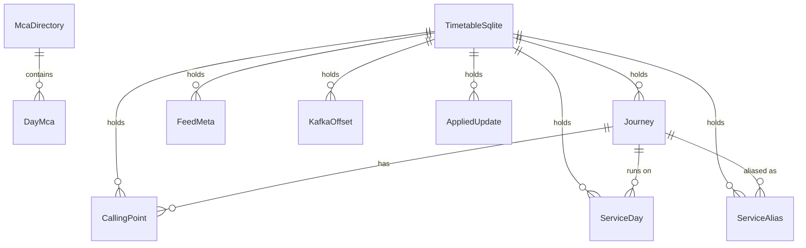

# Functional spec — mca-load

Behaviour for replacing the SQLite file from that day's MCA. This spec is the source of truth for workflows and state machines. Entity shapes live in `entities.md`. Decision logic lives in `rules.md`.

## Workflows

### W1 — Find today's MCA

1. Look in `apps/local-timetable/mca` (BR1.1).
2. Today is the calendar date on this machine in Europe/London, written `YYYYMMDD`.
3. Keep files whose filename contains that date (BR1.2).
4. Exactly one file is required. Zero or more than one is treated as no day's MCA (BR4.1).

### W2 — Start

1. The query calls start in the same process (BR2.1).
2. If state is already running, return that progress and stop (BR2.2).
3. If state is succeeded, begin a new replace (BR2.3).
4. If state is idle or failed, begin a replace.
5. Return LoadProgress at once. Do not wait for the replace to finish.

### W3 — Fail before any replace

1. If the directory, the unique file, or the file bytes cannot be read, state becomes failed. The sentence says the MCA cannot be read. The SQLite file is left as it was (BR4.1).
2. Open the file and read the header. If CIF columns 33 to 39 are not exactly seven decimal digits, state becomes failed. The sentence says the header sequence was refused. The SQLite file is left as it was (BR3.2).
3. No delete happens on these paths.

### W4 — Replace

1. After a readable MCA and an accepted header, delete the current SQLite file and write a new one (BR3.5).
2. Parse LM CIF schedules into Journey and CallingPoint rows with empty forecast times (BR3.7).
3. Assign serviceGuid and write service_day for today's YYMMDD using STP overlay rules (BR3.8).
4. Write feed_meta load metadata only; leave service_aliases, kafka_offsets, and applied_updates empty (BR3.9, BR3.6).
5. The new file has the seven tables named in contract-summary.
6. While this runs, state is running. howFar is a percent from 0 to 100 as text. sentence is present (BR2.4).
7. A client that already has the old file open keeps that old file until it reconnects.
8. On success, state is succeeded and the file is at `apps/local-timetable/db/timetable.sqlite` (BR1.3).
9. If the write fails after the old file is gone, state is failed. The query will then see a missing file.

### W5 — Progress

1. The query calls progress in the same process.
2. Return the current LoadProgress. Do not start a load.

### W6 — Process start

1. When the server process starts, LoadProgress state is idle (BR2.5).
2. An existing `timetable.sqlite` from an earlier load remains on disk (BR1.4) until start runs again in this process.

## State machines

### LoadProgress.state

```text
idle → running      (start, today's MCA readable, header accepted)
idle → failed       (start, no readable day's MCA or refused header)
failed → running    (later start, today's MCA readable, header accepted)
failed → failed     (later start, still no readable day's MCA or refused header)
succeeded → running (later start, today's MCA readable, header accepted)
succeeded → failed  (later start, no readable day's MCA or refused header; SQLite left as it was)
running → running   (start while already running; same load continues)
running → succeeded
running → failed    (write failed after the old file was deleted)
```

Start always returns at once. running is the only state that carries howFar.

## Entity relationship (derived from entities.md)



Text fallback: The MCA directory holds day files. The SQLite file holds journeys, calling points, service days, aliases, feed meta, and empty overlay tables. A journey has calling points, service days, and aliases. LoadProgress is the return shape for start and progress; it is not stored in the file.

## Rules summary (derived from rules.md)

| Id | When | Then |
| --- | --- | --- |
| BR1.1 | start | look only in `apps/local-timetable/mca` |
| BR1.2 | start | unique filename containing today's `YYYYMMDD` |
| BR1.3 | success | file is at `apps/local-timetable/db/timetable.sqlite` |
| BR1.4 | database container restart or rebuild | same file remains |
| BR2.1 | start | return at once |
| BR2.2 | start while running | return current progress |
| BR2.3 | start after success | new replace |
| BR2.4 | running | howFar is 0–100 text |
| BR3.1 | any write | this unit is the writer |
| BR3.2 | bad HD sequence | fail, SQLite unchanged |
| BR3.3 | persist | LM only |
| BR3.4 | load | no CFA |
| BR3.5 | accepted header | delete then write seven tables |
| BR3.6 | success | overlay tables empty |
| BR4.1 | missing MCA | fail, SQLite unchanged |
| BR5.1 | test | synthetic MCA |
| BR5.2 | stored values | no Kafka or Darwin secrets |

## Sources

- `aidlc/spaces/default/intents/261025-local-timetable-viewer/construction/mca-load/functional-design/entities.md`
- `aidlc/spaces/default/intents/261025-local-timetable-viewer/construction/mca-load/functional-design/rules.md`
- `aidlc/spaces/default/intents/261025-local-timetable-viewer/construction/mca-load/functional-design/functional-design-questions.md`
- `aidlc/spaces/default/intents/261025-local-timetable-viewer/inception/contract-design/contract-summary.md`
- `aidlc/spaces/default/intents/261025-local-timetable-viewer/inception/units-generation/unit-of-work.md`
- `aidlc/spaces/default/intents/261025-local-timetable-viewer/inception/units-generation/unit-of-work-story-map.md`
- `aidlc/spaces/default/intents/261025-local-timetable-viewer/inception/requirements-analysis/requirements.md`
- `aidlc/spaces/default/intents/261025-local-timetable-viewer/inception/domain-design/components.md`

## Assumptions & Open Questions

None.
