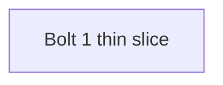

# Bolt Plan

A Bolt is one build pass over a piece of the work, ending in something that runs. This plan has one Bolt. It holds all three units. Done means the empty screen, the load, the pair page, and the network page.

Walking skeleton is off. This Bolt is still the thin slice from team-practices: the database, one view, and enough of a screen to see it, now with both pictured pages. Construction still builds one unit at a time, in the order of unit-of-work-dependency: mca-load, then timetable-query, then screen.

This plan is checked against requirements, stories, mockups, components, unit-of-work, unit-of-work-dependency, unit-of-work-story-map, contract-summary, and team-practices.

Text fallback: One Bolt. No later Bolt.

## Sequence

| # | Bolt | Units | Walking skeleton |
| --- | --- | --- | --- |
| 1 | Thin slice | U1 mca-load, U2 timetable-query, U3 screen | No |

## Bolt 1 — Thin slice

**Units.** U1 `mca-load` (`u1-mca-load`), U2 `timetable-query` (`u2-timetable-query`), U3 `screen` (`u3-screen`).

**Walking skeleton.** No. The ceremony is off. The demo is still the thin slice.

**Stories.** US1.1, US1.2, US2.1, US3.1, as mapped in unit-of-work-story-map.

**Contracts.** REST from screen to timetable-query (`/load`, `/network`, `/pair`), in-process start and progress from timetable-query to mca-load, SQLite file at `apps/local-timetable/db/timetable.sqlite` owned by mca-load, as in the approved contract-summary.

**Definition of Done.** The three containers run on this machine. The screen starts empty. The button starts the load. Progress shows on the same interval that starts at 30 seconds. When the load succeeds, the pair page and the network page show today's London Midland trains from the file. A restart of the database container keeps the same file. The query does not replace that file.

**Confidence hypothesis.** Shipping this Bolt proves one person on this machine can load that day's MCA and read both pictured pages without a hosted API.

**Expected demo.** Start the three containers. Open the empty screen. Press the load button. Watch progress. Open the pair page with two codes and the network page. Stop the server container; the file is still there for a SQL client on the host path.
