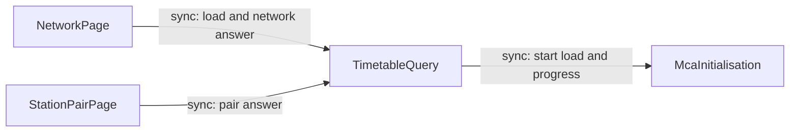

# Domain Components

The code we write is four blocks. `McaInitialisation` replaces the SQLite file from that day's MCA. `TimetableQuery` starts that load when the screen asks, reports progress, and builds the two train answers without rewriting the file. `NetworkPage` and `StationPairPage` call only `TimetableQuery`.

This catalogue is checked against requirements, stories, architecture, component-inventory, and team-practices.

```yaml
components:

  - name: McaInitialisation
    summary: >
      Replace the SQLite file from that day's MCA. Load London Midland only.
      No CFA. Refuse a header whose CIF columns 33 to 39 are not a valid sequence.
    behaviour: >
      Only this block replaces the SQLite file. It reads only under
      apps/local-timetable/mca, picks the unique filename whose name contains
      today's YYYYMMDD in Europe/London, locates and opens the MCA, and accepts
      the header before any delete. Zero or more than one matching file is a
      failed load and leaves the file as it was. An unreadable MCA or a refused
      header is a failed load with the agreed failure sentences. After an
      accepted header it deletes the current file and writes a new one. Overlay
      tables kafka_offsets and applied_updates exist with no rows. Forecast
      times on calling points are empty after the load. A start while a load is
      already running returns that load's progress and does not start a second
      load. A later start after success does a new replace. Progress is idle,
      running, succeeded, or failed, plus howFar from 0 to 100 as text, plus a
      sentence. Tests use a synthetic MCA and a throwaway SQLite path, not the
      host file in FR7.1.
    responsibilities:
      - Replace the SQLite file from that day's MCA with London Midland journeys only.
      - Leave overlay tables empty and forecast columns empty after a successful load.
    depends_on: []
    dependents:
      - component: TimetableQuery
        interaction: The query block starts this load in the same process and reads progress.
        style: sync
    external_dependencies:
      - name: DayMca
        kind: other
        purpose: The day's full timetable file under apps/local-timetable/mca. No CFA.
      - name: TimetableSqlite
        kind: database
        purpose: The file this block replaces at apps/local-timetable/db/timetable.sqlite.

  - name: TimetableQuery
    summary: >
      Start the day's MCA load when asked, report load progress, and build the
      network and station-pair answers by reading the file. This block never
      creates or rewrites the file for a train ask.
    behaviour: >
      Train asks use today as service_day in Europe/London as YYMMDD and times
      as HHMM. The network answer lists each London Midland journey whose
      service_day row runs today and is not a cancellation. A row is a problem
      when status is deactivated, or a forecast arrival or departure differs
      from the booked public time. A missing forecast does not differ. Reached is
      the latest calling point at or before now; next is the following stop.
      Stop time is the first present of forecast departure, forecast arrival,
      public departure, and public arrival. A stop time earlier than the origin
      is the next calendar day. The pair answer includes journeys whose calling
      points contain the earlier CRS then the later CRS in order, and includes
      a today service_day row that carries the word cancelled, including a row
      with no journey, with trainUid when serviceGuid is absent. Unmatched codes
      are a successful empty list. Missing, deleted, locked, or older-schema
      file failures name which case applies. Load start delegates to
      McaInitialisation in-process and returns the same progress shape. A train
      view request or a query test leaves the SQLite file byte-for-byte
      unchanged. This block does not call list_journeys().
    responsibilities:
      - Start the MCA load and surface load progress to the screen.
      - Build the network answer for today.
      - Build the station-pair answer for two CRS codes passed in from a page.
      - Name read failures as missing, deleted, locked, or older schema.
    depends_on:
      - component: McaInitialisation
        interaction: Start load and read progress in the same server process.
        style: sync
    dependents:
      - component: NetworkPage
        interaction: Empty screen, load control, network answer, and load progress polls.
        style: sync
      - component: StationPairPage
        interaction: Station-pair answer when both codes are present.
        style: sync
    external_dependencies:
      - name: TimetableSqlite
        kind: database
        purpose: Read-only source of the seven timetable tables for train asks.
    entities:
      - name: LoadProgress
        identifier: loadPhase
        attributes:
          - loadPhase
          - howFar
          - sentence
      - name: NetworkAnswer
        identifier: calendarDate
        attributes:
          - calendarDate
          - serviceGuid
          - reachedCrs
          - nextCrs
          - problem
      - name: StationPairAnswer
        identifier: calendarDate, earlierCrs, laterCrs
        attributes:
          - calendarDate
          - earlierCrs
          - laterCrs
          - serviceGuid
          - trainUid
          - status
          - reachedCrs
          - nextCrs
          - issue
          - cancellationLabel

  - name: NetworkPage
    summary: >
      Paint the empty first screen and the network page. Hold station codes and
      refresh interval. Call TimetableQuery for load progress and for the
      network answer.
    behaviour: >
      The screen opens empty with a load button. The button asks TimetableQuery
      to start the load; this page never calls McaInitialisation. Until load
      succeeds the same 30-second interval polls load progress only and does
      not ask for trains. When load succeeds the button goes away and train
      views may ask. A failed load stays on the empty screen with the button.
      Reload while a load is running shows that progress again. After success
      the page asks on open and on each interval even when station boxes are
      empty. RefreshInterval starts at 30 seconds. A positive whole number
      replaces the wait from the change moment. Blank, fraction, or
      non-positive values are refused and the interval in use stays. Reload
      resets to 30 seconds. An interval tick starts an ask and does not repaint
      by itself. The page repaints only when held data changes. Only the latest
      successful train ask may write the held network answer. A failed train ask
      leaves the held answer unchanged; with no held answer the page says No
      data can be retrieved. A hang, closed connection, or unreadable response
      keeps held trains, shows comms is lost in the status bar, does not retry
      until the next interval tick, and clears the bar on the next successful
      ask. Loading shows only before the first successful
      train ask. Empty list sentences match the approved mockup rules. Open
      station pair passes the current codes to the pair page.
    responsibilities:
      - Own empty-first-screen and load-button behaviour until load succeeds.
      - Hold StationSelection and RefreshInterval.
      - Ask TimetableQuery for load progress and for the network answer.
    depends_on:
      - component: TimetableQuery
        interaction: Load start, progress polls, and network answer reads.
        style: sync
    dependents: []
    external_dependencies: []
    entities:
      - name: StationSelection
        identifier: earlierCrs, laterCrs
        attributes:
          - earlierCrs
          - laterCrs
      - name: RefreshInterval
        identifier: seconds
        attributes:
          - seconds

  - name: StationPairPage
    summary: >
      Paint the station-pair page. Ask TimetableQuery for the pair answer only
      when both station boxes are non-empty.
    behaviour: >
      Opens at once with the codes the network page named. Reads and may change
      StationSelection and follows RefreshInterval rules owned by NetworkPage.
      Asks only when both boxes are non-empty. Unmatched codes are a successful
      empty list saying No trains. Swap exchanges the codes and asks when both
      are non-empty. Uses the same held-answer, comms is lost, and other failure
      sentences as the network page for pair data. Filter by headcode and Fleet say they have no
      data.
    responsibilities:
      - Paint the pair view and pass two CRS codes to TimetableQuery.
      - Follow RefreshInterval tick and validation rules from NetworkPage.
    depends_on:
      - component: TimetableQuery
        interaction: Station-pair answer when both codes are set.
        style: sync
    dependents: []
    external_dependencies: []
    entities:
      - name: PairViewContext
        identifier: earlierCrs, laterCrs
        attributes:
          - earlierCrs
          - laterCrs
        references:
          - entity: StationSelection
            owned_by: NetworkPage
            relationship: Pair page reads and edits the shared station codes.
          - entity: RefreshInterval
            owned_by: NetworkPage
            relationship: Pair page follows the same interval ticks and validation.
```

## Component Diagram



Text fallback: NetworkPage and StationPairPage call TimetableQuery. TimetableQuery calls McaInitialisation for load only. Screen blocks never call McaInitialisation directly.

## Component Summary

| Component | Purpose | Depends On | Dependents | Entities Owned |
| --- | --- | --- | --- | --- |
| McaInitialisation | Replace the SQLite file from that day's MCA | none | TimetableQuery | none |
| TimetableQuery | Load progress and the two train answers | McaInitialisation | NetworkPage, StationPairPage | LoadProgress, NetworkAnswer, StationPairAnswer |
| NetworkPage | Empty screen, load button, network page, interval | TimetableQuery | none | StationSelection, RefreshInterval |
| StationPairPage | Pair page when both codes are set | TimetableQuery | none | PairViewContext |

## Entity Ownership

| Entity | Owning Component | Identifier | Attributes | References |
| --- | --- | --- | --- | --- |
| LoadProgress | TimetableQuery | loadPhase | loadPhase, howFar, sentence | none |
| NetworkAnswer | TimetableQuery | calendarDate | calendarDate, serviceGuid, reachedCrs, nextCrs, problem | none |
| StationPairAnswer | TimetableQuery | calendarDate, earlierCrs, laterCrs | calendarDate, earlierCrs, laterCrs, serviceGuid, trainUid, status, reachedCrs, nextCrs, issue, cancellationLabel | none |
| StationSelection | NetworkPage | earlierCrs, laterCrs | earlierCrs, laterCrs | none |
| RefreshInterval | NetworkPage | seconds | seconds | none |
| PairViewContext | StationPairPage | earlierCrs, laterCrs | earlierCrs, laterCrs | StationSelection and RefreshInterval on NetworkPage |

## External Dependencies

| Component | Dependency | Kind | Purpose |
| --- | --- | --- | --- |
| McaInitialisation | DayMca | other | That day's MCA under apps/local-timetable/mca. |
| McaInitialisation | TimetableSqlite | database | File replaced at apps/local-timetable/db/timetable.sqlite. |
| TimetableQuery | TimetableSqlite | database | Read-only seven tables for train asks. |

## Rationale

| Component | Why it is separate |
| --- | --- |
| McaInitialisation | It is the only block that replaces the SQLite file from the day's MCA. |
| TimetableQuery | It owns train answers and load orchestration while keeping train asks read-only on the file. |
| NetworkPage | It owns the empty first screen, load button, interval validation, and the network picture. |
| StationPairPage | It is the pair picture with a stricter ask rule than the network page. |

The call graph is acyclic. The pair page references station codes and interval entities owned by the network page; that is not a call back to NetworkPage. Three Docker containers are decided in Units Generation; these blocks say who calls whom inside the server and screen.

These blocks run on this machine for one person. They have no accounts and make no remote call. No secret belongs in any of them.
