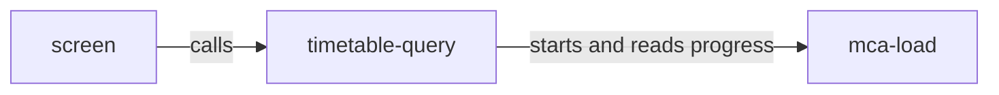

# Unit Dependencies

The screen calls the query. The query starts the MCA load and reads its progress. The MCA load calls no other unit. The database container is outside this graph. It holds the SQLite file both server units use.

This dependency record is checked against components, decisions, requirements, and stories.

## Dependency graph



Text fallback: screen depends on timetable-query. timetable-query depends on mca-load. mca-load depends on no other unit.

```yaml
units:
  - name: mca-load
    kind: service
    depends_on: []
  - name: timetable-query
    kind: service
    depends_on: [mca-load]
  - name: screen
    kind: ui
    depends_on: [timetable-query]
```

## Integration points

| From | To | How they meet |
| --- | --- | --- |
| screen | timetable-query | Synchronous call for the load button, the progress poll, the network list, and the station-pair list. |
| timetable-query | mca-load | Synchronous call to start the load and to read its progress. |
| mca-load | SQLite file | Replaces the file the database container holds. |
| timetable-query | SQLite file | Reads that same file. |
| SQL client on this machine | SQLite file | Opens the host path of the bind mount. |

## Parallel units

No pair of units is independent. screen depends on timetable-query, and timetable-query depends on mca-load. There is one chain.
