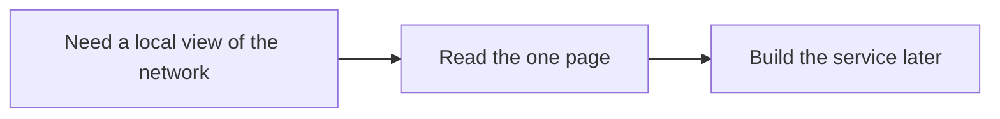

# Scope

This pass writes one page. The boundary below is taken from the intent statement (`intent-statement`) and the answers in this stage. Feasibility assessment and the constraint register were not produced.

## In Scope

One file, `docs/future-intents/local-timetable.md`. It holds both the future-intents note for this repo and the description of the local service. [Q3]

The service description covers a service the reader can deploy in Docker on their own machine, with a server, a database, and a UI. The UI shows all trains on the network now, which of those trains deviate from the published timetable, and a chosen pair of stations with the trains on that route, where they are, and any issues found there. The description is written from the proofs of concept already in the repo, and it is detailed enough to build later. [Q2][intent-statement]

The reader is the person who asked for this, alone, on their own machine. [intent-statement]

## Out of Scope

This pass does not build or run the service. It does not describe a hosted or cloud deployment. It does not add a step-by-step build guide. It does not add a second file for the future-intents note. [Q2][Q3]

## Sequence

Both parts of the page are written together in this pass. The service description depends on the proofs of concept already in the repo. The intent statement records that those proofs of concept are far enough along, and that the design should be written before any more build work. [intent-statement]

## Value Stream

The person wants a local view of the live network and of timetable problems, without a hosted service. This pass gives them one page they can build from later.

Text fallback: need a local view of the network, then read the one page, then build the service later.

## Assumptions & Open Questions

None.
