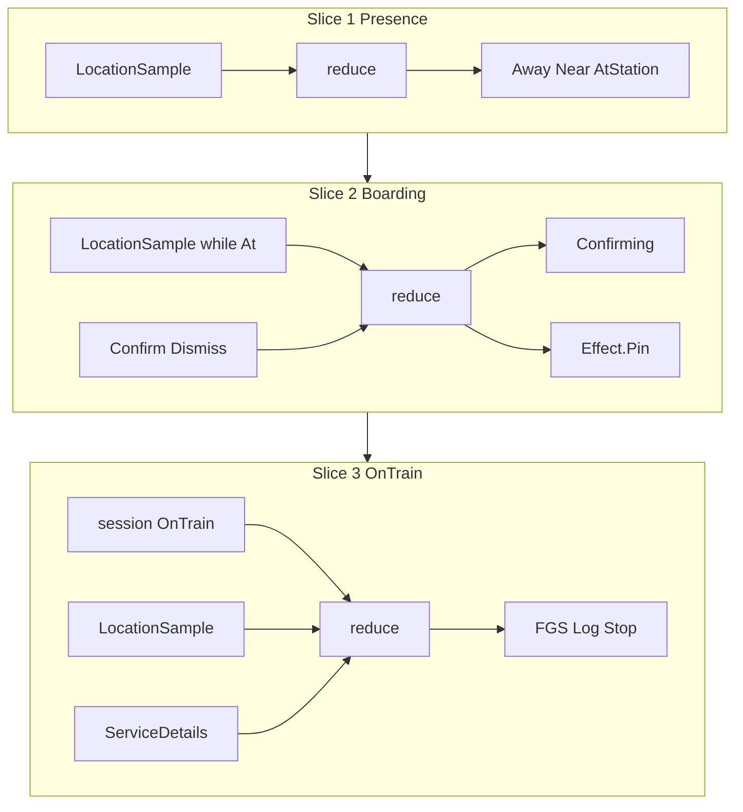

# Commute session — vertical slices

Track development of the reduce/effect commute session against [state-model.md](state-model.md#implementing-the-state-machine) and [architecture.md](architecture.md#commute-session-design-recommendation).

A vertical slice is **one user-visible step** through the full stack (`Event` → `reduce` → effects → `WalkUpHomeUi` → a trace test). It is not “rewrite every detector then glue later.”

Do **not** keep two sources of truth for the same phase (`walkUpPhase` *and* `CommuteSession.presence`). Each slice **moves ownership** of that region into the session and deletes the old `HomeViewModel` field.

---

## Progress

Tick when the slice is merged and the listed `HomeViewModel` fields are gone.

| Slice | Status | Notes |
|-------|--------|-------|
| 1 Presence | Done | `reduce` owns Idle / Near / AtStation; `boardingPhase` still in VM |
| 2 Boarding + pin effect | Not started | After 1 |
| 3 On-train + finish | Not started | After 2 |
| 4 Receivers enqueue events | Not started | Optional; after 1 |

When a slice lands, also update state-model “illustrative — not implemented” to the real type names.

---

## What stays put every slice

- Existing `DetectWalkUpArrival.next` / `DetectBoarding.next` / `DetectStationStop.next` — call them from `reduce`; do not rewrite thresholds.
- Live Darwin — Refresh and `JourneyRepository` stay real ([simulated-journey.md](simulated-journey.md)).
- `WalkUpHomeUi` as the Compose contract; map `session` → UI at the edge.

New types under `domain/usecase/` (or `domain/commute/`): `CommuteSession`, `CommuteEvent`, `CommuteEffect`, `fun reduce(...)`. [`HomeViewModel`](../android/app/src/main/java/com/ukrailtracker/app/ui/home/HomeViewModel.kt) interprets effects only.

Each PR: reduce + VM wiring + unit traces. No Compose rewrite beyond mapping if `WalkUpHomeUi` is unchanged.

---

## Slice 1 — Presence (Away / Near / At)

**User-visible:** Home status bar and at-station favourite boards from GPS (and manual origin override).

**Session:** `Idle` | `Near` | `AtStation(origin, boarding = Idle)`.

**Events:** `Location`, `SetOriginOverride`, `ClearOverride`, permission loss.

**Effects:** `LoadFavouriteBoundDepartures` (keep the loader job in the VM; emit the effect from reduce).

**Delete from VM when done:** `walkUpPhase`, `lockedOrigin`.

**Leave in the VM until later slices:** `boardingPhase`, `activePinned`. While `activePinned != null`, do not call slice-1 `reduce` for GPS (on-train still owns location).

**Tests:** existing [`DetectWalkUpArrivalTest`](../android/app/src/test/java/com/ukrailtracker/app/domain/usecase/DetectWalkUpArrivalTest.kt) plus `CommuteReduceTest` traces: Away → Near → At.

**Ship when:** cold start at station, walk-up dwell, vehicle reject, and manual override still match production.

### Checklist

- [x] `CommuteSession` / `CommuteEvent` / `reduce` for presence only
- [x] `HomeViewModel.sampleLocation` uses reduce for walk-up
- [x] `walkUpPhase` and `lockedOrigin` removed
- [x] `CommuteReduceTest` Away → Near → At
- [x] Manual origin override still works

---

## Slice 2 — Boarding prompt + pin as effect

**User-visible:** leave-station motion → “On the HH:mm to …?” → Confirm / picker / Dismiss / 60 s accept.

**Session:** `AtStation` with real `BoardingPhase`; add `Confirming`.

**Events:** `Location` (qualifying motion), `Confirm`, `SelectService`, `Dismiss`, `Tick` for auto-accept only.

**Effects:** `Pin(journey)`. Stop pinning inside `pinAndOpen` as a UI side effect. Interpreter writes DataStore; `beginOnTrainSession` may still run until slice 3.

**Delete from VM when done:** `boardingPhase`, `boardingAutoAcceptJob` (auto-accept is `Tick` vs `triggeredAt + 60s`).

**Tests:** leave ≥400 m at ≥5 m/s for 8 s → Confirming; Confirm → effect `Pin`; no match → Idle.

Debug tap-to-pin in `DebugWalkUp` can stay until a later sim change; production path uses reduce.

### Checklist

- [ ] Boarding motion + `Confirming` in session
- [ ] `Pin` is an effect; DataStore write in interpreter
- [ ] Auto-accept via `Tick`, not `delay { confirmBoarding() }`
- [ ] `boardingPhase` / auto-accept job removed
- [ ] Trace tests for trigger / confirm / no-match / dismiss

---

## Slice 3 — On-train + finish

**User-visible:** diagram, countdown, stop confirm, End trip, `journey_log`.

**Session:** `OnTrain(pin, stop, confirmedStopCrs, buzzed)`.

**Events:** `Location` → `DetectStationStop`; `ServiceDetails`; `EndTrip`; `Tick` for buzz (here or a 3b).

**Effects:** `StartTracking` / `UpdateTracking` / `StopTracking`, `WriteJourneyLog`, `ClearPin`, `Vibrate`.

**Delete from VM when done:** `stationStopPhase`, duplicate `activePinned` (pin is session; DataStore restore on init hydrates `OnTrain`).

Darwin `refreshing` / `errorMessage` / `serviceMissing` stay on UI or nested load state, not a session phase.

### Checklist

- [ ] `OnTrain` in session; GPS goes to `DetectStationStop` via reduce
- [ ] Finish: GPS at favourite CRS, Darwin AT, End trip → effects
- [ ] FGS start/update/stop are effects
- [ ] `journey_log` write is an effect
- [ ] `stationStopPhase` / parallel pin flag removed
- [ ] Trace tests: stop confirm, dest arrival, End trip

---

## Slice 4 — Receivers enqueue only (optional)

`GeofenceTransitionsReceiver` / `onOpenedForFrequentChecks` emit `OpenedForFrequentChecks` into the same reduce (poll interval / `alreadyPresentOk`). Skip if slice 1 already treats the first GPS fix as cold-start lock.

### Checklist

- [ ] Geofence / notification tap enqueue `CommuteEvent` only
- [ ] Receiver does not set presence

---

## What is not a slice

- Rewriting all of `HomeViewModel` in one PR
- Introducing XState / Redux
- GPS time-scale or DebugWalkUp changes ([simulated-journey.md](simulated-journey.md) later work)
- Virtual Darwin clock

---

## Order

| Slice | Risk | Ships independently? |
|-------|------|----------------------|
| 1 Presence | Low — same detectors | Yes |
| 2 Boarding | Medium — pin / effect boundary | After 1 |
| 3 On-train | Medium — FGS + log | After 2 |
| 4 Geofence event | Low | After 1 |
