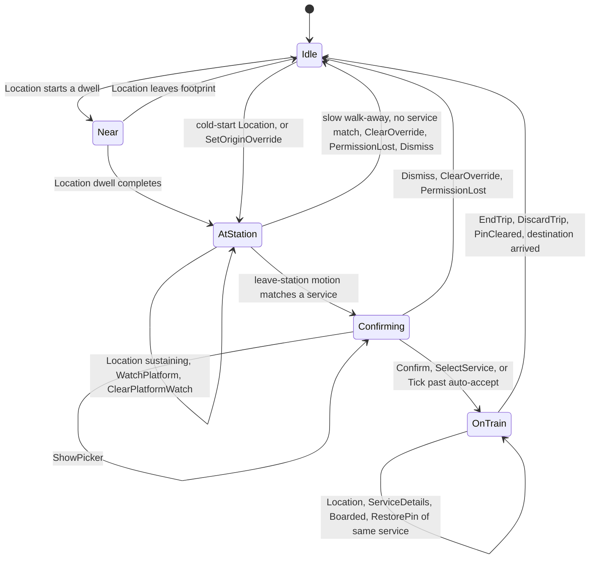

# Commute state engine

How commute presence is represented, how the reactive session engine arbitrates and reduces events, and which states, priorities, and effects exist.

This is the engine reference. Thresholds, geofence arming, and the walk-up → finish story live in [state-model.md](state-model.md). Slice history lives in [commute-session-slices.md](commute-session-slices.md). The architectural decision record lives in [android/docs/session-state-engine-architecture.md](../android/docs/session-state-engine-architecture.md).

Core types live in:

- `android/app/src/main/java/com/ukrailtracker/app/domain/usecase/CommuteSession.kt` — `CommuteSession`, `CommuteEvent`, `CommuteEffect`, `CommuteTransition`
- `android/app/src/main/java/com/ukrailtracker/app/domain/session/` — `SessionEngine`, `EventPriority`, `EventArbitrator`, `SessionReducer`, `SessionReduceContext`, and modular state handlers
- `android/app/src/main/java/com/ukrailtracker/app/domain/commute/CommuteRuntime.kt` — runtime controller owning `SessionEngine`, aux state, and side-effect interpreters

---


## The loop

One immutable `CommuteSession` is the source of truth, owned by `SessionEngine`. Callers dispatch a `CommuteEvent`. Events are classified into priority tiers, arbitrated against competing events in the same micro-slice, and evaluated by `SessionReducer` through isolated state handlers.

```text
dispatch(event)
    │
    ▼
SessionEngine (Event Buffer)
    ├── USER_INTENT / SYSTEM_CRITICAL  ──► Immediate flush (0ms latency)
    └── AMBIENT_SENSOR                 ──► Micro-tick coalescing (~250ms)
    │
    ▼
EventArbitrator.arbitrate(batch)  ──► Winning Event
    │
    ▼
SessionReducer.reduce(session, event, context)
    ├── IdleStateHandler
    ├── NearStateHandler
    ├── AtStationStateHandler
    ├── ConfirmingStateHandler
    └── OnTrainStateHandler
    │
    ▼
CommuteTransition(newSession, effects)
    │
    ▼
CommuteRuntime.applyTransition
    ├── update sessionFlow
    ├── enter / exit jobs (platform watch, on-train poll, auto-accept tick)
    └── interpretEffect for each effect
```


### Determinism & Context

`SessionReducer` and its state handlers are pure functions. They do not read GPS sensors, DataStore, or the system clock directly. All contextual information is passed via `SessionReduceContext`:

- `config`: `WalkUpConfig` (dwell thresholds, geofence radii)
- `boardingConfig`: `BoardingConfig` (leave radii, auto-accept duration, speed thresholds)
- `stationStopConfig`: `StationStopConfig`
- `cachedBoardingServices`: current candidate departures from Darwin
- `routeStations`: calling points with coordinates for route progress
- `onTrainCallingPoints`: timetable calling points
- `zoneId`: system time zone
- `progressNow`: evaluation timestamp

The same session and the same inputs always produce the identical transition. An event that does not apply returns the session unchanged with an empty effect list.

---


## Priority tiers & event arbitration

To eliminate race conditions between user actions and ambient background noise (e.g. user tapping "Dismiss" at the exact moment a sensor fix leaps or an auto-accept timer expires), every `CommuteEvent` implements `val priority: EventPriority`.


| Tier  | Priority Enum      | Events                                                                                                                                   | Invariants                                                                                                                 |
| ----- | ------------------ | ---------------------------------------------------------------------------------------------------------------------------------------- | -------------------------------------------------------------------------------------------------------------------------- |
| **0** | `USER_INTENT`      | `Confirm`, `SelectService`, `Dismiss`, `EndTrip`, `Boarded`, `WatchPlatform`, `ClearPlatformWatch`, `SetOriginOverride`, `ClearOverride` | **Always wins.** Flushes buffer immediately with 0ms latency. Invalidates lower-priority ambient events in the same slice. |
| **1** | `SYSTEM_CRITICAL`  | `PermissionLost`, `PinCleared`                                                                                                           | Hard system boundary changes that force reset.                                                                             |
| **2** | `DEADLINE_TIMEOUT` | `Tick`                                                                                                                                   | Auto-accept window expiration.                                                                                             |
| **3** | `AMBIENT_SENSOR`   | `Location`, `OsGeofenceEnter`, `OpenedForFrequentChecks`, `RestorePin`, `ServiceDetails`                                                 | Background hardware/network signals. Multiple `Location` fixes in the same slice coalesce to the newest sample.            |


### `EventArbitrator` Rules

1. **Preemption**: When events of different tiers collide in a batch, the highest tier wins. For example, in `[Location(Departed), Dismiss]`, `Dismiss` wins and the GPS leap is dropped.
2. **User Tap Preservation**: Multiple user taps in one slice resolve to the latest tap.
3. **Sensor Coalescing**: Multiple GPS samples coalesce down to the latest fix; earlier fixes in the same slice are discarded.

---


## Session states

`CommuteSession` represents the commute presence. The five variants are mutually exclusive:




| Session      | Carries                                                                                                | Meaning                                                                                                                  |
| ------------ | ------------------------------------------------------------------------------------------------------ | ------------------------------------------------------------------------------------------------------------------------ |
| `Idle`       | nothing                                                                                                | No walk-up lock. Home shows not-at-station.                                                                              |
| `Near`       | `WalkUpPhase.Dwelling`                                                                                 | Inside the geofence footprint and dwelling toward a lock.                                                                |
| `AtStation`  | `LockedOrigin`, `BoardingPhase`, `PlatformWatchPhase`                                                  | Origin is locked by GPS or manual override. Home shows favourite-bound departures.                                       |
| `Confirming` | origin, assumed service, alternatives, `triggeredAtEpochMs`, `showPicker`                              | Leave-station motion matched a favourite-bound service. Waiting for confirm, picker, or timeout. Ambient GPS is ignored. |
| `OnTrain`    | `PinnedJourney`, `GpsMotion`, `OnTrainRidePhase`, progress anchor, journey fraction, buzzed thresholds | A service is pinned. Darwin supplies expected times; GPS supplies spatial progress.                                      |


`LockedOrigin.manualOverride` indicates a user (or debug) lock. While set, ambient `Location` does not alter presence. `ClearOverride` drops it.

### Nested phases

These sub-phases model fine-grained detector state without polluting top-level session types:

- `BoardingPhase` (on `AtStation`):
  - `Idle`: Station presence quiet.
  - `Sustaining`: Leave-station motion detected, accumulating duration.
  - `Triggered`: Thresholds met (immediately converted to `Confirming` if a departure matches, or `Idle` if no match).
- `PlatformWatchPhase` (on `AtStation`):
  - `Idle`: Browsing departures.
  - `Watching`: Polling one departure until its departure platform appears.
- `OnTrainRidePhase` (on `OnTrain`):
  - `WaitingAtOrigin`: Pinned, platform wait. Displays approaching train details if available.
  - `AwaitingDeparture`: Marked boarded (via button or auto-board) and waiting for train-like speed.
  - `EnRoute`: Train moving between stations. Journey fraction advances from GPS.
  - `AtCallingPoint`: GPS confirmed calling-point stop. Progress snaps to stop.
- `GpsMotion` (on `OnTrain`): Raw stop detector (`Moving`, `Dwelling`, `Confirmed`). Confirming destination CRS finishes the trip.
- `WalkUpPhase`: Walk-up detector (`Away`, `Dwelling`, `Arrived`). Mapped by `SessionWalkUpSupport` to `Idle`, `Near`, or `AtStation`.

---


## Modular state handlers

Instead of a monolithic switchboard, `SessionReducer` delegates to dedicated state handlers in `domain/session/`:

```kotlin
interface SessionStateHandler<S : CommuteSession> {
    fun handle(
        session: S,
        event: CommuteEvent,
        context: SessionReduceContext,
    ): CommuteTransition
}
```

1. `IdleStateHandler`:
  - Evaluates walk-up arrivals from `Location` via `SessionWalkUpSupport`.
  - Handles `SetOriginOverride` (locks `AtStation` and requests departure reload).
  - Handles `OsGeofenceEnter` (emits `NotifyProximity` without changing presence).
  - Handles `OpenedForFrequentChecks` (emits `ElevateFrequentChecks`).
  - Handles `RestorePin` (restores active pinned ride to `OnTrain`).
2. `NearStateHandler`:
  - Manages dwelling progress toward an origin lock.
  - Transitions to `AtStation` upon dwell completion, or back to `Idle` on footprint exit.
3. `AtStationStateHandler`:
  - Manages `PlatformWatch` selection and clearing.
  - Evaluates leave-station motion and matches candidates via `MatchBoardingCandidates`.
  - Reverts to `Idle` on slow walk-away past leave radius or upon `Dismiss`/`ClearOverride`.
4. `ConfirmingStateHandler`:
  - Handles `Confirm` and `SelectService` (transitions to `OnTrain`).
  - Toggles alternatives via `ShowPicker`.
  - Returns to `Idle` on `Dismiss` or `PermissionLost`.
  - Evaluates auto-accept deadline on `Tick`.
5. `OnTrainStateHandler`:
  - Evaluates `Location` against calling points via `DetectStationStop`.
  - Updates calling point expectations and journey progress on `ServiceDetails`.
  - Advances ride phase on `Boarded`.
  - Handles `EndTrip`, `DiscardTrip`, `PinCleared`, and destination arrivals.
  - Safely ignores `Dismiss`, `PermissionLost`, and station overrides during an active ride.
6. `SessionWalkUpSupport`:
  - Shared helper containing pure conversions (`toWalkUpPhase`, `loadEffects`, `pinSnapshot`, `restorePin`).

---


## Events reference


| Event                     | Priority           | Payload                                            | Source                           | Engine Behavior                                                                        |
| ------------------------- | ------------------ | -------------------------------------------------- | -------------------------------- | -------------------------------------------------------------------------------------- |
| `Location`                | `AMBIENT_SENSOR`   | sample, nearest station, speed, `alreadyPresentOk` | `CommuteRuntime` location watch  | Evaluated by active state handler. Coalesced if multiple fixes queue.                  |
| `SetOriginOverride`       | `USER_INTENT`      | `LockedOrigin`                                     | User / debug origin selection    | Moves to `AtStation` (unless `OnTrain`) and requests force refresh.                    |
| `ClearOverride`           | `USER_INTENT`      | —                                                  | User clears origin               | Moves to `Idle` (unless `OnTrain`).                                                    |
| `OsGeofenceEnter`         | `AMBIENT_SENSOR`   | CRS, station name                                  | `GeofenceTransitionsReceiver`    | Emits `NotifyProximity` (unless `OnTrain`). Never locks presence.                      |
| `OpenedForFrequentChecks` | `AMBIENT_SENSOR`   | until epoch ms, hint CRS                           | Notification tap                 | Emits `ElevateFrequentChecks`. Presence untouched.                                     |
| `PermissionLost`          | `SYSTEM_CRITICAL`  | —                                                  | Location permission revoked      | Returns to `Idle` (unless `OnTrain`).                                                  |
| `Confirm`                 | `USER_INTENT`      | now epoch ms                                       | Home "Confirm" button            | From `Confirming`: pins assumed service and transitions to `OnTrain`.                  |
| `SelectService`           | `USER_INTENT`      | service id, now epoch ms                           | Home alternative picker          | From `Confirming`: pins selected snapshot and transitions to `OnTrain`.                |
| `ShowPicker`              | `USER_INTENT`      | —                                                  | Home "Not this train"            | In `Confirming`: sets `showPicker = true`.                                             |
| `Dismiss`                 | `USER_INTENT`      | —                                                  | Home dismiss prompt              | From `AtStation` / `Confirming`: returns to `Idle`. Ignored on `OnTrain`.              |
| `Tick`                    | `DEADLINE_TIMEOUT` | now epoch ms                                       | Boarding auto-accept job         | From `Confirming`: auto-accepts once deadline is reached.                              |
| `RestorePin`              | `AMBIENT_SENSOR`   | `PinnedJourney`                                    | DataStore flow collector         | Re-attaches to `OnTrain(WaitingAtOrigin)` if not already riding this service.          |
| `PinCleared`              | `SYSTEM_CRITICAL`  | —                                                  | DataStore pin cleared externally | From `OnTrain`: returns to `Idle` and stops foreground tracking.                       |
| `EndTrip`                 | `USER_INTENT`      | —                                                  | Home "End trip" button           | From `OnTrain`: returns to `Idle`, writes journey log, stops tracking, clears pin.     |
| `DiscardTrip`             | `USER_INTENT`      | —                                                  | Debug / teardown                 | From `OnTrain`: returns to `Idle`, stops tracking, clears pin. No log.                 |
| `ServiceDetails`          | `AMBIENT_SENSOR`   | `JourneyOption`                                    | Darwin timetable poll            | In `OnTrain`: updates timetable progress, emits vibration buzzes, finishes if arrived. |
| `Boarded`                 | `USER_INTENT`      | —                                                  | Home "Boarded" button            | In `OnTrain(WaitingAtOrigin)`: promotes to `AwaitingDeparture`.                        |
| `WatchPlatform`           | `USER_INTENT`      | service details & platform                         | Home departure watch tap         | In `AtStation`: sets `PlatformWatchPhase.Watching`.                                    |
| `ClearPlatformWatch`      | `USER_INTENT`      | —                                                  | Home clear watch tap             | In `AtStation`: resets platform watch to `Idle`.                                       |


---


## Effects

Effects represent side-effect work that pure reducers are not allowed to execute directly. `CommuteRuntime.interpretEffect` performs them after the transition:


| Effect                         | Payload                    | Interpreter Action                                                              |
| ------------------------------ | -------------------------- | ------------------------------------------------------------------------------- |
| `LoadFavouriteBoundDepartures` | origin CRS, `forceRefresh` | Fetches departures for the locked CRS into at-station aux state.                |
| `Pin`                          | `PinnedJourney`            | Writes the pinned journey to DataStore.                                         |
| `StartTracking`                | destination name, minutes  | Starts the on-train foreground notification service (`OnTrainTrackingService`). |
| `UpdateTracking`               | destination name, minutes  | Updates foreground notification text and ETA.                                   |
| `StopTracking`                 | —                          | Stops foreground notification service.                                          |
| `WriteJourneyLog`              | —                          | Writes a `journey_log` row for Delay Repay if Darwin details exist.             |
| `ClearPin`                     | —                          | Clears `PinnedJourney` from DataStore.                                          |
| `Vibrate`                      | thresholds (3, 2, 1 min)   | Emits vibration thresholds on `arrivalBuzz` flow.                               |
| `RefreshServiceDetails`        | —                          | Triggers an immediate timetable refresh after calling point confirm.            |
| `ElevateFrequentChecks`        | until epoch ms             | Elevates GPS poll rate until deadline.                                          |
| `NotifyProximity`              | CRS, station name          | Handled by `GeofenceTransitionsReceiver` to post proximity notification.        |


### State-scoped enter/exit jobs

Certain jobs run only during specific session phases and are cancelled automatically on state exit:


| Phase Transition          | Lifecycle Job Action                                                                              |
| ------------------------- | ------------------------------------------------------------------------------------------------- |
| Enter `Confirming`        | Starts countdown timer delay; dispatches `Tick` upon deadline.                                    |
| Exit `Confirming`         | Cancels auto-accept tick job.                                                                     |
| Enter `OnTrain` (new pin) | Clears boarding aux; starts on-train periodic poll and progress ticker; refreshes Darwin details. |
| Exit `OnTrain`            | Cancels on-train poll and progress ticker; clears on-train aux state.                             |
| `AtStation` → `Idle`      | Cancels platform watch job; clears at-station aux state and cached boarding services.             |
| Start `Watching` platform | Starts periodic platform poll job.                                                                |
| Stop `Watching` platform  | Cancels platform poll job.                                                                        |


---


## Where to change behaviour


| Objective                                | Where to make changes                                                                                                                                                                     |
| ---------------------------------------- | ----------------------------------------------------------------------------------------------------------------------------------------------------------------------------------------- |
| **Add a new state**                      | Add variant to `CommuteSession`, create new `SessionStateHandler` implementation, register in `SessionReducer`, and add mapping in `CommuteUiMapper`.                                     |
| **Add a new event**                      | Add variant to `CommuteEvent`, specify its `priority: EventPriority`, handle it in the relevant state handler, and add test cases in `EventArbitratorTest` and `SessionStateHandlerTest`. |
| **Adjust priority or race handling**     | Update `EventPriority` or `EventArbitrator.arbitrate`.                                                                                                                                    |
| **New asynchronous side-effect**         | Add variant to `CommuteEffect` and implement in `CommuteRuntime.interpretEffect`. Keep handlers pure.                                                                                     |
| **GPS poll cadence or sensing policies** | Adjust extensions in `CommuteSessionPolicy.kt` and table tests in `CommuteSessionPolicyTest.kt`.                                                                                          |


