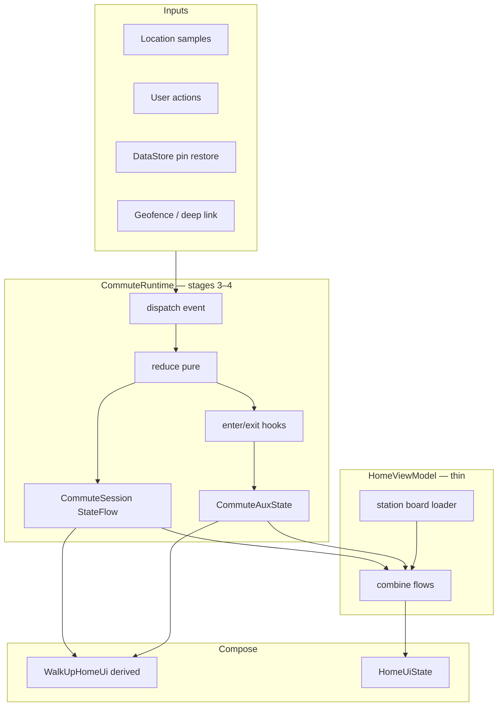

# Commute state migration plan

Incremental refactor to make adding new `CommuteSession` states cheap, without rewriting the existing reducer or Compose screens.

**Context:** The domain commute pipeline (`CommuteSession` → `reduce` → `CommuteEffect`) is in good shape and documented in [state-model.md](state-model.md) and [commute-session-slices.md](commute-session-slices.md). The remaining pain is in **runtime orchestration and UI projection** inside `[HomeViewModel](../android/app/src/main/java/com/ukrailtracker/app/ui/home/HomeViewModel.kt)`: two parallel state models, scattered `commuteSession is …` checks, and a growing `applyTransition` switchboard.

**Goal:** One authoritative commute session (+ explicit auxiliary data), derived UI, and colocated per-state behaviour — so new states touch `reduce`, mapping, and at most one enter/exit hook.

**Non-goals (this migration):**

- Rewriting `DetectWalkUpArrival`, `DetectBoarding`, or `DetectStationStop`
- Changing `WalkUpHomeUi` as the Compose contract (unless a new state genuinely needs a new variant)
- Promoting commute state to app scope (noted as a follow-up if new states need cross-component access)
- Adding the new product states themselves (this plan prepares the architecture; state additions come after stage 5)

---

## Current problems (summary)

| Problem                                        | Symptom when adding a state                                                                                                        |
| ---------------------------------------------- | ---------------------------------------------------------------------------------------------------------------------------------- |
| Dual state (`CommuteSession` + `WalkUpHomeUi`) | Update reducer, UI sealed type, `applyPresenceUi`, and ad-hoc `patchWalkUp` call sites                                             |
| Imperative UI patching                         | Async loaders (`loadDestinations`, `applyOnTrainProgress`) mutate UI independently of session                                      |
| Fat `applyTransition`                          | New top-level session → more `previous`/`next` branches for jobs and cleanup                                                       |
| Scattered session type checks                  | `currentPollIntervalMs`, `sampleLocation`, `startLocationWatch`, etc. each grow new `when` arms                                    |
| Implicit auxiliary state                       | `cachedBoardingServices`, `lastAtStationUi`, `platformNotified`, `latestOnTrainOption` are not part of session but drive behaviour |

---

## Target architecture

**Principles:**

1. **Session is authoritative** for commute phase; UI is always derived, never patched in parallel.
2. **Auxiliary data is explicit** — loading flags, cached departures, platform watch, latest Darwin option live in `CommuteAuxState`, not loose ViewModel fields.
3. **Side effects are interpreted once** — pin writes, FGS, journey log, destination fetch requests.
4. **Cross-cutting behaviour is colocated** — poll interval, “accepts location events”, etc. live on `CommuteSession` (or a `CommutePhase` enum), not duplicated across methods.
5. **Enter/exit hooks are opt-in** — only states that start/stop jobs register handlers.

---

## Migration stages

Each stage is a shippable PR. Do not start the next stage until the previous stage’s definition of done is met. Prefer small follow-up PRs over a single large rewrite.

---

### Stage 1 — Explicit auxiliary state + single UI mapper

**Objective:** Eliminate the dual mutation path for presence UI. All `WalkUpHomeUi` values come from one mapping function; delete `applyPresenceUi`.

#### Scope

**Add:**

- `CommuteAuxState` — a data class (or small hierarchy) holding everything the UI needs that is *not* already on `CommuteSession`:
  - Permission / location availability overlay (`NeedsPermission`, `LocationUnavailable` are not session states today)
  - At-station destination list + loading + `noFavouritesConfigured`
  - Platform watch snapshot
  - On-train progress fields (minutes remaining, calling points, mismatch, etc.)
  - Any flags currently implicit (`platformNotified` may stay internal to runtime later; for stage 1 it can live in aux or remain VM-private if only used by jobs)
- `CommuteSession.toWalkUpUi(aux, permissionOverlay)` — single pure mapping from session + aux → `WalkUpHomeUi?`

**Change:**

- Replace every `applyPresenceUi` call with: update session (unchanged for now) → recompute `walkUp` via mapper → set on `HomeUiState.Content`
- Replace direct `patchWalkUp(...)` calls that mirror session state with mapper recomputation
- Keep permission/GPS error overlays as explicit aux fields (or a small `PresenceOverlay` enum) so they participate in the mapper instead of bypassing it

**Do not change yet:**

- `commuteSession` as a private `var` (still synchronous)
- `applyTransition` structure
- `reduce()` or effect types
- Compose screens

#### Files (expected)

| Area | Files                                                                             |
| ---- | --------------------------------------------------------------------------------- |
| New  | `domain/commute/CommuteAuxState.kt` (or `ui/home/CommuteUiMapper.kt`)             |
| Edit | `HomeViewModel.kt` — remove `applyPresenceUi`, consolidate `patchWalkUp`          |
| Edit | `HomeUi.kt` — only if overlay / extension properties need updating                |
| Test | New `CommuteUiMapperTest` — table-driven: session + aux → expected `WalkUpHomeUi` |

#### Steps

1. Inventory all `patchWalkUp` and `updateAtStation` call sites; classify each as **session-driven**, **aux-driven**, or **overlay**.
2. Define `CommuteAuxState` with fields for every aux-driven piece identified.
3. Implement the mapper; port logic from `applyPresenceUi`, `applyArrived`, `patchOnTrainSkeleton`, `applyOnTrainProgress`.
4. Introduce a private `recomputeWalkUp()` used after session changes *and* aux changes.
5. Delete `applyPresenceUi`.
6. Add unit tests for each existing session variant + representative aux combinations.

#### Validation

- Manual: walk-up dwell, manual override, boarding prompt, on-train progress, permission deny/grant, location unavailable
- Automated: mapper unit tests; existing `CommuteReduceTest` unchanged
- No behaviour change intended — refactor only

#### Definition of done

- [ ] Zero calls to `applyPresenceUi`
- [ ] All `WalkUpHomeUi` emissions go through the mapper (except possibly `HomeUiState.Loading/Empty/Error` shell states)
- [ ] Mapper tests cover Idle, Near, AtStation, Confirming, OnTrain
- [ ] `focusesAtStation` / `focusesTripUi` still correct (update to use mapper output or `CommuteSession` if cleaner)

#### Risks

- **At-station destination preservation** — today `applyArrived` merges existing UI when the station CRS is unchanged; express this as aux merge rules in the mapper, not imperative patching.
- **On-train incremental updates** — progress updates currently patch many `OnJourney` fields; ensure aux holds progress snapshot and mapper is cheap to call on every tick.

---

### Stage 2 — Reactive session + derived `HomeUiState`

**Objective:** Make `commuteSession` observable and derive the content portion of `HomeUiState` from flows, removing imperative `_uiState` patching for walk-up.

#### Scope

**Add:**

- `MutableStateFlow<CommuteSession>` (or expose read-only `StateFlow` from runtime placeholder)
- `MutableStateFlow<CommuteAuxState>`
- `combine(session, aux, stations, …) { … }` → `HomeUiState`

**Change:**

- `applyTransition` updates `sessionFlow.value` instead of `commuteSession = …`
- Aux mutations (`loadDestinations` completion, platform watch updates, on-train progress) update `auxFlow`
- `HomeViewModel.uiState` becomes the combined flow (or a single `_uiState` updated only from the combine collector)
- Remove redundant `patchWalkUp` — recomputation happens automatically when session or aux changes

**Do not change yet:**

- Extract class from ViewModel (still inline)
- Location job ownership (still in ViewModel)

#### Files (expected)

| Area | Files                                                              |
| ---- | ------------------------------------------------------------------ |
| Edit | `HomeViewModel.kt` — flows, combine, simplify state writes         |
| Edit | `HomeScreen.kt` — no change expected if `uiState` API unchanged    |
| Test | ViewModel test with `runTest` + fake flows (optional but valuable) |

#### Steps

1. Replace `private var commuteSession` with `sessionFlow`.
2. Replace scattered aux fields with `auxFlow` (or a single `updateAux { copy(…) }` helper).
3. Wire `combine` in `init` to produce `HomeUiState`; keep station board loading feeding into the combine as today.
4. Audit every `_uiState.value =` assignment — each must either feed the combine inputs or set a non-content shell state.
5. Ensure `collectAsStateWithLifecycle` in Compose still has one collection point.

#### Validation

- Rotation / process death: session still rehydrates from `PinnedJourneyStore` as today
- No duplicate recomputation causing flicker (use `distinctUntilChanged` on derived walk-up if needed)
- Board refresh + walk-up updates do not race to stale UI

#### Definition of done

- [ ] `commuteSession` is not a bare `var` read from coroutines without synchronization
- [ ] Changing session or aux automatically updates `walkUp` in UI state
- [ ] `patchWalkUp` deleted or reduced to a thin `recompute` that only updates aux/session inputs
- [ ] Station cards and disruption modal still work unchanged

#### Risks

- **Combine fan-out** — too many inputs in one combine; group aux under one data class to keep arity manageable.
- **Performance** — on-train progress tick every second; ensure mapper + combine do not rebuild unrelated station cards.

---

### Stage 3 — Extract `CommuteRuntime`

**Objective:** Move session dispatch, transition application, effect interpretation, and job lifecycle out of `HomeViewModel` into a dedicated class. ViewModel becomes orchestration + station boards + navigation events.

#### Scope

**Add:**

- `CommuteRuntime` (name flexible: `CommuteStore`, `CommuteEngine`)
  - Owns `sessionFlow`, `auxFlow`
  - `dispatch(event: CommuteEvent)` — calls `reduce`, applies transition, runs effects
  - `interpretEffect(effect: CommuteEffect)` — pin store, FGS, journey log, load departures *requests*
  - Callbacks or `SharedFlow` for runtime → VM boundaries (e.g. “refresh station boards”, “open journey”)
- **Enter/exit hooks** (initially inline in runtime, refactor to registry in stage 4 if needed):
  - Enter `Confirming` → start boarding tick
  - Exit `Confirming` → cancel boarding tick
  - Enter `OnTrain` → start on-train poll + progress tick
  - Exit `OnTrain` → cancel polls, reset aux slices
  - Enter/exit `AtStation` / `Idle` → platform watch cleanup rules currently in `applyTransition`

**Change:**

- `HomeViewModel` delegates `onConfirmBoarding`, `sampleLocation` event dispatch, pin restore collector, etc. to runtime
- Effect handlers that need repositories are injected into runtime constructor (same deps as VM today)
- Location watch loop may stay in VM initially *or* move to runtime — prefer runtime if it simplifies session access

**Do not change yet:**

- `CommuteSession` extensions for poll interval (stage 4)
- App-scoped runtime

#### Files (expected)

| Area | Files                                                                                 |
| ---- | ------------------------------------------------------------------------------------- |
| New  | `domain/commute/CommuteRuntime.kt`                                                    |
| New  | `domain/commute/CommuteEffectInterpreter.kt` (optional split)                         |
| Edit | `HomeViewModel.kt` — shrink substantially                                             |
| Edit | `AppContainer.kt` — only if runtime is constructed there later                        |
| Test | `CommuteRuntimeTest` — dispatch sequences, effect lists, hook side effects with fakes |

#### Steps

1. Cut `applyTransition`, `interpretEffect`, `reduceEvent`, and session/aux flows into `CommuteRuntime` verbatim (mechanical move).
2. Define a narrow interface VM uses: `dispatch`, `sessionFlow`, `auxFlow`, plus any `SharedFlow` outputs (`arrivalBuzz`, `platformAppeared`).
3. Move boarding tick, on-train poll, on-train progress tick ownership into runtime enter/exit.
4. Keep destination loading callable from effect interpreter — runtime emits “need destinations for CRS” and either calls loader internally or exposes suspend API.
5. Delete duplicated session logic from VM.

#### Validation

- All existing `CommuteReduceTest` pass unchanged
- New runtime tests for: confirm → pin → on-train → end trip; dismiss boarding; pin restore from DataStore
- Manual full commute flow unchanged

#### Definition of done

- [ ] `HomeViewModel` no longer contains `applyTransition` or `interpretEffect`
- [ ] Session mutations only happen inside `CommuteRuntime.dispatch`
- [ ] Enter/exit job rules documented next to runtime (short comment block or table in this doc’s appendix)
- [ ] ViewModel line count materially reduced (target: < half current size)

#### Risks

- **Circular dependency** — runtime needs repos, VM needs runtime; construct runtime in VM factory or `AppContainer` with clear ownership.
- **Android Context in runtime** — FGS start/stop may need `Context`; keep at interpreter edge, not inside pure reduce.

---

### Stage 4 — Colocate cross-cutting behaviour on session

**Objective:** Remove scattered `commuteSession is …` checks. Poll interval, location acceptance, and similar policies live in one place per concern.

#### Scope

**Add (on** `CommuteSession` **or** `CommutePhase`**):**

- `locationPollIntervalMs(now, elevatedUntilMs)` — replaces `currentPollIntervalMs`
- `acceptsWalkUpLocationEvents()` — replaces guards in `sampleLocation` / `startLocationWatch`
- `shouldResolveNearbyStations()` — replaces on-train empty nearby check
- `lockedOriginCrs()` — already have `lockedOriginOrNull`; ensure single accessor
- Optional: `CommutePhase` enum grouping states for UI flags (`focusesTripUi`, `focusesAtStation`)

**Change:**

- `CommuteRuntime` location loop uses extension methods only
- Delete `isConfirmingBoarding()` if subsumed by session API
- Update `focusesAtStation` / `focusesTripUi` in `HomeUi.kt` to delegate to session phase if exposed to UI layer

**Do not change:**

- `reduce()` transition table (unless a policy was incorrectly duplicated in reducer)

#### Files (expected)

| Area | Files                                                 |
| ---- | ----------------------------------------------------- |
| New  | `domain/commute/CommuteSessionPolicy.kt` (extensions) |
| Edit | `CommuteRuntime.kt` — simplify location loop          |
| Edit | `HomeUi.kt` — optional phase-based extensions         |
| Test | `CommuteSessionPolicyTest`                            |

#### Steps

1. Grep for `commuteSession is` and `CommuteSession.` type checks in VM/runtime; list each as a policy.
2. Implement extensions with table-driven tests per session variant.
3. Replace call sites one file at a time.
4. Review reducer for duplicate policy (e.g. “on train ignores walk-up”) — reducer stays authoritative for transitions; extensions only for runtime infrastructure.

#### Validation

- Poll interval behaviour identical in all phases (idle, watching, on-train, elevated checks)
- Confirming still ignores location transitions
- Manual override still blocks GPS overwrite

#### Definition of done

- [x] No `commuteSession is CommuteSession.X` in `HomeViewModel`
- [x] At most one policy module consulted by location sampling and job scheduling
- [x] New state checklist documented: “if it changes GPS policy, add one extension method + test”

#### Risks

- **Policy drift vs reducer** — document rule: transitions = `reduce`, infrastructure = extensions; never encode the same rule in both without a comment linking them.

---

### Stage 5 — New state playbook (validation of the migration)

**Objective:** Prove the architecture works by adding one or more planned states using only the new touchpoints. This stage is both **verification** and **documentation** for future work.

#### Scope

**Do:**

- Add the real product state(s) you already have in mind (to be chosen when stage 4 completes)
- For each new state, touch only:
  1. `CommuteSession` sealed hierarchy (prefer **nested** state if it is a sub-phase of AtStation / OnTrain / Confirming)
  2. `CommuteEvent` if new inputs are needed
  3. `reduce()` branches
  4. `CommuteAuxState` fields if the UI needs data not on session
  5. `toWalkUpUi` mapper branch
  6. Optional `CommuteRuntime` enter/exit handler if jobs start/stop
  7. Optional `CommuteSessionPolicy` extension if GPS behaviour changes
  8. `CommuteReduceTest` traces + mapper tests

**Do not:**

- Add `patchWalkUp` or new `when` branches in `HomeViewModel`
- Add parallel UI-only state enums

#### Suggested criteria for choosing the first new state

Pick a state that stress-tests the migration:

- **Nested sub-phase** (e.g. at-station “platform watch active” as session sub-state) → validates nesting over top-level explosion
- **Or** a state needing aux data fetch → validates effect → aux → combine pipeline
- **Or** a state changing poll interval → validates policy extensions

#### Definition of done

- [x] New state shipped behind full test coverage
- [x] `HomeViewModel` diff for the feature is minimal (wiring only)
- [x] “Adding a commute state” checklist added to this doc (see below)
- [x] [state-model.md](state-model.md) diagram updated

---

## Checklist: adding a commute state (post-migration)

Use after stage 5.

| Step | Action                                          | Required?                     |
| ---- | ----------------------------------------------- | ----------------------------- |
| 1    | Model in `CommuteSession` (nested if sub-phase) | Yes                           |
| 2    | Events in `CommuteEvent`                        | If new inputs                 |
| 3    | Transitions in `reduce()`                       | Yes                           |
| 4    | Effects in `CommuteEffect`                      | If side effects               |
| 5    | Aux fields in `CommuteAuxState`                 | If UI needs async/extra data  |
| 6    | Branch in `toWalkUpUi`                          | Yes                           |
| 7    | Enter/exit handler in `CommuteRuntime`          | If jobs start/stop            |
| 8    | Policy extension                                | If GPS/poll behaviour changes |
| 8a   | Table row in `CommuteSessionPolicyTest`         | If step 8                      |
| 9    | `CommuteReduceTest` trace                       | Yes                           |
| 10   | Mapper unit test                                | Yes                           |
| 11   | Update state-model.md                           | If user-visible               |

**Explicitly skip:** `HomeViewModel` unless adding a new user action handler that calls `runtime.dispatch`.

**GPS / poll policy:** if the new state changes whether location events are accepted, nearby stations are resolved, or poll interval — add/adjust one method in `CommuteSessionPolicy` and a table assertion in `CommuteSessionPolicyTest`. Do not add `is CommuteSession.X` branches in `CommuteRuntime`’s location loop. Transitions stay in `reduce()`; infrastructure stays in policy extensions.

---

## Testing strategy (all stages)

| Layer       | What to test                                                                                 |
| ----------- | -------------------------------------------------------------------------------------------- |
| `reduce`    | Existing `CommuteReduceTest` — keep as source of truth for transitions                       |
| Mapper      | Session × aux → `WalkUpHomeUi` table tests                                                   |
| Policy      | Poll interval, location acceptance per session                                               |
| Runtime     | Dispatch sequences, effect execution with fakes, hook job registration                       |
| Integration | Optional: ViewModel with fake runtime + fake repos for board loading                         |
| Manual      | Full walk-up → board → boarding → on-train → end trip; permission; deep link frequent checks |

Regression priority: **mapper + reduce** over Compose screenshot tests.

---

## Follow-ups (out of scope for stages 1–5)

| Item                                                 | When to consider                                                                                  |
| ---------------------------------------------------- | ------------------------------------------------------------------------------------------------- |
| App-scoped `CommuteRuntime` in `AppContainer`        | New states needed in `GeofenceTransitionsReceiver`, `OnTrainTrackingService`, or multiple screens |
| Merge `WalkUpHomeUi` variants into fewer composables | Compose refactor separate from state migration                                                    |
| Hilt / DI for runtime                                | When constructor wiring becomes painful                                                           |
| Persist aux state                                    | Only if process-death UX requires restoring in-progress platform watch                            |

---

## PR sequencing summary

| PR  | Stage   | User-visible change        |
| --- | ------- | -------------------------- |
| 1   | Stage 1 | None (refactor)            |
| 2   | Stage 2 | None (refactor)            |
| 3   | Stage 3 | None (refactor)            |
| 4   | Stage 4 | None (refactor)            |
| 5   | Stage 5 | Yes — new feature state(s) |

Keep each PR reviewable. If stage 3 is too large, split into 3a (extract runtime, keep jobs in VM) and 3b (move jobs to enter/exit).

---

## Appendix: auxiliary state inventory (starting point for stage 1)

Fields currently in `HomeViewModel` that should migrate into `CommuteAuxState` or runtime internal state:

| Field                        | Role                                   | Mapper or internal?                   |
| ---------------------------- | -------------------------------------- | ------------------------------------- |
| `cachedBoardingServices`     | Boarding match input to reduce         | Runtime internal (passed into reduce) |
| `lastAtStationUi`            | Preserve destinations across re-arrive | Aux or mapper merge rule              |
| `lastLoadedOriginCrs`        | Avoid redundant destination fetch      | Runtime internal                      |
| `platformNotified`           | Platform appeared buzz                 | Runtime internal                      |
| `latestOnTrainOption`        | Progress / mismatch                    | Aux                                   |
| `routeStations`              | Stop detection                         | Runtime internal                      |
| `onTrainServiceStarted`      | FGS idempotency                        | Runtime internal                      |
| `frequentChecksUntilEpochMs` | Elevated poll                          | Runtime internal (policy input)       |
| `alreadyPresentOk`           | Cold-start lock                        | Runtime internal                      |
| `previousSample`             | Speed resolution                       | Runtime internal                      |
| Permission overlay           | `NeedsPermission` UI                   | Aux overlay                           |

---

## References

- [state-model.md](state-model.md) — user-visible journey phases
- [commute-session-slices.md](commute-session-slices.md) — completed reducer vertical slices
- [architecture.md](architecture.md) — commute session design notes
- `[HomeViewModel.kt](../android/app/src/main/java/com/ukrailtracker/app/ui/home/HomeViewModel.kt)` — current orchestration monolith
- `[CommuteSession.kt](../android/app/src/main/java/com/ukrailtracker/app/domain/usecase/CommuteSession.kt)` / `[SessionReducer.kt](../android/app/src/main/java/com/ukrailtracker/app/domain/session/SessionReducer.kt)` — domain core (keep stable)

