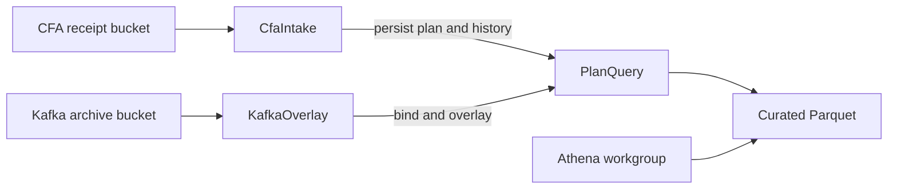

# Athena timetable lake

Architecture for a later S3 / Glue / Athena timetable lake that follows the live-sched ideas. This file is the product of this piece of work. It names the first ingest and the first cheap lookups so a later implementer can build them without reopening those decisions.

These resources are **named, not created** here. There is no running lake, Glue job, or CI in this piece of work.

Audience: Later Implementer. Re-enter by heading.



Text fallback: CfaIntake reads the CFA receipt bucket and persists current-plan grains through PlanQuery. KafkaOverlay writes every message to a separate archive bucket, then binds and projects overlay through PlanQuery. PlanQuery is the only writer of curated Parquet. Athena reads those tables. CfaIntake and KafkaOverlay do not call each other.

## Environments

Every logical S3 location, Glue database, and Athena workgroup is qualified with `{env}` in `{dev, staging, prod}`.

Promote cadence: merge to `main` may roll staging. Production needs a separate human approval and a rollback path that must be tested before a prod cut. This file names that obligation; it does not prove a test already ran.

CFA receipt and Kafka archive are **separate buckets**. Receipt is the drop zone shared with the external CFA supply system. Curated Parquet is a third location.

Example strings (author choice; replace if a later env already uses another naming scheme):

| Location | Kind | Example |
|----------|------|---------|
| CFA receipt | S3 bucket | `s3://uk-rail-tracker-cfa-receipt-{env}/` |
| Kafka archive | S3 bucket | `s3://uk-rail-tracker-kafka-archive-{env}/` |
| Curated Parquet | S3 prefix | `s3://uk-rail-tracker-lake-{env}/curated/` |
| Glue database | Glue | `uk_rail_tracker_{env}` |
| Athena workgroup | Athena | `uk-rail-tracker-{env}` |

These objects do not exist yet. Do not put Kafka keys, Darwin keys, or long-lived AWS access keys in this file or in later architecture text. Later runtime secrets stay in gitignored `.env`. Cloud controls (KMS, bucket policies, workgroup encryption) are listed under Deferred.

## CFA receipt → validate → apply

CfaIntake owns this door. It shapes CIF/CFA records into journey, calling-point, and service_day grains and applies the STP winner `C` then `O` then `P` then `N`. PlanQuery only persists already-shaped rows. Object-store clients stay out of CIF parsers. Do not import `schedule_poc`.

### Receipt location

Env-qualified S3 bucket `s3://uk-rail-tracker-cfa-receipt-{env}/`. The supplier drops one zip object. The raw zip stays as the replay source after accept, refuse, or error.

### Validate

If the zip contains an **MCA** member, treat it as a **full update** (MCA wins if CFA is also present). Else expect **exactly one CFA** member. If there is no MCA and no CFA, log an error, leave the current plan and feed sequence unchanged, and keep the raw zip.

CFA sequence (CFA path only):

- Sequence is the three-digit run in HD Current File Reference **columns 33–39**.
- Zip basename is never the sequence.
- Member-name sequence fallback is forbidden.
- Expected code is stored previous plus one, modulo 1000, zero-padded.
- Empty store seeds `990`.
- Refuse when that HD field has no three digits.

MCA path does **not** run those sequence checks. After an MCA accept, **clear FeedSequence** so the next CFA uses seed `990`. Do not set FeedSequence from MCA HD and do not leave a stale `currentCode`.

Empty-lake identities and the CRS/TIPLOC map enter with the **MCA full update** into the same current-plan grains (same CIF identity and LM persist rules). CFA-only silence on first identities is forbidden.

### Refuse

These paths are fail-closed. Words: **refuse**, **unchanged**, **reason**, **raw zip stays**.

| Reason | Current plan | FeedSequence | Record |
|--------|--------------|--------------|--------|
| Sequence mismatch (CFA path) | unchanged | unchanged | expected and actual codes |
| Zero CFA members (and no MCA) | unchanged | unchanged | validation reason |
| More than one CFA member (and no MCA) | unchanged | unchanged | validation reason |
| HD field has no three-digit run (CFA path) | unchanged | unchanged | validation reason |
| Neither MCA nor CFA | unchanged | unchanged | error log |

No PlanQuery entity writes on refuse.

### Accept / apply

CIF identity is `(train_uid, run_date, stp_indicator)`.

`service_guid` is `SVC-` plus that triple as `{train_uid}-{run_date}-{stp_indicator}` (example: `SVC-C12345-261020-P`). Same CIF triple always yields the same guid. Origin, dest, and booked times are attributes, not part of the guid. Do not use the live-sched origin/dest/time form.

LM persist: skip non-delete drafts whose TOC is not `LM`. Deletes follow identity, not TOC.

CFA accept applies incremental `N` / `R` / `D` for TOC `LM` only.

MCA full update replaces Journey booked identity columns, CallingPoint booked times, and ServiceDay, and **writes** LocationMap.

Publish set (atomic persist into PlanQuery):

| Path | Journey booked | CallingPoint booked | ServiceDay | ApplyHistory | LocationMap | Overlay | ServiceAlias | Journey.status | CallingPoint forecast | FeedSequence |
|------|----------------|---------------------|------------|--------------|-------------|---------|--------------|----------------|----------------------|--------------|
| Refuse | unchanged | unchanged | unchanged | unchanged | unchanged | unchanged | unchanged | unchanged | unchanged | unchanged |
| CFA accept | replace | replace | replace | append | intact | merge-preserve | merge-preserve | merge-preserve | merge-preserve | advance |
| MCA full update | replace | replace | replace | append | write | merge-preserve | merge-preserve | merge-preserve | merge-preserve | clear (next CFA seeds 990) |

Overlay, rid aliases, journey status, and per-stop forecast columns are **merge-preserved**. Daily CFA must not wipe live overlay the way live-sched `load` deletes the SQLite file.

### Apply history

Glue table `apply_history`. After accept, Athena holds the current plan plus history of: sequence, total / new / override / duplicate / delete counts, and identities changed. Identities changed are CIF triples `(train_uid, run_date, stp_indicator)`, not `service_guid`. Not a full versioned copy of every journey row after every file. Raw zips remain the replay source.

### Publish and failure

An accepted apply is **one atomic** published current-plan plus history update. A mid-apply failure leaves the previous plan queryable and writes no partial grain from the failed apply. Kafka overlay is **not** in this transaction.

## Cheap lookups

File layout: **Parquet** under `s3://uk-rail-tracker-lake-{env}/curated/{grain}/`. One Glue table per grain in database `uk_rail_tracker_{env}`:

`journey`, `calling_points`, `service_day`, `overlay`, `apply_history`, `service_aliases`, `location_map`.

Partition keys skip unrelated **dates** and **TOCs**. Overlay types are skipped by **column projection** on one overlay row, not by partitioning on type.

Station-plus-time-window is **not** a cheapest-scan target (see Deferred).

Exact four-item set:

1. Journey by CIF identity `(train_uid, run_date, stp_indicator)` or `service_guid`
2. Calling points `(service_guid, seq)`
3. Service day after STP resolution `(train_uid, calendar_date)` — winner `C` then `O` then `P` then `N`
4. Live overlay — columns under Kafka archive/overlay

This chapter names partition keys and projected columns for items 1–3. Item 4 is listed here and specified in the Kafka chapter.

| Lookup | Glue table | Partition keys | Prefix / grain | Projected columns |
|--------|------------|----------------|----------------|-------------------|
| CIF identity / `service_guid` | `journey` | `toc`, `run_date` | `curated/journey/toc=…/run_date=…/` | `service_guid`, `train_uid`, `run_date`, `stp_indicator`, `toc`, `origin_crs`, `dest_crs`, `status` |
| Stop sequence | `calling_points` | `toc`, `run_date` | `curated/calling_points/toc=…/run_date=…/` | `service_guid`, `seq`, `crs`, `booked_arrival`, `booked_departure` |
| Service day | `service_day` | `toc`, `calendar_date` | `curated/service_day/toc=…/calendar_date=…/` | `train_uid`, `calendar_date`, `service_guid`, `cancelled` |
| Live overlay | `overlay` | see Kafka chapter | — | see Kafka chapter |

`toc` and `run_date` / `calendar_date` are stored on calling-point and service-day files so Athena can skip without joining every journey.

### Worked example — plan lookups

One train, one calendar date. TOC `LM`, `train_uid` `C12345`, `run_date` / `calendar_date` `261020`, `stp_indicator` `P`, `service_guid` `SVC-C12345-261020-P`.

```text
journey:
  path   curated/journey/toc=LM/run_date=261020/
  where  service_guid = 'SVC-C12345-261020-P'
         or (train_uid = 'C12345' and run_date = '261020' and stp_indicator = 'P')
  cols   service_guid, train_uid, run_date, stp_indicator, toc, origin_crs, dest_crs, status

calling_points:
  path   curated/calling_points/toc=LM/run_date=261020/
  where  service_guid = 'SVC-C12345-261020-P'
  cols   service_guid, seq, crs, booked_arrival, booked_departure
  order  seq

service_day:
  path   curated/service_day/toc=LM/calendar_date=261020/
  where  train_uid = 'C12345' and calendar_date = '261020'
  cols   train_uid, calendar_date, service_guid, cancelled
  note   service_guid is the STP winner C then O then P then N
```

### Fixture query

A later query-contract test for this train on this date must **not** scan every journey file group or every Kafka archive object. It reads only the `toc=LM` + date partitions above, plus the overlay partition in the Kafka chapter.

## Kafka archive/overlay

KafkaOverlay owns archive and the three overlay projections. Fail-open after the archive object exists: classify or overlay persist failure is logged, consuming continues, and no overlay row is required for that message. Overlay is outside the CfaIntake transaction.

### Archive-before-classify

Every Kafka message, including undecodable payload, writes first to `s3://uk-rail-tracker-kafka-archive-{env}/`. A later classify or apply failure does **not** erase that object. Reserved types stay in the archive. Nothing is dropped at the door.

### Overlay apply

Project only when the message binds to a journey that **already exists**.

| Type | Effect | Booked times |
|------|--------|--------------|
| `TS` | Update forecast arrival and departure on the overlay row (and matching calling-point forecast columns if the message has per-stop times) | unchanged |
| `schedule` | Write `schedule_payload` on the same overlay row | unchanged; does not rewrite booked rows |
| `deactivated` | Set overlay `deactivated` and Journey.status | unchanged |

Queryable overlay is **one current row** per `(train_uid, calendar_date)` with columns `forecast_arrival`, `forecast_departure`, `deactivated`, `schedule_payload`. Last successful overlay persist wins: a later bound `TS`, `schedule`, or `deactivated` replaces the matching columns on that row. `overlayType` is not an identity or partition key.

Per-stop `forecast_arrival` / `forecast_departure` on `calling_points` are persist details merge-preserved on CFA/MCA publish. The cheapest overlay lookup is the overlay row, not a rescan of calling points.

### Bind keys

Try Darwin **`rid` first**. If missing, bind via **`service_day`** `(train_uid, scheduled start date)`. **Log** when the fallback is used and when both miss.

A miss: keep the archive object, create **no** journey, leave booked times unchanged. Forbid a UID-wide `list_journeys()` scan.

`service_aliases` identifier is `(alias_type, alias_value)`. Columns: `alias_type`, `alias_value`, `service_guid`. Darwin `rid` maps as `alias_type = rid`, `alias_value = <Darwin rid>`. When a message carries `rid` and bind succeeds (rid hit or service_day fallback), write that alias so later messages can bind rid-first.

### Reserved types

Archived, not queryable overlay, not dropped: `association`, `scheduleFormations`, `formationLoading`, `serviceLoading`, `trainOrder`, `OW`, `trainAlert`, `trackingID`, `alarm`, `stationInformation`.

### Overlay cheap lookup

Fourth item in Cheap lookups. Partition keys **inherit the service-day date/TOC keys**: `toc`, `calendar_date`. Overlay-type skip is column projection (`forecast_*` vs `deactivated` vs `schedule_payload`), not a type partition.

| Lookup | Glue table | Partition keys | Prefix / grain | Projected columns |
|--------|------------|----------------|----------------|-------------------|
| Live overlay | `overlay` | `toc`, `calendar_date` | `curated/overlay/toc=…/calendar_date=…/` | `train_uid`, `calendar_date`, `forecast_arrival`, `forecast_departure`, `deactivated`, `schedule_payload` |

Worked example (same train and date as Cheap lookups):

```text
overlay:
  path   curated/overlay/toc=LM/calendar_date=261020/
  where  train_uid = 'C12345' and calendar_date = '261020'
  cols   train_uid, calendar_date, forecast_arrival, forecast_departure, deactivated, schedule_payload
```

Booked times for the same train come from `journey` / `calling_points` in the plan partitions, not from this row.

## TOC extension

First queryable population is London Midland (`LM`) only.

Other TOCs later use the **same** receipt location, HD sequence (columns 33–39), CIF identity, calendar / STP winner, and refuse/accept rules. No new receipt bucket and no new sequence mechanism.

Until then: non-delete drafts whose TOC is not `LM` are skipped; deletes follow identity, not TOC.

## Later package layering

When code is written later, lake / transform / ingest lives in a **sibling package under `server/`** with its own `pyproject.toml` and tests. Do not add Athena or S3 clients inside `live_sched`. Do not import `schedule_poc`. Object-store and query-engine clients stay out of CIF parsers and the repository layer.

Logical components (later **three independently deployable services**):

| Component | Role |
|-----------|------|
| CfaIntake | MCA-or-CFA zip door; fail-closed; shapes CIF/CFA; owns FeedSequence |
| KafkaOverlay | Archive-before-classify; bind; three overlay types; writes rid aliases; fail-open after archive |
| PlanQuery | Sole persist of curated Parquet; Glue / Athena names |

CfaIntake and KafkaOverlay each call PlanQuery synchronously. Those runtime call shapes are for a later intent; this file is the document contract.

Error policy: fail-closed on CFA / sequence intake; fail-open on Kafka overlay after the archive object exists.

## Deferred / not in this document

- KMS, bucket policies, and Athena workgroup encryption (later NFR / infrastructure; not created here)
- Queryable overlay for reserved Kafka types
- Station + time-window as a cheapest Athena scan
- Full versioned journey history after every CFA
- Runtime ingest, Glue jobs, buckets, or CI in this piece of work
- Android / OpenLDBWS changes, or a pointer from `docs/architecture.md`
- Exact `SVC-` suffix if a later implementer prefers a hash of the same CIF triple instead of the concatenated form above
- Which reserved Kafka type is projected first, when a later intent does that
