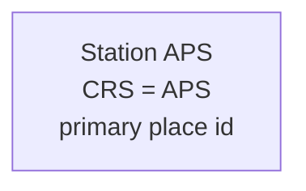
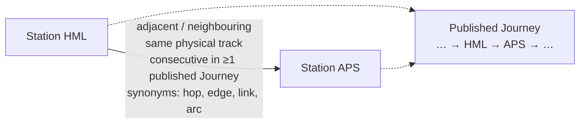
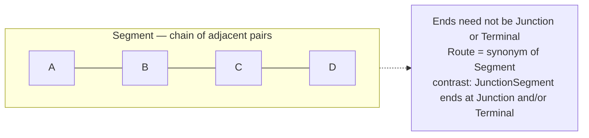
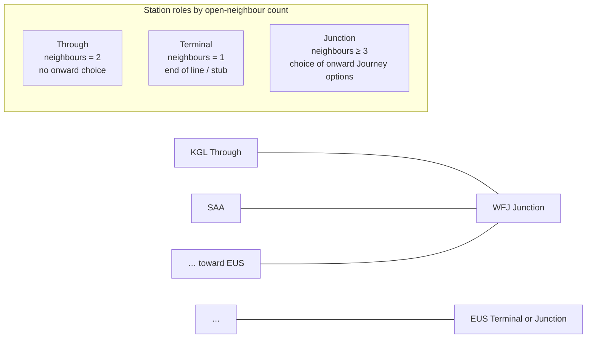
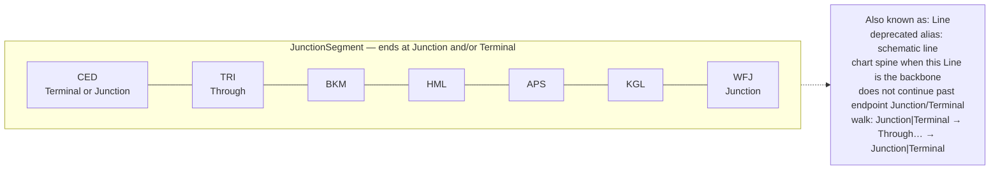
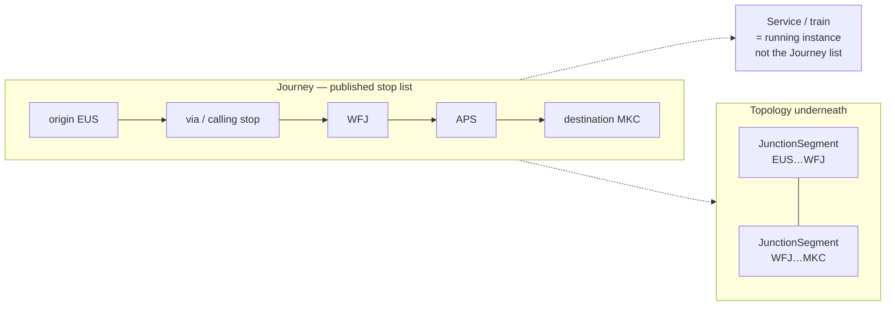
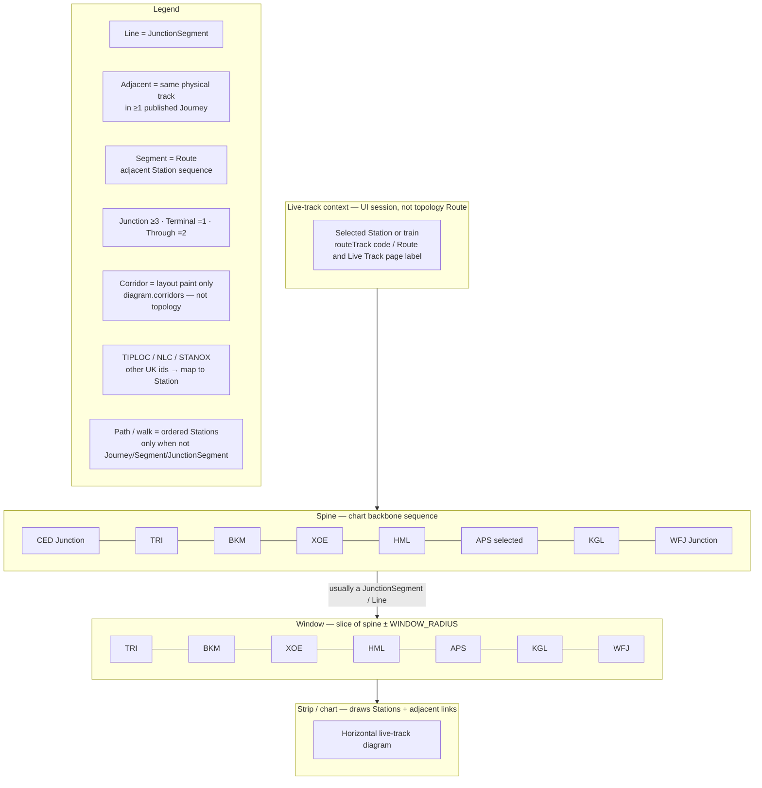

# KDD-002 — Project terminology map (graphical + canon)

Project-wide names for places and paths. **Diagrams are normative** for the build-up; code and older docs migrate toward these terms over time.

## Glossary

| Term | Quick read |
|------|------------|
| **Station** | Place; primary id is a **CRS**. |
| **Adjacent / neighbouring** | Two Stations on the **same physical track**, evidenced as consecutive stops in **at least one published Journey**. |
| **Through Station** | Open neighbours = **2** (no choice; walk continues). |
| **Terminal** | Open neighbours = **1** (end of the line / stub). |
| **Junction** | Open neighbours ≥ **3** (choice of onward direction). |
| **Segment** / **Route** | Synonyms: ordered chain of adjacent Station pairs (**not** required to end at Junction/Terminal). |
| **JunctionSegment** | Segment/Route whose ends are **Junction and/or Terminal** (aliases: **Line**, schematic line; chart **spine** when line-sourced). |
| **Journey** | Published origin → calling stops → destination. |
| **Live-track context** | UI tracking session for a selected Station or train (`routeTrack` / “Route & Live Track” page) — **not** the topology term Route. |

## 1 — Station

Text: A **Station** is a place identified primarily by a three-letter **CRS** (e.g. `APS`).

## 2 — Adjacent / neighbouring

Text: **Adjacent / neighbouring** always means two Stations on the **same physical track**, reflected as consecutive stops in **at least one published Journey**. Graph synonyms (hop, edge, link, arc) are implementation wording only. Do not use **section** for CRS-pair topology. Code `StripSegment` draws one adjacent link on the strip — migrate naming over time.

## 3 — Segment (not endpoint-bounded)

Text: A **Segment** (synonym: **Route**) is an ordered sequence of Stations joined by **adjacent** pairs, with **no** requirement that ends are Junction or Terminal. A **JunctionSegment** is the special case that **is** bounded by those endpoints. Prefer either name in prose; do not use **Route** for the live-track UI session (that is **live-track context**).

## 4 — Through, Terminal, Junction

Text: **Junction** means onward **choice** (degree ≥ 3). **Terminal** means degree 1. **Through** means degree 2. Code today often folds Junction∪Terminal into one `isJunction` (neighbours ≠ 2) for walk cutting — migrate names toward this split.

## 5 — JunctionSegment

Text: A **JunctionSegment** is a **Segment** whose ends are **Junction and/or Terminal**. Through Stations lie between. Stations beyond an endpoint belong to a different JunctionSegment.

## 6 — Journey

Text: A **Journey** may cross several JunctionSegments. **Calling stop / calling point** = board/alight; pass-through is schedule data, not a separate topology type. **Via** = Station between origin and destination on the Journey.

## 7 — Composite: chart, window, live-track context

Text: Selecting a Station opens a **live-track context** (code `routeTrack`; page title may still say “Route & Live Track”). The chart **Window** is cut from a **Spine** (usually a **JunctionSegment** / **Line**, which is a kind of Segment/Route). The **strip** renders Stations and adjacent links inside that Window. See [KDD-001](001-live-track-station-chart-window.md) for window/clamp algorithm detail.

## Leftover dictionary

Terms that did not need a separate figure:

| Term | Project meaning |
|------|-----------------|
| **TOC line** | Marketing/operator “line” name — only when explicitly labelled; not **Line** / JunctionSegment. |
| **Pass** | Schedule run-through at a Station without a public call (contrast calling stop). |
| **isJunction (code)** | Today: neighbours ≠ 2 (Junction ∪ Terminal ∪ isolated). Prefer the split names in new prose; rename when migrating. |
| **“Route & Live Track”** | Product/page label for the live-track context — not the topology synonym **Route** (= Segment). |

## Migration

New prose and new code use the **New** column. Existing identifiers stay until deliberately renamed. [KDD-001](001-live-track-station-chart-window.md) keeps the window algorithm; names resolve here.

### Prose / concept

| Old | Migrates to |
|-----|-------------|
| Two-station “segment” / strip edge (topology sense) | **Adjacent / neighbouring** |
| Sequence of stations (informal “route” / “path” on track) | **Segment** / **Route** (synonyms) |
| Schematic line / `diagram.lines` entry (concept) | **Line** = **JunctionSegment** |
| Junction meaning “neighbours ≠ 2” (branch **or** end) | Split: **Junction** (≥3), **Terminal** (=1), **Through** (=2) |
| “Route” as the live-track page / tracking session | **Live-track context** (not topology **Route**) |
| Corridor as a topology path | Do not — **corridor** stays **layout paint only** |
| Path / walk when Journey or Segment/Route applies | Prefer **Journey** or **Segment** / **Route** / **JunctionSegment** |
| Section (CRS-pair) | **Adjacent / neighbouring** |

### Code / identifiers (when renamed)

| Old identifier | Migrates toward |
|----------------|-----------------|
| `StripSegment` | Type/name for one **adjacent** link on the strip |
| `diagram.lines` / schematic line fields | **JunctionSegment** / **Line** naming |
| `isJunction` (neighbours ≠ 2) | Helpers or names for **Junction** / **Terminal** / **Through** (or “walk endpoint” = Junction∪Terminal) |
| `spine*` / spine path vars | **Spine** (chart backbone) or **JunctionSegment** when line-sourced |
| `routeTrack` / route live page symbols | **Live-track context** naming (keep UI string “Route & Live Track” until product copy changes) |
| `corridor` / `diagram.corridors` | Unchanged meaning: layout only — do not repurpose as Segment/Route |
