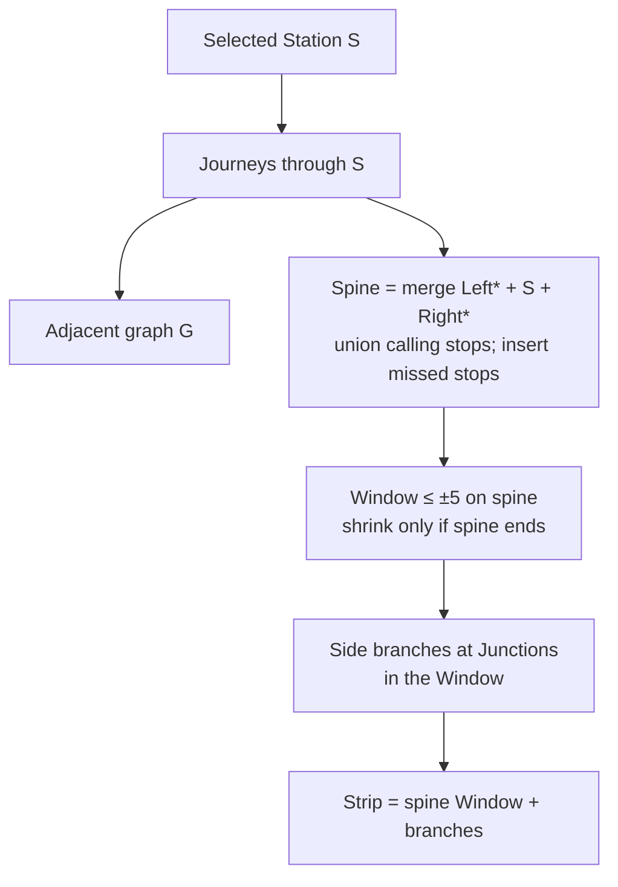
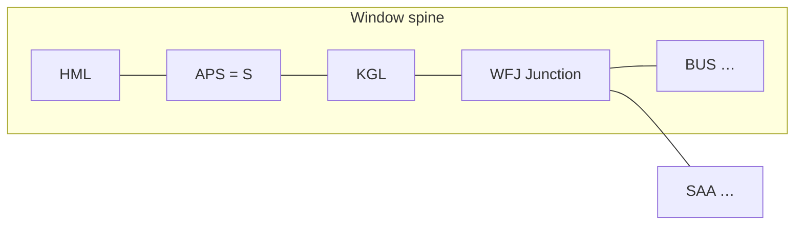

# KDD-003 — Journey-based chart Stations (station tap)

**Intent:** Make the live-track strip Station list match how people think about the network: *trains that call here*, then *a few stops either side* — not “one JunctionSegment that stops at the next Junction.”

Uses [KDD-002](002-terminology-map.md) terms. Updates the **station-tap window rule** in [KDD-001](001-live-track-station-chart-window.md). Entry path stays as in KDD-001; **spine construction, window, and Junction side branches** change. **Status: implemented** (`journeySpine.ts` + station branch of `resolveRouteWindow`).

## Glossary

| Term | Meaning here (see also KDD-002) |
|------|----------------------------------|
| **Selected Station** | Station tapped on Network overview (`S`). |
| **Live-track context** | UI session for that tap (`routeTrack`). |
| **Journey** | Published origin → calling stops → destination. |
| **Journeys through S** | Journeys that include `S` as a **calling stop**. |
| **Adjacent graph** | Undirected graph: Stations linked when they are consecutive calling stops on at least one Journey through `S`. |
| **Segment / Route** | Ordered adjacent Station chain (KDD-002 synonyms). |
| **Spine** | **Merge** of Journeys through `S` into one ordered Segment through `S` (union of calling stops; see Step 3). |
| **Side branch** | Alternative Segment leaving the spine at a **Junction**, from other Journeys through `S`. |
| **WINDOW_RADIUS** | **5** — target Stations either side of `S` on the spine. |
| **Window** | Contiguous spine slice around `S` (up to ±5), plus any side branches attached inside that slice. |

## Why change KDD-001

KDD-001 picks the longest **JunctionSegment** / **Line** through `S`, then windows ±5. That **clamps at Junction/Terminal**, so e.g. `APS` often stops at `WFJ` and never shows London-side Stations even when Journeys continue through. It also drops Stations that some services call at but the chosen Line omits.

KDD-003 **merges** Journeys through `S` so skipped calls reappear, continues past Junctions while the merged spine has onward stops, and draws **side branches** for alternatives at Junctions.

## Algorithm (station tap)

```text
S = selected Station
1. J = Journeys through S
2. G = Adjacent graph from J
3. Spine = merge of Journeys through S   // union ordered through S
4. Window = up to ± WINDOW_RADIUS on Spine around S
   — shorten a side only when that side has no further spine Stations (Terminal / end)
5. At each Junction on the Window spine, attach Side branches from J
6. Strip = Window spine + Side branches
```

### Step 1 — Journeys through S

Include a Journey iff its published calling-stop list contains `S`.

- **In:** public calling stops.  
- **Out (v1):** pass-only / non-public timing points unless product later says otherwise.  
- **Source (v1):** same day/network bundle already backing the live-track context. Exact query API is an implementation detail.

### Step 2 — Adjacent graph

From every Journey in `J`, for each consecutive calling-stop pair `(A, B)`:

- `A` and `B` are **adjacent** (KDD-002).
- Add both to the station set; add undirected edge `A—B` to `G`.

### Step 3 — Spine = merge of Journeys through S

The spine is **not** a single Journey and **not** a JunctionSegment. It is one ordered **Segment / Route** through `S` built by merging all Journeys in `J`.

**Split each Journey at S**

- `Left(j)` = calling stops of `j` strictly before `S`, in journey order toward `S` (so the stop next to `S` is last).  
- `Right(j)` = calling stops of `j` strictly after `S`, in journey order away from `S`.

**Merge rule (each side)**

Merge all `Left(j)` into one `Left*`, and all `Right(j)` into one `Right*`, so that:

1. **Union:** if any Journey through `S` calls at a Station on that side, it appears on the merged side (a Journey that “misses” a stop does not remove it).  
2. **Order:** relative order from every Journey is respected when acyclic — if every Journey that contains both `A` and `B` on that side visits `A` before `B`, then `A` before `B` on the merge.  
3. **Insert:** if Journey₁ has `… → HML → APS` and Journey₂ has `… → HML → XOE → APS`, the merge includes `… → HML → XOE → APS`.  
4. **Conflict / diverge:** when two Journeys disagree on order or take different next Stations after a shared Station (a **Junction** fork), keep one chain on the spine (deterministic: prefer the next Station that appears on more Journeys through `S`; ties → lexicographically smaller CRS) and record the other onward Segment as a **candidate side branch** at that Junction (Step 5).

**Spine**

```text
Spine = reverse(Left*) + [S] + Right*
```

If `J` is empty: fall back to KDD-001 `corridorThroughStation` so the page never goes empty (no merge, no side branches).

### Step 4 — Window: ±5, shrink only at end of spine

On the spine, find index of `S`. Target

`[index − WINDOW_RADIUS, index + WINDOW_RADIUS]`

- **Do not** cut the window short because a **Junction** sits inside the range while more spine Stations continue beyond.  
- **Do** shorten a side below 5 only when that side of the spine has fewer than 5 Stations left — i.e. a **Terminal** / stub / end of the merged Segment (no onward stops on the spine).

Example: merged spine `… → APS → KGL → WFJ → BUS → …`. Selecting `APS` still walks past `WFJ` for up to five calling stops. If the London side only has two Stations before the spine ends, show those two — not an empty pad.

### Step 5 — Side branches at Junctions

For each **Junction** Station `U` that lies on the **Window** spine:

1. From `G` and Journeys in `J`, find Adjacent neighbours of `U` that are **not** the spine’s predecessor/successor at `U` (onward alternatives).  
2. For each such alternative neighbour `V`, grow a **side branch** Segment along Journeys through `S` that use `U → V` (or `V → U`), away from the spine.  
3. Branch length (v1): include Stations along that alternative up to the remaining budget of `WINDOW_RADIUS` hops from `S` (graph/calling distance via `U`), or until that branch hits another Junction/Terminal — whichever comes first. Do not re-merge branch Stations onto the main spine.

**Render:** main strip = Window spine (horizontal). Side branches leave the spine at `U` (e.g. spur / second rail) so the Abbey line at `WFJ` can appear while WCML continues on the spine.

### Step 6 — Strip model

- `routeLive.window` = ordered Window spine Stations.  
- `routeLive.sideBranches` (new) = list of `{ junctionCrs, stations[] }` for branches attached inside the window.  
- Train markers: place on spine or on a side branch when the train’s live place falls on that Segment (implementation detail).

## Picture





Text: Merged spine continues through `WFJ`; Abbey (or other) alternative is a **side branch** at the Junction. ±5 only shortens when that side of the spine has no further Stations.

## Relation to KDD-001 / KDD-002

| Topic | KDD-001 (current code) | KDD-003 (proposed) |
|-------|------------------------|--------------------|
| Spine source | Longest JunctionSegment / Line | **Merge** of Journeys through `S` |
| Missed calling stop | Omitted if not on chosen Line | **Included** if any Journey through `S` calls there |
| Clamp | At Junction/Terminal end of Line | Only when merged spine has **no onward** Station that side |
| Junction | Ends the Line / window | Spine may continue; **side branch** for alternatives |
| Adjacent | From corridors/lines | From Journeys through `S` |
| WINDOW_RADIUS | 5 | 5 target either side (unchanged) |

## Out of scope (v1)

- Replacing train-tracking window rules (still KDD-001 train path).  
- Fancy layout for crossing/rejoining branches beyond a simple spur at the Junction.  
- Pass-only timing points on the spine.  
- Code rename of `spine*` / `routeTrack` (see KDD-002 migration).

## Invariants

- Window spine always includes `S` when resolution succeeds.  
- If any Journey through `S` calls at `T` on a side of `S`, and `T` lies within the ±5 spine walk (or closer because the side is short), `T` is eligible for the spine merge — a different Journey omitting `T` does not remove it.  
- A side has fewer than 5 Stations **only** when the merged spine ends that side (Terminal / no onward spine Station).  
- Every side branch attaches at a **Junction** on the Window spine and represents an onward alternative evidenced by Journeys through `S`.
