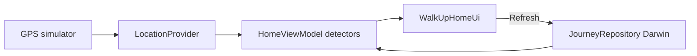

# In-app simulated test journey

How to watch the commute pipeline on Home with **fake GPS** and **live Darwin**. Pull-to-refresh / Refresh must always hit the real OpenLDBWS clients so delay, cancel, and missing-service responses show in the same UI as a real trip.

This is not a stubbed journey player. Only [`LocationProvider`](../android/app/src/main/java/com/ukrailtracker/app/domain/location/LocationProvider.kt) is overridden.

See [state-model.md](state-model.md) for Away → finish. See [architecture.md](architecture.md) for the `includeSimulator` source set.

---

## Seam



| Input | Source | Stubbed in-app? |
|-------|--------|-----------------|
| Lat / lng / speed | `WalkUpLocationSimulator` via `SimulatingLocationProvider` | Yes, while a sim phase is active |
| Favourite boards, platform, `GetServiceDetails`, countdown | `JourneyRepository` / departure repo | **No** |

Do not wrap Darwin for this path. JVM unit tests of `Detect*` may use fixtures; the debug Home journey must not.

`HomeViewModel.refresh()` reloads boards, at-station destinations, and (if pinned) `getServiceDetails`, then samples location. The location sample may still be simulated; the API calls are not.

---

## Dual clocks

Two clocks run at once. That is intentional.

| Clock | Drives | Compressed today? |
|-------|--------|-------------------|
| GPS sim | Walk-up presence (Away → Near → At). After debug pin: calling-point motion and dwells | Walk-up only (~2 min for 300 m). On-train GPS follows **real timetable gaps** |
| Wall / Darwin | Boards, platform watch, ET/AT, countdown, arrival buzz, Refresh | Never |

Compressed (or debug) GPS can sit at the destination CRS while Darwin still says “32 min”. Refresh must show that live ET, not a fake time that matches the fake GPS.

Journey **finish** can still come from GPS `Confirmed` at the favourite CRS, or from Darwin publishing an actual arrival. If the real service is late, cancelled, or 404s, the on-train UI shows `errorMessage` / `serviceMissing` as in production.

**Boarding match** uses wall-clock vs departure labels (−8 / +3 minutes). Pick a **live** favourite-bound service due around now. A train that left 20 minutes ago will not match `DetectBoarding` (and today the debug icon **bypasses** that matcher — see below).

---

## Build

GPS simulation is opt-in. Without it, `DebugWalkUp` is a no-op and simulator classes are not compiled.

```bash
# Gradle
./gradlew :app:installDebug -PincludeSimulator=true

# Or deploy scripts
./android/scripts/deploy-emulator.sh --simulator
./android/scripts/deploy-phone.sh --simulator
```

`INCLUDE_SIMULATOR=1` in the environment has the same effect.

---

## How to run today (Home app bar)

With a simulator build, Home shows a walk / train icon. Taps advance phases. Darwin stays live on every Refresh.

1. **Idle → Walking.** Tap the walk icon. Seeds favourites **APS** and **EUS** plus weekday commute windows. GPS walks 300 m into Apsley over **~2 minutes** at walking speed. Home should move Near → At Apsley (or lock immediately if already inside the footprint after prepare).
2. **At station.** Usual at-station Home: favourite-bound trains from Darwin. **Refresh** if the board looks stale or empty. Select a service for platform watch; platform poll is live OpenLDBWS.
3. **On train.** Tap the train icon (only after a platform-watch service is selected). Debug loads **live** `GetServiceDetails`, builds GPS waypoints from calling-point lat/lng, **pins the service directly** (does not wait for leave-station motion or `BoardingPrompt`), and interpolates GPS along the route using **timetable `st` deltas** plus **60 s** dwells at intermediate stops.
4. **While riding.** Pull-to-refresh / Refresh still calls `GetServiceDetails`. Countdown and delay chips are Darwin. GPS motion is independent. End trip is the real Home action.
5. **Ready disembark.** When GPS reaches the last waypoint, tap to walk 300 m away (~4 minutes). Debug **clears the pin** (may skip a Darwin AT finish if you disembark first).

Active motion phases (walking / on-train / disembarking) ignore extra taps. The icon blinks while GPS is interpolating.

If `GetServiceDetails` fails or there are fewer than two geocoded calling points, the app shows an error snack and does not pin.

---

## What this does *not* exercise yet

| Production path | Debug today |
|-----------------|-------------|
| `DetectBoarding` (leave ≥400 m at ≥5 m/s for 8 s → prompt) | Bypassed: `DebugWalkUp` writes `PinnedJourney` itself |
| 60 s boarding auto-accept / Confirm / Not this train | Not used on the tap-to-board path |
| Faster-than-real-time on-train GPS | On-train follows wall-clock timetable length (a 40 min service takes ~40 min of GPS) |
| OS geofence ENTER | Not simulated; in-app walk-up is the detector |

You can still walk up with sim GPS, then **leave boarding to production** if you do not tap the train icon: stay At station, Refresh live boards, and (on a device with real motion) the real prompt can fire. The train icon is the shortcut that skips that.

---

## Later (not implemented)

- GPS **time scale** (N× interpolation). Keep sample `epochMs` and reported speeds (walk / train / stop m/s) on the wall clock so detectors and Darwin stay aligned. Do not virtualize countdown `Clock` while Refresh is live Darwin.
- Inject leave-station GPS after platform watch so **Home** owns pin via `BoardingPrompt`.
- 1× vs N× on the existing app-bar control.

Until then, the “real-time, unexpected API” run is: simulator walk-up + live Refresh + tap-to-pin + watch Darwin while GPS crawls the timetable.
