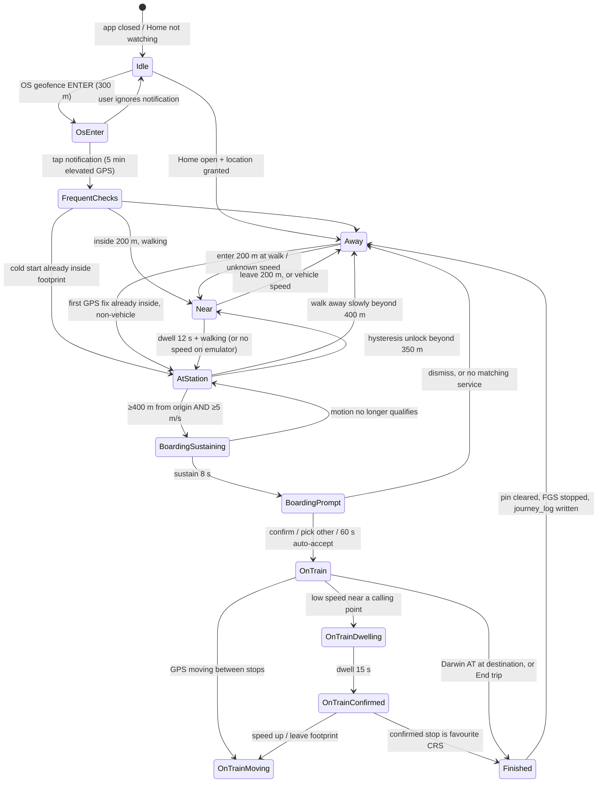

# Journey state model

How UK Rail Tracker moves from **idle (waiting for a station geofence)** through **walk-up**, **boarding**, **on-train tracking**, and **journey finish**.

The live commute pipeline (milestones M4–M6) is a chain of small state machines. OS geofences only **wake** the app. In-app GPS detectors are the source of truth for “are we at a station / on a train?”.

Primary types:

| Layer | Type | Role |
|-------|------|------|
| OS wake | Play Services geofence ENTER | Hint that the user may be near a station while the app is closed |
| Walk-up | `WalkUpPhase` | Soft geofence + walk/dwell lock of an origin station |
| Home presence | `WalkUpHomeUi` | What Home shows in the status bar and body |
| Boarding | `BoardingPhase` | Leave-station + train-like motion after a locked origin |
| Pin | `PinnedJourney` (DataStore) | Survives process death; starts the on-train session |
| On-train stop | `StationStopPhase` | Low-speed + proximity confirm of calling-point stops |
| Progress | `JourneyProgress` | Diagram, countdown, mismatch, destination-arrived |
| Finish | `journey_log` row | Snapshot for later Delay Repay (M7) |

---

## End-to-end pipeline



Home never treats OS ENTER as arrival. ENTER only posts a notification; tapping it opens Home and raises the in-app poll so `DetectWalkUpArrival` can confirm presence.

---

## 1. Idle — waiting for a geofence

**When:** the app is not actively sampling walk-up (closed, or Home without location). WorkManager still keeps a **moving window** of OS geofences armed.

### What is armed

Every **15 minutes** (`GeofenceRearmWorker`, battery-not-low), and on boot / package replace (`GeofenceBootReceiver`), `StationGeofenceController` registers:

- the **nearest 5** stations to the last known location
- plus **favourite** and **commute-window** stations that were not already in that set
- capped at **20** fences (`SelectGeofenceStations`)

Each fence is a **300 m** circle around the station centre (`StationGeofenceRegistrar.DEFAULT_RADIUS_METRES`). That is deliberately larger than the in-app walk-up radius (200 m) so ENTER can fire **before** a walk-up dwell lock.

Re-arm uses `setInitialTrigger(0)` so already-inside stations do **not** fire ENTER on every 15-minute refresh.

### Preconditions

- Foreground location (`ACCESS_FINE_LOCATION` or `ACCESS_COARSE_LOCATION`)
- Optional `ACCESS_BACKGROUND_LOCATION` so ENTER can fire while the app is closed
- If location is revoked, the scheduler **cancels** the periodic work

### What idle is *not*

Idle is not a `WalkUpHomeUi` value. When Home *is* open with permission, the matching presence is **Not at a station** (`WalkUpHomeUi.NotAtStation` / `WalkUpPhase.Away`).

---

## 2. OS ENTER — wake hint

**Trigger:** `GeofenceTransitionsReceiver` receives `GEOFENCE_TRANSITION_ENTER`.

**Skipped when:** a `PinnedJourney` is already stored (on-train session owns presence; proximity noise is ignored).

**Side effects:**

1. `GeofenceProximityNotifier` posts a high-priority notification: *“Near {station} — open to check trains”*, and vibrates.
2. Per-CRS **30 minute** cooldown so the same station does not spam.
3. Tap opens `MainActivity` with `ACTION_OPEN_HOME_FREQUENT_CHECKS`.

ENTER does **not** lock an origin, load favourite-bound boards, or start boarding detection.

---

## 3. Frequent checks — elevated GPS after a wake

**UI:** still `NotAtStation` / `NearStation` / `AtStation` as walk-up decides. The difference is **poll cadence**.

`HomeViewModel.onOpenedForFrequentChecks()` sets `frequentChecksUntilEpochMs` for **5 minutes**. During that window (and while at-station / boarding / on-train):

| Situation | Location poll |
|-----------|----------------|
| Idle Home, not watching a station | 10 s |
| Frequent-checks TTL, at station, boarding prompt | 4 s |
| On-train session | 5 s |

Samples use `forceRefresh = true` while watching so fused location is not stale last-known.

After 5 minutes, if walk-up never locked, polling falls back to 10 s. The OS fences remain armed independently.

---

## 4. Walk-up presence (`WalkUpPhase` → `WalkUpHomeUi`)

In-app detector: `DetectWalkUpArrival`. Speed is GPS-reported, or derived from consecutive samples (`resolveSpeed`). Vehicle speed (**≥ 8 m/s ≈ 29 km/h**) always resets to **Away**.

### 4.1 Away — not at a station

| | |
|--|--|
| Domain | `WalkUpPhase.Away` |
| UI | `WalkUpHomeUi.NotAtStation` (or `NeedsPermission` / `LocationUnavailable`) |
| Status bar | “Not at a station” |
| Home body | Usual contextual commute / favourite boards (M2) |

**Enter:**

- Location granted and first sample is outside 200 m
- Vehicle speed anywhere near a station
- User dismisses boarding, clears a manual origin, or a trip ends
- Walk-away after a locked origin (slow, beyond 400 m — see §5)

**Leave:**

- Distance to nearest station **≤ 200 m** at walking or unknown speed → **Dwelling**
- **Cold start:** first GPS fix inside 200 m at non-vehicle speed → **Arrived** immediately (`alreadyPresentOk`). No extra walk required so opening the app already on the platform works.

Drive-and-stop (known speed below walk-min after a vehicle reset) stays **Away** so parking next to a station does not count as walk-up.

### 4.2 Dwelling — near a station

| | |
|--|--|
| Domain | `WalkUpPhase.Dwelling` |
| UI | `WalkUpHomeUi.NearStation` |
| Status bar | “Near {name}” (amber), CRS + distance |
| Home body | Still usual Home boards |

**Enter:** inside 200 m from Away, and not a cold-start lock.

**Stay:** same CRS, still inside 200 m. Accumulates `sawWalkingPace` (0.28–2.0 m/s ≈ 1–7.2 km/h).

**Promote to Arrived** after **12 s** dwell if:

- walking pace was seen at least once, **or**
- no speed was ever reported (emulator geo fix)

**Leave to Away:** distance > 200 m, vehicle speed, or nearest CRS changes (dwell timer restarts on the new station).

### 4.3 Arrived — at station (origin locked)

| | |
|--|--|
| Domain | `WalkUpPhase.Arrived` |
| UI | `WalkUpHomeUi.AtStation` |
| Status bar | “At {name}” (cyan) |
| Home body | **Replaces** usual Home: favourite-bound trains from this origin for the next hour |

**Lock:** `lockedOrigin` stores CRS, name, lat/lng. Boarding detection starts watching this point. Walk-up hysteresis holds the lock until **350 m** (`lockHoldMetres`) so the status does not flap at the 200 m edge.

**On lock:**

1. Load favourite destinations (`LoadFavouriteBoundDepartures`) excluding the current CRS.
2. Cache `BoardingServiceSnapshot`s for later matching (no extra network at board time).
3. Raise GPS poll to 4 s.

**Hysteresis unlock:** beyond 350 m, if still ≤ 200 m of *some* station, drop to Dwelling; otherwise Away. A different CRS inside 200 m also restarts Dwelling (do not silently swap origin).

**Manual override:** user picks a station (`setOriginOverride`). UI is `AtStation` with `manualOverride = true`. GPS walk-up is frozen until they tap GPS / clear override.

### At-station sub-state: platform watch

Not a separate presence. While `AtStation`, the user can select a favourite-bound service. Home polls that service until a **departure platform** appears, then vibrates once (`platformAppeared`).

Poll cadence tightens as departure approaches (60 s → 10 s). Clearing the watch or leaving the station cancels it.

---

## 5. Boarding (`BoardingPhase`)

Runs only while `lockedOrigin` is set and there is **no** pinned journey. Walk-up still updates in the background; if the user has already left Arrived, Home **keeps the last At-station UI** while boarding motion is being evaluated (`handleLeftOrWatching`).

### 5.1 Idle

Default after lock. Qualifying motion is **both**:

- distance from locked origin **≥ 400 m**
- speed **≥ 5 m/s ≈ 18 km/h** (needs a real speed reading; unknown speed never qualifies)

Slow walk-away (≥ 400 m but below board speed) is **not** boarding: origin is cleared and presence returns to **Not at a station**.

Still inside 400 m after leaving Arrived (platform shuffle, GPS jitter): keep last at-station UI and keep watching.

### 5.2 Sustaining

First qualifying sample starts an 8 s timer. If a later sample drops below the thresholds, return to Idle (timer does not accumulate). Home still shows At-station.

### 5.3 Triggered → boarding prompt

After 8 s of qualifying motion → `BoardingPhase.Triggered`.

`MatchBoardingCandidates.match` filters the cached favourite-bound services whose **effective departure** is within **8 minutes before** to **3 minutes after** the trigger time. Cancelled services are excluded.

**Assumption order:** lowest favourite rank (first favourite wins), then closest departure time, then scheduled label / service id.

| Match result | Behaviour |
|--------------|-----------|
| At least one candidate | `WalkUpHomeUi.BoardingPrompt` — “Leaving {origin}?” / “On the {HH:mm} to {dest}?” |
| None | Clear session → **Not at a station** (false positive / no favourite train) |

Location sampling **freezes** while the prompt is showing so walk-up cannot overwrite it.

**Prompt actions:**

| Action | Effect |
|--------|--------|
| Confirm | Pin assumed service, start on-train |
| Not this train | Show picker of co-departing alternatives (`showPicker = true`); auto-accept still targets the **assumed** service |
| Pick another | Pin that service |
| Dismiss | Clear lock, back to Away |
| **60 s timeout** | Auto-accept the assumed service |

Pin writes `PinnedJourney` to DataStore. `pinnedFlow` then starts the on-train session even if Home is recreated.

---

## 6. On-train (`WalkUpHomeUi.OnJourney`)

**Enter:** `beginOnTrainSession` after a pin (boarding confirm, auto-accept, or restoring a pin after process death).

Walk-up and boarding are suppressed for the rest of the trip. GPS samples go to `DetectStationStop` only.

**Side effects on enter:**

1. Presence becomes On-journey (progress diagram + countdown); status bar “On train to {dest}”.
2. `OnTrainTrackingService` foreground service (`location`, or `specialUse` under the debug GPS simulator) with an ongoing notification: *“On train to {dest} — {n} min”*.
3. `GetServiceDetails` loads calling points; each CRS is mapped to lat/lng from Room as `RouteStation`.
4. Darwin poll: **45 s** while moving, **60 s** while stopped/dwelling (per-minute ETA while at a station).
5. Location poll: **5 s**.

The pin **persists**. If Home is destroyed, the FGS keeps running; the next Home open re-attaches via `pinnedFlow`.

### 6.1 Station-stop machine (`StationStopPhase`)

Only calling points on **this** service are considered (not every nearby station).

| Phase | Meaning |
|-------|---------|
| `Moving` | Default. Speed above stop max, or not within 250 m of a route station. |
| `Dwelling` | Speed **≤ 1.5 m/s ≈ 5.4 km/h** and within **250 m** of a route station. 15 s timer. |
| `Confirmed` | Dwell held 15 s. That CRS is `confirmedStopCrs` for progress. |

Leaving the footprint or speeding up returns to **Moving**. A different nearby route CRS restarts Dwelling.

On **new** Confirmed CRS:

1. Refresh `GetServiceDetails` (Darwin AT/ET for this stop).
2. If CRS equals the pinned **favourite destination** → **finish the journey** (§7).

`stoppedAtStation` on the UI is true for both Dwelling and Confirmed. Status subtitle: “At {stop}” while stopped, otherwise “Next: {stop}”.

### 6.2 Progress diagram (`ComputeJourneyProgress`)

Calling points from origin to favourite destination are marked past / current / next.

- **Current stop:** last GPS-confirmed CRS if any, else the timetable stop before the next expected arrival.
- **Countdown:** minutes until destination **expected** arrival (never Darwin AT).
- **Fraction complete:** index along origin→destination.
- **Route mismatch:** confirmed stop is *ahead of* the timetable’s next expected calling point (not the expected stop, and not still dwelling at the previous one). Home shows an amber warning with the unexpected station name.
- **Approaching destination:** next stop CRS is the favourite.

Darwin publishing an **actual arrival (AT)** at the destination (`destinationArrived`) also finishes the trip, even if GPS has not confirmed the stop yet.

### 6.3 Arrival buzz

`ArrivalBuzzTracker` — only when approaching the destination. Vibrates at **3, 2, and 1 minute** remaining. Each threshold fires **at most once** per trip; if ETA slips later, that threshold is not re-armed.

---

## 7. Finished — journey complete

`tearDownOnTrainSession(clearPin = true, logJourney = true)` runs when:

| Cause | How |
|-------|-----|
| GPS arrival | Confirmed stop CRS = pinned destination |
| Darwin arrival | `destinationArrived` (AT / “On time” actual at destination) |
| Manual | Home **End trip** |

**Teardown:**

1. Cancel on-train Darwin poll.
2. If logging and a `JourneyOption` is in memory, write `journey_log` (`JourneyLogRepository.logFromOption`): delay, cancel flag, claim status `eligible` if cancelled or delay ≥ 15 min, else `not_eligible`.
3. Stop `OnTrainTrackingService` (drop the ongoing notification).
4. Clear `PinnedJourney` from DataStore.
5. Reset stop/buzz/route state; `alreadyPresentOk = true` so the next first fix can lock if the user is still on the platform.
6. Presence → **Not at a station**.

If `pinnedFlow` emits null because something else cleared the pin, teardown runs **without** writing a log (avoid double-insert). Clearing the pin for debug walk-up also skips the log.

After finish the OS geofence window is still armed; the next commute starts again from Idle / Away.

---

## Parallel machines (do not collapse them)

Home presence is a **projection** of several machines. They are not one enum.

```text
OS geofences (armed / ENTER)          — background, 300 m, wake only
        │
        ▼
WalkUpPhase  ──maps──►  WalkUpHomeUi
  Away                    NotAtStation / NeedsPermission / LocationUnavailable
  Dwelling                NearStation
  Arrived                 AtStation  (+ optional platformWatch)
        │
        ▼  (lockedOrigin)
BoardingPhase
  Idle / Sustaining       still AtStation UI
  Triggered               BoardingPrompt
        │
        ▼  (PinnedJourney)
WalkUpHomeUi.OnJourney  +  StationStopPhase (Moving / Dwelling / Confirmed)
        │
        ▼
journey_log + Away
```

**Ownership rule:** if `activePinned != null`, on-train owns GPS. Walk-up must not steal focus (a train passing through stations would otherwise look like a new walk-up).

### Implementing the state machine

This is the how-to for the recommendation in [architecture.md](architecture.md#commute-session-design-recommendation). The detectors are already pure; the work is **composition + effects at the edge**. Ship it in vertical slices and track them in [commute-session-slices.md](commute-session-slices.md).

#### 1. Events in, state out, effects as data

Treat the commute as:

```text
Event  →  reduce(session, event)  →  Transition(newSession, List<Effect>)
```

Events are things that happened: `LocationSample`, `DarwinOption`, `OpenedForFrequentChecks`, `ConfirmBoarding`, `EndTrip`, `Tick(now)`. `reduce` has no `Context`, no coroutines, no Retrofit. Effects are *intentions* (`Pin`, `ClearPin`, `StartTracking`, `StopTracking`, `Vibrate(3)`, `RefreshServiceDetails`, `WriteJourneyLog`). A thin interpreter in `HomeViewModel` (or `CommuteController`) runs them **after** the transition.

Idempotent transitions: applying the same sample twice must not double-pin or double-buzz. Effects should be derived from *edge* (Idle → Triggered), not from sitting in Triggered.

#### 2. Orthogonal regions, not a mega-enum

Do not flatten Away / Boarding / OnTrain / DwellingAtStop into one enum. Those are different timescales and inputs. Use a nested session so invalid combinations cannot be constructed:

```text
Session
├─ Presence     Away | Near | AtStation | BoardingPrompt
├─ Pin          None | Pinned(service)     // durable
├─ Motion       (only while AtStation) Idle | Sustaining
└─ Ride         (only while Pinned) Moving | Dwelling | Confirmed
```

Kotlin (slice 1 implemented in `CommuteSession.kt` / `reduce`; later slices add Confirming / OnTrain events):

```kotlin
sealed interface CommuteSession {
    data object Idle : CommuteSession
    data class Near(val dwelling: WalkUpPhase.Dwelling) : CommuteSession
    data class AtStation(val origin: LockedOrigin, val boarding: BoardingPhase = BoardingPhase.Idle) : CommuteSession
}

sealed interface CommuteEvent {
    data class Location(
        val sample: WalkUpSample,
        val nearest: StationWithDistance?,
        val speedMps: Double?,
        val alreadyPresentOk: Boolean = false,
    ) : CommuteEvent
    data class SetOriginOverride(val origin: LockedOrigin) : CommuteEvent
    data object ClearOverride : CommuteEvent
    data object PermissionLost : CommuteEvent
}
```

Keep calling the existing `next()` functions from `reduce`. One `reduce(session, event)` returns the new session. A library (XState, Redux) is optional; the pattern is not.

#### 3. One writer

GPS polls, Darwin callbacks, geofence taps, and buttons must all go through `reduce`. If Home, a Worker, and the FGS each mutate “are we on a train?”, you get split-brain (ENTER is already ignored when a pin exists — that is the right *policy*, expressed in the wrong *place*). Receivers only enqueue events.

#### 4. Time is an input

Dwells (12 s walk-up, 8 s boarding, 15 s stop), 60 s auto-accept, and 3/2/1 min buzz belong in reduce as comparisons against `now` / `sample.epochMs`. Tests can jump time; production uses wall clock. A `delay { confirmBoarding() }` job is the form that leaks across sessions.

#### 5. Side effects at the edge

| Kind | Example | Where |
|------|---------|--------|
| Pure | Away → Dwelling | `next()` / `reduce` |
| Effect | `OnTrainTrackingService.start`, DataStore pin, vibrate | interpreter |
| Projection | “On train to EUS”, diagram, `refreshing` | `toUi(session)` |

Darwin in-flight is **not** a presence state. Keep `refreshing` / `errorMessage` / `serviceMissing` on the on-train view model (or a nested `LoadState`), not as siblings of `Away`.

#### 6. Persist the session, not the sensors

| Durable | Ephemeral |
|---------|-----------|
| `PinnedJourney`, `journey_log` | `WalkUpPhase`, `BoardingPhase`, platform watch |

After a kill, restore **OnTrain** from the pin; everything else starts Away and re-locks from GPS.

#### 7. Test traces, not screens

Unit-test each `next()` with sample tables (already done). Add session-level traces:

```text
enter 180 m @ 1.2 m/s → Near
+12 s still there     → AtStation
+400 m @ 12 m/s × 8 s → Confirming(APS→EUS) + no pin yet
Confirm               → OnTrain + [Pin, StartFGS, FetchDetails]
```

Compose tests only check that `BoardingPrompt` renders Confirm. In debug builds, log `(event, from, to, effects)` — GPS bugs are otherwise undiagnosable.

#### What not to do

- One 40-value enum for the whole commute.
- Putting `GetServiceDetails` latency inside the FSM as a presence phase.
- DataStore-ing Dwelling so a process death “resumes” a 12 s timer.
- Treating OS geofence ENTER as Arrived (fences flap; dwell/speed filters exist for a reason).
- Virtualizing Darwin time so a compressed GPS ride and the countdown stay in lockstep — Refresh would lie. See [simulated-journey.md](simulated-journey.md).

`HomeViewModel` still holds `boardingPhase` / `activePinned` / jobs. Slice 1 moved walk-up presence into `reduce`; pinning and FGS stay in the interpreter until later slices.

---

## Thresholds (defaults)

| Constant | Value | Used by |
|----------|-------|---------|
| OS fence radius | 300 m | `StationGeofenceRegistrar` |
| OS re-arm period | 15 min | `GeofenceRearmScheduler` |
| OS ENTER notify cooldown | 30 min per CRS | `GeofenceProximityNotifier` |
| Frequent-checks TTL | 5 min | Home after notification tap |
| Soft walk-up radius | 200 m | `WalkUpConfig.geofenceMetres` |
| Walk-up lock hold | 350 m | hysteresis after Arrived |
| Walk min / max | 0.28–2.0 m/s | pedestrian entry |
| Vehicle reject | 8 m/s | reset walk-up |
| Walk-up dwell | 12 s | Away → Arrived via Dwelling |
| Boarding leave | 400 m | must leave footprint |
| Boarding min speed | 5 m/s | train-like motion |
| Boarding sustain | 8 s | Idle → Triggered |
| Match window | −8 / +3 min | departure vs board signal |
| Boarding auto-accept | 60 s | prompt timeout |
| Stop match | 250 m | calling-point proximity |
| Stop max speed | 1.5 m/s | dwelling on train |
| Stop dwell | 15 s | Dwelling → Confirmed |
| Arrival buzz | 3 / 2 / 1 min | approaching destination only |
| Geofence window | nearest 5 + always-on, max 20 | `SelectGeofenceStations` |

---

## Location and Darwin poll rates

| Mode | GPS | Darwin / board |
|------|-----|----------------|
| Idle Home | 10 s (cached last-known OK) | Home boards: pull-to-refresh / WorkManager 15 min |
| Frequent checks, at station, boarding | 4 s, force refresh | Favourite-bound board on lock; platform watch 10–60 s |
| On-train moving | 5 s | `GetServiceDetails` every 45 s |
| On-train stopped | 5 s | `GetServiceDetails` every 60 s, plus an immediate refresh on new Confirmed stop |

---

## Abort and override paths

| Event | Result |
|-------|--------|
| Location permission denied | `NeedsPermission`; geofence work cancelled |
| No GPS fix (and not already locked / on-train) | `LocationUnavailable` |
| No favourites (other than current CRS) | At-station empty state; boarding match will fail |
| Vehicle through a station | Walk-up stays Away |
| Slow walk-away after lock | Away, no prompt |
| Boarding with no matching favourite service | Away, no prompt |
| Dismiss boarding | Away |
| End trip | Finish with log |
| Debug walk-up prepare | Tear down any pin **without** log, reset to Away, elevate poll |
| Process death during on-train | Pin + FGS survive; Home re-attaches OnJourney |

---

## Debug GPS (does not replace Darwin)

An opt-in `includeSimulator` build injects lat/lng/speed through `LocationProvider` so you can watch this state model on Home without walking to a station. **Refresh and on-train polls still call live OpenLDBWS.** Debug tap-to-board pins directly and skips `BoardingPhase` / `BoardingPrompt`. How to run it, dual clocks, and what is deferred: [simulated-journey.md](simulated-journey.md).

---

## Persistence

| Data | Store | Lifetime |
|------|-------|----------|
| Armed OS fences | Play Services (device) | Until re-arm replaces them; re-registered on boot |
| ENTER notify cooldown | SharedPreferences | 30 min per CRS |
| Locked origin / walk-up / boarding phase | In-memory (`HomeViewModel`) | Lost on process death (re-detected from GPS) |
| Platform watch | In-memory | Lost on process death |
| Pinned service | DataStore `pinned_journey` | Until arrival / End trip / dismiss |
| Completed trip | Room `journey_log` | Until retention policy (M7) |

---

## Related code

| Concern | Location |
|---------|----------|
| OS arm / ENTER | `location/geofence/`, `worker/GeofenceRearm*` |
| Walk-up | `DetectWalkUpArrival` |
| Boarding | `DetectBoarding`, `MatchBoardingCandidates` |
| On-train stop / progress / buzz | `DetectStationStop`, `ComputeJourneyProgress`, `ArrivalBuzzTracker` |
| Orchestration + UI mapping | `HomeViewModel`, `WalkUpHomeUi` |
| Foreground notification | `OnTrainTrackingService` |
| Pin / log | `PinnedJourneyStore`, `JourneyLogRepository` |

See also [architecture.md](architecture.md#commute-session-design-recommendation) (commute session design), [simulated-journey.md](simulated-journey.md) (in-app GPS sim + live Refresh), and [milestone-roadmap.md](milestone-roadmap.md) (M4–M6 acceptance criteria).
