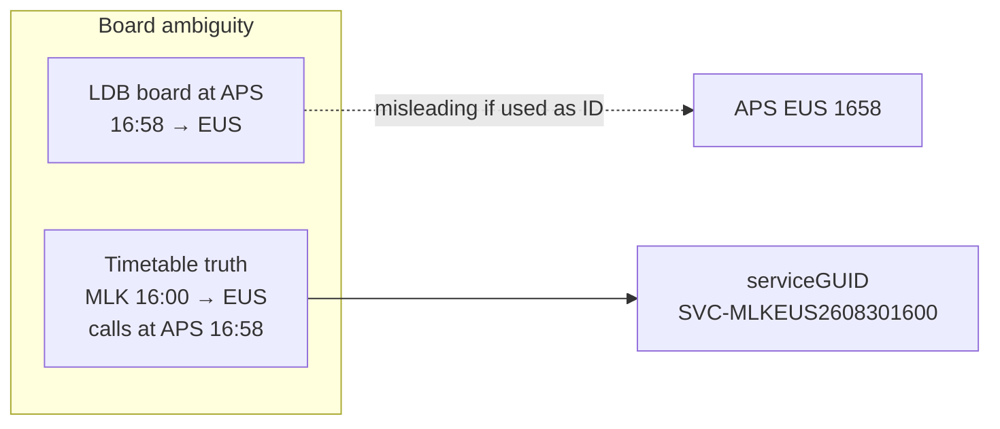
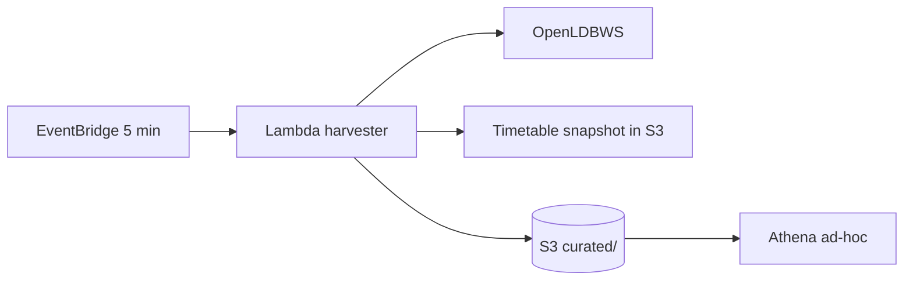
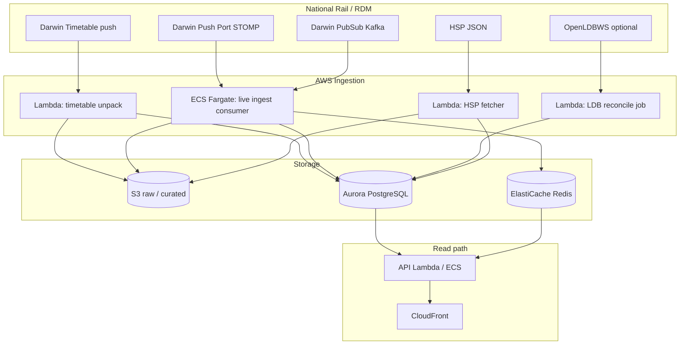
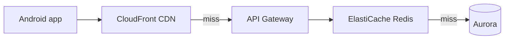

# UK Rail Tracker — AWS Harvesting Server Plan

**Status:** Draft — design only, no implementation yet  
**Audience:** Future implementation of `server/` and Android integration (M7+)  
**Related:** [data-sources.md](../docs/data-sources.md), [data-model.md](../docs/data-model.md), [architecture.md](../docs/architecture.md)

---

## 1. Problem statement

The National Rail **OpenLDBWS** APIs (currently used by the Android app) expose a Darwin **`serviceID`** that is:

- **Ephemeral** — valid for the current operational day/session, not stable across days or restarts.
- **Context-dependent** — the same physical train can appear on a departure board under different origin/destination labels depending on where you query. Example: the **16:58 APS → EUS** row may be the **16:00 MLK → EUS** service calling at Apsley; without the full calling pattern you cannot reliably identify the train from a filtered board alone.
- **Unsuitable for archival** — `journey_log.service_id` in the app cannot be correlated with historic performance (HSP) or cross-day analytics.

A backend harvester is needed to:

1. Ingest authoritative timetable + live movement data.
2. Assign and maintain a **`serviceGUID`** (our persistent service identity) that survives board presentation quirks.
3. Expose a thin read API aligned with existing domain models (`DepartureBoard`, `JourneyOption`, etc.).
4. Serve mostly-immutable data from an edge cache so high read load does not hammer Darwin or the database.

---

## 2. Goals and non-goals

### Goals

| Goal | Detail |
|------|--------|
| **Stable service identity** | Every scheduled run on a given calendar day has one **`serviceGUID`**, resolvable from any calling point or board filter. |
| **Published service record** | Store the *as-published* timetable snapshot (origin, destination, calling points, operator, headcode/UID) separate from live deltas (delay, platform, cancellation). |
| **Live state overlay** | Merge real-time movement (ETD/ETA, platform, cancel reason) onto the published record without changing identity. |
| **Route-oriented reads** | Efficient queries for `(origin_crs, destination_crs, date)` and station boards — matching app commute patterns. |
| **Aggressive HTTP caching** | Immutable or slow-changing responses cacheable at CDN; only hot live slices hit origin. |
| **SQL-first operational store** | Relational schema for joins, constraints, and app-shaped queries. |
| **S3 data lake + Athena** | Cheap long-term retention and ad-hoc analytics (delay distributions, operator performance, M7 compensation evidence). |

### Non-goals (v1)

- Replacing Darwin as the authority for *live* CIS state — we replicate and cache, not invent.
- Real-time journey planning (RTJP/OJP) — remain client-side or a later phase.
- User accounts, personalisation sync, or storing GPS/location server-side (privacy constraint from [architecture.md](../docs/architecture.md)).
- Running Darwin Push Port on a phone — explicitly server-side only per existing docs.

---

## 3. Service identity design

### 3.0 Identifier glossary (do not conflate)

Third-party Darwin names stay as published (OpenLDBWS swagger / Push Port). **Only our persistent ID is named by us.**

| Name | Owner | Example | Lifetime | Notes |
|------|-------|---------|----------|-------|
| **`serviceID`** | Darwin OpenLDBWS | `AMQxIFns3fc8Q4+ZeM3xmw==` | Hours (operational day) | Ephemeral LDB handle — keep Darwin’s spelling |
| **`rid`** | Darwin Push Port | `202608316721810` | One activation (~48h in Darwin) | Running Identity |
| **`uid`** | Darwin Push Port / timetable | `C21810` | Timetable slot | Not unique per day alone |
| **`rsid`** | Darwin Push Port (optional) | `NW123400` | Retail mapping | Retail Service ID |
| **`trainId`** | Darwin | `1N15` | Display | Headcode |
| **`serviceGUID`** | **Ours** | `SVC-MLKEUS2608301600` | Permanent for that published run | Collision-free service-level ID for API, pins, journey log, deep links |

JSON/API: `serviceGUID`. SQL: `service_guid`. Value format below is deterministic and namespaced — not a UUID, despite the name: **GUID = globally unique at service-run level**, not RFC 4122.

### 3.1 Recommended `serviceGUID` format: `SVC-{originCrs}{destCrs}{runDate}{originStd}`

Human-readable, deterministic:

```text
MLKEUS2608301600
 ││││││││││││└─ HHMM scheduled departure at origin (WTT)
 │││││││└────── YYMMDD (Europe/London calendar date of origin departure)
 └└└└└──────── Origin CRS + Destination CRS (uppercase)
```

Full API form (namespaced, URL-safe):

```text
SVC-MLKEUS2608301600
```

**Rules:**

| Field | Source | Notes |
|-------|--------|-------|
| `origin_crs` | First *public* origin of the service in the working timetable (not the board query station) | Resolve via Darwin Timetable / TSCH / `OR` association, not LDB row label |
| `dest_crs` | Final destination CRS of the service | From timetable destination |
| `run_date` | Calendar date of origin `STD` in `Europe/London` | Midnight boundary follows railway day conventions |
| `origin_std` | WTT departure at origin | 24h `HHMM`, zero-padded |

**Aliases (stored, not primary keys) — Darwin / third-party IDs:**

| Alias | Purpose | TTL |
|-------|---------|-----|
| `serviceID` (LDB) / column `darwin_service_id` | Current LDB session token | Hours (same operational day) |
| `uid` / `train_uid` | Darwin timetable UID (e.g. `C12345`) | Permanent for timetable slot |
| `rid` | Running Identity when Push Port provides it | Per run; links schedule changes |
| `trainId` / `headcode` | Display / staff reference | Informational |

### 3.2 Why not Darwin `serviceID` or board row alone?



The harvester resolves identity from **timetable + association data first**, then attaches live movement. Board rows become *views* onto a `serviceGUID`, not sources of truth. Darwin `serviceID` remains an **alias** for same-day LDB compatibility.

### 3.3 Edge cases to handle in design

| Case | Behaviour |
|------|-----------|
| **Split / join** | New RID → may map to new `serviceGUID` if origin STD or path changes; retain `supersedes_service_guid` link |
| **Cancelled before run** | Published record exists; live overlay `status=cancelled` |
| **Extra stops / diverted route** | Identity unchanged; calling points versioned in `service_calling_point` with `effective_from` |
| **Clock change (BST/GMT)** | All date/time normalisation in `Europe/London` |
| **Duplicate UID rare replan** | Secondary uniqueness: `(train_uid, run_date)` constraint; `serviceGUID` remains canonical |

---

## 4. Data sources and ingestion strategy

### 4.1 Feed matrix

| Feed | Role in harvester | Ingest mode |
|------|-------------------|-------------|
| **Darwin Timetable (push)** | Published schedule, UID, calling points, associations | Daily / on-change push → S3 → load to SQL |
| **Darwin Push Port (STOMP)** | Live movement, RID, delays, platforms, cancellations | Persistent STOMP client (always on) |
| **Darwin PubSub Kafka (RDM)** | Same Push Port payload semantics as STOMP | Managed Kafka consumer (`confluent-kafka`); **POC-validated** — see `poc/kafka/FINDINGS.md` |
| **OpenLDBWS** (optional) | Gap-fill, validation, bootstrap before live ingest | Poll favourite/route CRS set sparingly |
| **HSP JSON** | Historic actuals for M7 compensation proof | Batch / on-demand per `(origin, dest, date)` |
| **Knowledgebase Incidents** | Disruptions overlay | Poll every 5 min |
| **Bundled `stations.xml`** | Station dimension table | One-time / versioned import |

Push Port (STOMP or RDM Kafka) is the **primary live ingest** once operational — unlimited volume on RDM, designed for national replication. **RDM Kafka PubSub** ([RSPS5053](https://www.rspaccreditation.org/publicDocumentation.php#RSPS5053)) delivers the same §3.3 Push Port messages over SASL_SSL; decode/classify logic is shared — only the transport layer differs. LDB polling remains useful for **bootstrap**, **reconciliation**, and **stations not yet covered** by your client-side filter.

### 4.1a What Darwin actually delivers (proven characteristics)

Documented by NRE / the [Open Rail Data wiki](https://wiki.openraildata.com/index.php/Darwin:Push_Port), community consumers, and **validated in `poc/kafka/`** (RDM PubSub Kafka, Aug 2026). Payload semantics follow [P75301004 Push Port Data Interface Specification](https://www.raildeliverygroup.com/) §3.3 regardless of transport.

#### Transport options

| Question | Direct Push Port (STOMP) | RDM PubSub Kafka (POC) |
|----------|---------------------------|-------------------------|
| **Protocol** | ActiveMQ over **STOMP** (or OpenWire) | **SASL_SSL + PLAIN** to RDM bootstrap ([RSPS5053](https://www.rspaccreditation.org/publicDocumentation.php#RSPS5053)) |
| **Encoding** | gzip XML (`Pport`) | Separate topics: **JSON**, **XML**, **Avro** |
| **Persistence** | Short reconnect buffer (~**5 min** on durable subscribe) | Kafka **retained log** (partition watermarks; retention TBC with RDM) |
| **Consumer** | Persistent STOMP client | `confluent-kafka`: manual assign + `poll()` (POC uses local offset files) |
| **Payload** | `uR` / `sR` + child elements | **Same** — JSON topic wraps Push Port in `{ "bytes": "<inner JSON>" }` |

Either transport is a valid Phase 1 live-ingest path. Prefer **Kafka on Fargate** if RDM subscription includes PubSub (simpler ops, replay via retained offsets / `--from-beginning`); use **STOMP on the same Fargate shape** only if credentials are STOMP-only.

#### Behaviour (both transports)

| Question | Proven answer |
|----------|---------------|
| **Is data batched?** | **Two levels.** (1) One envelope may contain **multiple Push Port update types** under `uR` (typical: one). (2) STOMP: gzip XML bundles; Kafka: librdkafka **prefetches** records — app should still **process one Kafka record at a time** (atomic offset). |
| **Arrival pattern** | **Continuous stream**, rate varies. STOMP community: **several thousand messages** in a typical 5-minute reconnect window; peak bursts need **hundreds of msg/s** receive throughput. |
| **Can you subscribe to a few stations only?** | **No at source.** National feed — **CRS filtering is client-side** after decode. For a handful of stations, **LDB polling is the correct v1 ingest**. |
| **Ordering guarantees** | **Weak.** **Two partitions**; same `rid` may arrive out of order across partitions. Use idempotent upserts by `(rid, tpl, …)` or per-partition sequence / `PushPortSequence`. |
| **Message types** | Identified by **child element names under `uR` (update) or `sR` (snapshot)** — not by `updateOrigin` / `requestSource` (those are metadata). See **§4.1c**. Raw messages are not board-shaped; maintain **state** (`rid` → service) from `schedule` before `TS` is fully meaningful. |
| **Offline / dev without live stream** | RDM **FTP 5-minute `pPort` logs** (XML) and **timetable snapshots via S3**. POC: `poc/kafka/consume.py` + archived Kafka replay. |

**Implication:** RDM Kafka is the **source buffer** (retained log). **Fargate** (or EC2) is the **always-on poll owner**. **SQS** is an optional secondary buffer for slow DB work — Darwin/RDM does not push into SQS for you. Proven pattern:

```text
Kafka poll (Fargate, one record)  →  decode → classify → filter
  →  [optional SQS]  →  upsert Postgres/Redis + S3 raw
  →  commit durable offset (S3/Dynamo or broker group)
```

If the worker is slow (e.g. per-message RDS write), lag grows and you stay stale after reconnect/replay ([community STOMP thread](https://groups.google.com/g/openraildata-talk/c/0naZfmv43F8); same risk on Kafka if `poll` stalls). Keep the Fargate owner thin; batch or async the writes.

### 4.1c Push Port message format (POC-validated)

Full detail: **`poc/kafka/FINDINGS.md`**. Summary for ingest implementation:

#### Envelope (RDM Kafka JSON topic)

```text
Kafka record.value → json.loads → envelope["bytes"] → json.loads → Push Port payload
  { ts, version, uR | sR }
```

On the JSON topic there is **no binary decode** — inner `bytes` is UTF-8 JSON. Avro/XML topics use the same Push Port semantics with different outer encoding.

#### Classifying update types

| Step | Rule |
|------|------|
| Wrapper | `uR` = live update; `sR` = snapshot |
| Type(s) | **Child keys** under `uR`/`sR` (see table below) |
| Not types | `updateOrigin`, `requestSource`, `requestID`, `ts`, `version` |
| Empty `uR` | Valid DCIS ack with no data change |

| Element key | Spec § | Route to |
|-------------|--------|----------|
| `schedule` | 3.3.1 | Timetable / `service_publication`, identity |
| `deactivated` | 3.3.1 | Mark service inactive |
| `association` | 3.3.2 | Split/join graph |
| `scheduleFormations` | 3.3.3 | Formation store |
| **`TS`** | **3.3.4** | **`service_live_state`** (ETD/ETA, platform, delay) — primary board path |
| `formationLoading` / `serviceLoading` | 3.3.5–6 | Loading (optional v1) |
| `trainOrder` | 3.3.7 | Junction order |
| `OW` | 3.3.8 | Station messages / suppression |
| `trainAlert` | 3.3.9 | Alerts |
| `trackingID` | 3.3.10 | TD berth corrections |
| `alarm` | 3.3.11 | Alarms |
| `stationInformation` | 3.3.12 | Station info (lifts, etc.) |

One message may contain **0, 1, or many** of these elements. Typical live traffic: **`TS` only** or **`schedule` then `TS`**.

#### `TS` location shapes

| Activity | Scheduled (working) | Forecast | Example fields |
|----------|---------------------|----------|----------------|
| Passing point | `wtp` | `pass.et`, `pass.src` | Rural movement between stops |
| Calling point | `wta`, `wtd` (+ public `pta`, `ptd`) | `arr.et`, `dep.et` | Passenger stops, platforms |

`Location` is a **JSON object** (one stop) or **array** (many) — normalise to a list. Platform text from XML may appear as `"plat": { "": "1" }`. Codes (`tpl`, `LateReason`) need **Timetable Reference Data** (§4.2.2) for display names.

#### Recommended processor pipeline

```text
poll (one Kafka record) → decode envelope → classify uR/sR + types
  → route: schedule → identity store; TS → live overlay; deactivated → cleanup
  → CRS/route filter → idempotent upsert → commit offset
```

### 4.1b Minimal v1 — near-zero cost, few stations, S3 final format

**Goal:** validate `serviceGUID` assignment, curated schema, and Athena downstream **before** paying for always-on ingest, Aurora, or Redis.

| Principle | Choice |
|-----------|--------|
| Ingest | **OpenLDBWS poll** for 5–15 allowlisted CRS (commute favourites), EventBridge every **5 min** |
| Identity | Resolve `serviceGUID` from **Darwin Timetable** snapshot (RDM S3 dump or one-time FTP) loaded into Lambda memory / small S3 lookup file — not from ephemeral Darwin `serviceID` alone |
| Storage | **S3 only** — write **curated** Parquet (or JSON Lines) directly; skip raw XML archive initially |
| Compute | **Lambda** in public subnet or with **S3 VPC endpoint** — no NAT Gateway |
| Query | **Athena** on curated bucket to confirm boards/routes look right |
| Skip for v1 | Push Port STOMP, Aurora, Redis, CloudFront, API |



#### S3 layout (final format from day one)

Write what downstream SQL would eventually hold — not raw LDB JSON:

```text
s3://uk-rail-tracker-dev/
└── curated/
    ├── service_publication/run_date=YYYY-MM-DD/part-*.parquet
    ├── service_calling_point/run_date=YYYY-MM-DD/part-*.parquet
    ├── service_live_state/run_date=YYYY-MM-DD/hour=HH/part-*.parquet   # append-only snapshots
    └── board_departure/run_date=YYYY-MM-DD/crs=XXX/part-*.parquet      # denormalised rows per poll
```

Each Lambda run **merges** new live state for services touching the allowlisted CRS set. Use **partition overwrite** per `(run_date, crs)` for board slices; append for live-state history if you want a time series.

#### Example curated row (`board_departure`)

| Column | Example |
|--------|---------|
| `service_guid` | `SVC-MLKEUS2608301600` |
| `crs` | `APS` |
| `dest_crs` | `EUS` |
| `display_std` | `16:58` |
| `origin_crs` | `MLK` |
| `origin_std` | `16:00` |
| `platform` | `3` |
| `status` | `delayed` |
| `delay_minutes` | `2` |
| `darwin_service_id` | `AMQx…` (Darwin LDB `serviceID`) |
| `observed_at` | `2026-08-30T16:45:00Z` |

This row proves the APS-board / MLK-origin identity resolution works before any database exists.

#### Cost (minimal v1)

| Item | ~£/month |
|------|----------|
| S3 (< 1 GB curated + timetable) | **< £1** |
| Lambda (10 CRS × 288 runs/day × 30 days, ~3s each) | **£0–2** (likely free tier) |
| Athena (light dev queries) | **< £1** |
| EventBridge | **< £0.50** |
| **Total** | **~£0–3** |

#### Exit criteria → promote to full plan

- [ ] Athena query: APS 16:58 → EUS row resolves to same `service_guid` as MLK 16:00 → EUS timetable row
- [ ] 7 days of partitions without duplicate `(service_guid, run_date)` violations
- [ ] Curated schema stable enough to `CREATE TABLE` in Aurora with `COPY` / Glue ETL
- [ ] Measured LDB poll latency + RDM quota headroom acceptable at chosen CRS count

Only then add Push Port (national stream + client-side filter) or RDS serving layer.

#### Optional: FTP `pPort` logs instead of live STOMP

If you have Push Port FTP credentials but want to avoid always-on compute: a **daily Lambda** (or manual cron) downloads the day's 5-minute XML logs, filters to allowlisted CRS, and writes the same curated S3 paths. **~£0** extra, **minutes** of latency, good for validating Push Port *parse logic* without STOMP ops.

---



**Live ingest consumer** (RDM Kafka preferred; STOMP fallback — same decode pipeline per **§4.1c**) needs a long-lived process — **ECS Fargate** (desired count = 1) or **EC2**. **Kafka does not change this:** Fargate is a normal, well-supported host for `confluent-kafka` / librdkafka poll loops (outbound SASL_SSL only). Use **SQS** as an *optional* buffer between receiver and heavy processors; with Kafka the **retained log is already the primary buffer**.

### 4.3 Live ingest consumer — alternatives and cost

Darwin live ingest is a **persistent stream receiver** problem — primarily an **RDM Kafka consumer** (`confluent-kafka`), with STOMP as an alternate transport if PubSub is unavailable. Anything that cannot hold an always-on connection / poll loop is ruled out as the *receiver* (though Lambda remains fine **downstream** of SQS).

#### Kafka + Fargate — reassessment (Aug 2026)

| Assessment | Verdict under RDM Kafka | Why |
|------------|-------------------------|-----|
| **Can we use Fargate?** | **Yes — recommended** | Long-running ECS task; outbound TLS to RDM bootstrap; no inbound ports; AWS-documented pattern for Kafka consumers |
| **Does Kafka force EC2?** | **No** | No local broker state, no host networking tricks required; client is just a container |
| **Does Kafka force MSK/Amazon MQ?** | **No** | RDM *is* the Kafka cluster; running a second broker in AWS adds cost and no value |
| **Does Kafka unlock Lambda as receiver?** | **Still no** | 15 min max runtime; no durable poll loop; group/session semantics unsuitable |
| **Is Fargate *better* with Kafka than STOMP?** | **Slightly yes** | Kafka **retained log** + durable offsets absorb Fargate task restarts (seconds–minutes); STOMP durable buffer is only ~**5 min** |
| **SQS still required?** | **No — optional** | Kafka already buffers. SQS still useful to isolate slow RDS upserts from the poll loop |
| **desiredCount > 1 for HA?** | **Usually no (v1)** | RDM: **one authorised consumer group**; POC — run **one consumer at a time**. Two tasks cause partition fights / rejected groups. Prefer restart + offset resume |
| **Local offset files on Fargate?** | **Unsafe as sole store** | Task storage is ephemeral. Persist offsets to **S3 / DynamoDB / EFS**, or RDM group commits if allowed |
| **Graviton (ARM) Fargate?** | **Yes, with image care** | Need ARM `confluent-kafka` / librdkafka wheels in the image; ~20% cheaper than x86 |
| **NAT Gateway?** | **Unchanged** | Still needed for private-subnet egress to RDM *unless* public subnet + SG, or other egress path. VPC endpoints help AWS APIs only, not RDM brokers |

**Bottom line:** Choosing Kafka **strengthens** the Fargate recommendation (replay after restart) and **does not** reopen Lambda-as-receiver or require MSK/EC2. The main Kafka-specific hard requirement is **durable offset state** outside the task filesystem.

All figures below are **order-of-magnitude** for **`eu-west-2` (London)**, one consumer process running **24×7** (~730 h/month), **excluding** shared platform costs (Aurora, Redis, S3) and **excluding** NAT Gateway unless noted. USD list prices × ~**£0.80** for rough GBP. Verify with the [AWS Pricing Calculator](https://calculator.aws/).

#### Option comparison

| Option | Fits Kafka live ingest? | Ops burden | Compute £/mo (single task) | Notes |
|--------|-------------------------|------------|----------------------------|-------|
| **A. ECS Fargate (x86)** | **Yes** | Low | **£18–22** (0.5 vCPU / 1 GB) | Solid default; simple `confluent-kafka` image |
| **B. ECS Fargate (Graviton ARM)** | **Yes** | Low | **£14–18** (0.5 vCPU / 1 GB) | **Recommended** if ARM wheels build cleanly — same Kafka task shape, ~20% less |
| **C. ECS on EC2 (t4g.small)** | Yes | Medium | **£10–14** | Cost tune later; not required by Kafka |
| **D. Single EC2 (no ECS)** | Yes | Medium | **£6–12** (t4g.micro–small) | Only if you want disk-local offsets without S3/Dynamo; ops trade-off |
| **E. Lightsail instance** | Yes | Low | **£4–8** ($5–10 plan) | Fine for Kafka POC/staging; weaker VPC story for Aurora/Redis |
| **F. App Runner** | Yes* | Low | **£20–35** | *Always-on min instances = 1; less control; no Kafka advantage over Fargate |
| **G. Lambda (receiver)** | **No** | — | — | Cannot own Kafka poll / session; max ~15 min |
| **H. Lambda + SQS (processor only)** | Partial | Low | **£1–5** | Downstream of Fargate Kafka owner; still valid |
| **I. LDB poll only (no live stream)** | N/A | Low | **£2–15** | Bootstrap — not a Kafka substitute |
| **J. Non-AWS VPS (Hetzner, etc.)** | Yes | Medium | **£4–8** | Kafka client is just outbound TLS; egress to AWS S3/RDS is the cost |

#### Sizing notes (live ingest consumer)

A minimal consumer is mostly **I/O-bound** (Kafka `poll`, decode, filter, enqueue). CPU spikes on parse / backlog replay. Process **one record per loop**; tune `fetch.min.bytes` / `fetch.wait.max.ms` (see `poc/kafka/FINDINGS.md`). librdkafka prefetch needs a little RAM headroom — prefer **≥ 1 GB** for national stream + filter even if CPU stays at 0.25–0.5.

| Profile | Resources | When to use |
|---------|-----------|-------------|
| **Minimal** | 0.25 vCPU / 0.5 GB Fargate (~**£8–10/mo**) | Filtered allowlist, archive to S3 only, process async — watch OOM under prefetch |
| **Standard** | 0.5 vCPU / 1 GB Fargate (~**£12–18/mo**) | **Default Kafka path:** filter + durable offset commit + health metrics (+ optional SQS) |
| **Comfortable** | 1 vCPU / 2 GB (~**£25–35/mo**) | Large replay catch-up, richer metrics, headroom for burst decode |

Heavy DB upserts should stay off the critical path: either **in-task batch upsert** (simple v1) or **SQS → Lambda** so the Kafka owner never stalls `poll` long enough to risk session / lag blow-ups.

#### High availability (Kafka-aware)

| Pattern | Extra compute £/mo | Trade-off under RDM Kafka |
|---------|-------------------|---------------------------|
| **Single Fargate task + ECS restart** | £0 | **Preferred v1.** Gap ~30s–2 min; resume from durable offsets / retained log |
| Active + warm standby (2 tasks) | **2×** | **Usually wrong** — RDM authorises **one** consumer group; POC: one consumer at a time. Second task does not safely share partitions unless RDM explicitly allows |
| Multi-AZ EC2 + ECS | ~£12–24 + ops | Same single-consumer constraint; AZ diversity helps host failure, not parallel consume |

For v1: **one Fargate task**, `desiredCount=1`, aggressive restart policy, **CloudWatch alarm on consumer lag / last-message age**, durable offsets outside the task.

#### Hidden / shared networking costs

These apply to **every** AWS option that talks to RDS/Redis from a private subnet **and** reaches RDM brokers on the public internet:

| Item | Typical £/mo | Mitigation |
|------|--------------|------------|
| **NAT Gateway** | **£25–35** fixed + ~£0.04/GB egress | Kafka needs egress to RDM. VPC endpoints cover **S3/SQS/Secrets** only. Dev: public subnet + tight SG; prod: NAT or equivalent egress |
| **CloudWatch Logs** | £2–10 | Log sampling; short retention on raw payload debug |
| **Secrets Manager** | ~£0.30/secret | One secret for RDM Kafka (and STOMP if dual) + API keys |
| **Data transfer** live ingest → AWS | Usually **< £5** | Inbound from internet is free; egress to clients is separate (CDN) |
| **Offset store (S3/Dynamo)** | **≪ £1** | Required on Fargate if not using broker-committed group offsets |

**Lightsail / external VPS** avoid NAT Gateway but add cross-cloud egress if writing to S3/RDS in AWS.

#### Option I — LDB polling only (no live stream)

Valid for **Phase 0 / Phase 1 bootstrap** before Kafka credentials and ops are ready.

| Pattern | Rough £/mo | Freshness | Limit |
|---------|------------|-----------|-------|
| EventBridge **every 5 min**, 20 favourite CRS, Lambda → RDS | **£2–5** | 5 min | No national coverage; burns RDM request quota |
| Same, **50 CRS** | **£5–12** | 5 min | Approaches awkward at scale |
| Fargate poller (continuous staggered poll) | **£12–20** | 1–2 min | Still not a true movement stream — prefer Kafka Fargate at this price |

OpenLDBWS is **5M requests / 4-week railway period** — polling 50 stations every 5 min ≈ **430k req/month**, which is fine, but you **do not** get pre-emptive movement events or reliable RID/UID association at national scale.

#### Recommended architecture by phase

```text
Phase 0 (bootstrap):  Option I — Lambda schedule + LDB reconcile for allowlisted CRS
Phase 1 (production): Option B — Fargate Graviton Kafka consumer → (optional SQS) → Lambda/DB
Phase 2 (cost tune):  Option C — ECS on t4g.small only if Fargate £ hurts; Kafka client unchanged
```

#### Why not these? (reassessed for Kafka)

| Service | Verdict |
|---------|---------|
| **Lambda as Kafka receiver** | Still wrong — no long-lived poll / session |
| **API Gateway / ALB** | Inbound HTTP only; Kafka ingest is outbound client |
| **Amazon MQ / MSK** | You would run a *second* broker — RDM Kafka is already the broker |
| **EKS** | Control-plane + node cost overkill for one daemon |
| **Step Functions** | Orchestration, not streaming |
| **Fargate Spot for the consumer** | Risky for always-on lag SLA; use on-demand for the stream owner |
| **ECS desiredCount = partitions (2)** | Tempting for Kafka parallelism — **blocked** until RDM allows multi-member groups |

#### Decision summary

| Priority | Choose |
|----------|--------|
| Kafka + lowest ops (AWS-native) | **Fargate Graviton** 0.5 vCPU / 1 GB (~£15/mo) + durable offsets |
| Lowest AWS compute | **ECS on t4g.small** or **Lightsail** (~£8–12/mo) — same Kafka code |
| Fastest path before Kafka | **Lambda LDB reconcile** (~£3/mo) — Phase −1 / 0 |
| Production resilience | Single Kafka owner + retained-log replay + lag alarms — **not** dual consumers |

---

## 5. Data model (SQL operational store)

**Engine:** Aurora PostgreSQL (Serverless v2 for variable load) or RDS PostgreSQL.

### 5.1 Core entities

```text
station (from stations.xml)
service_publication          -- service_guid + timetable snapshot header
service_calling_point        -- ordered stops, WTT times, versioned
service_live_state           -- current ETD/ETA, platform, status (hot row)
service_alias                -- Darwin serviceID, rid, train_uid → service_guid
route_service_index          -- denormalised (origin, dest, date, std) → service_guid for fast route queries
board_snapshot               -- optional materialised per-CRS board JSON + cache headers
```

### 5.2 Table sketches

#### `service_publication`

| Column | Type | Notes |
|--------|------|-------|
| `service_guid` | `VARCHAR(32) PK` | e.g. `SVC-MLKEUS2608301600` |
| `train_uid` | `VARCHAR(16)` | Darwin UID |
| `run_date` | `DATE` | Origin departure date |
| `origin_crs` | `CHAR(3)` | |
| `dest_crs` | `CHAR(3)` | |
| `origin_std` | `TIME` | WTT at origin |
| `dest_sta` | `TIME` | WTT at destination |
| `operator_code` | `VARCHAR(4)` | |
| `headcode` | `VARCHAR(8)` NULL | |
| `published_at` | `TIMESTAMPTZ` | When timetable snapshot ingested |
| `supersedes_service_guid` | `VARCHAR(32) NULL` | Schedule change linkage |

Unique: `(train_uid, run_date)` where not superseded.

#### `service_calling_point`

| Column | Type | Notes |
|--------|------|-------|
| `service_guid` | FK | |
| `sequence` | `SMALLINT` | Order |
| `crs` | `CHAR(3)` | |
| `wtt_arrive` | `TIME NULL` | |
| `wtt_depart` | `TIME NULL` | |
| `wtt_pass` | `TIME NULL` | |

#### `service_live_state` (also mirrored in Redis)

| Column | Type | Notes |
|--------|------|-------|
| `service_guid` | `PK` | |
| `status` | `ENUM` | on_time, delayed, cancelled, departed, arrived |
| `delay_minutes` | `INT NULL` | |
| `platform` | `VARCHAR(8) NULL` | |
| `cancel_reason` | `TEXT NULL` | |
| `updated_at` | `TIMESTAMPTZ` | |
| `darwin_service_id` | `VARCHAR(64) NULL` | Latest Darwin LDB `serviceID` |

Per-calling-point live times live in `service_calling_point_live` (service_guid, crs, eta, etd, ata, atd).

#### `service_alias`

| Column | Type | Notes |
|--------|------|-------|
| `alias_type` | `VARCHAR(16)` | `darwin_service_id` (LDB `serviceID`), `rid`, … |
| `alias_value` | `VARCHAR(64)` | |
| `service_guid` | FK | |
| `valid_until` | `TIMESTAMPTZ NULL` | |

Index: `(alias_type, alias_value)` for reverse lookup from LDB.

#### `route_service_index`

Denormalised for commute queries — rebuilt on timetable ingest and updated on cancellation:

| Column | Type | Notes |
|--------|------|-------|
| `origin_crs` | `CHAR(3)` | Query origin (board station or journey origin) |
| `dest_crs` | `CHAR(3)` | |
| `run_date` | `DATE` | |
| `departure_time` | `TIME` | At `origin_crs` |
| `service_guid` | FK | |

Index: `(origin_crs, dest_crs, run_date, departure_time)`.

### 5.3 Alignment with Android domain models

Extend existing types (server DTO mirrors app domain):

| App domain type | Server adds |
|-----------------|-------------|
| `Departure` | `serviceGUID`, `trainUid` (optional in API) |
| `JourneyOption` | `serviceGUID` as primary key in URLs |
| `JourneyLogEntry` | Store `service_guid` alongside Darwin `serviceID` during migration |
| `CallingPoint` | Unchanged shape; times from live overlay |

API paths should accept **either** `serviceGUID` or Darwin `serviceID` (resolve via `service_alias`) during transition.

---

## 6. S3 data lake and Athena

### 6.1 Layout

```text
s3://uk-rail-tracker-{env}/
├── raw/
│   ├── push_port/year=YYYY/month=MM/day=DD/hour=HH/*.xml.gz
│   ├── timetable/year=YYYY/month=MM/day=DD/*.xml.gz
│   └── hsp/year=YYYY/month=MM/day=DD/*.json
├── curated/
│   ├── service_runs/          # Parquet: one row per service_guid per day
│   ├── calling_points/        # Parquet: service_guid, sequence, times
│   ├── movement_events/       # Parquet: event stream denormalised
│   └── delay_outcomes/        # Parquet: HSP + observed delay for M7
└── exports/
    └── athena-results/
```

**Partitioning:** `year/month/day` on all curated tables. **Format:** Parquet + Snappy.

### 6.2 Glue Data Catalog + Athena

| Table | Use |
|-------|-----|
| `service_runs` | "All MLK→EUS services in August 2026" |
| `movement_events` | Delay distribution, dwell analysis |
| `delay_outcomes` | Compensation eligibility research, operator benchmarking |

Athena is for **analytics, batch backfill, and M7 evidence queries** — not the hot read path for mobile boards (latency and cost).

**ETL:** Glue job or scheduled Lambda converts Push Port / HSP raw → curated Parquet nightly and on-demand.

### 6.3 SQL vs Athena — when to use which

| Query pattern | Store |
|---------------|-------|
| Live board for CRS, next 2 hours | PostgreSQL + Redis + CloudFront |
| Service detail by `serviceGUID` | PostgreSQL + Redis |
| "My journey last Tuesday delay proof" | PostgreSQL if recent; Athena if archived to lake |
| Operator delay percentiles over 12 months | Athena only |

---

## 7. Caching strategy (front-end / edge)

High read volume for data that **does not change** (published timetable slice) or **changes slowly** (delays update every 30–60s) must not reach PostgreSQL on every request.

### 7.1 Cache tiers



| Tier | Technology | Contents | TTL |
|------|------------|----------|-----|
| **L1 — Device** | Existing Room `departure_cache` | Boards, 60s fresh / 30m stale | Unchanged |
| **L2 — CDN** | CloudFront in front of API Gateway | GET responses with explicit `Cache-Control` | See below |
| **L3 — Origin memory** | ElastiCache Redis | Assembled board JSON, service detail, alias lookups | 30–120s live; hours for static |
| **L4 — Database** | Aurora | Source of truth | — |

### 7.2 HTTP cache policy by endpoint

| Endpoint | Cache-Control | CDN TTL | Invalidation |
|----------|---------------|---------|--------------|
| `GET /v1/stations` | `public, max-age=86400` | 24h | On `stations.xml` version bump |
| `GET /v1/boards/{crs}` | `public, max-age=30, stale-while-revalidate=60` | 30s | Push Port update → Redis pub/sub → optional CF surrogate-key purge |
| `GET /v1/boards/{crs}?filterTo={dest}` | Same | 30s | Same |
| `GET /v1/services/{serviceGUID}` published slice | `public, max-age=3600` | 1h | Timetable revision only |
| `GET /v1/services/{serviceGUID}/live` | `public, max-age=15, stale-while-revalidate=30` | 15s | Frequent |
| `GET /v1/routes/{orig}/{dest}/{date}` | `public, max-age=300` | 5m | Timetable + cancel events |

Use **`ETag`** derived from `(service_guid, updated_at)` or content hash so clients send `If-None-Match` → `304 Not Modified` (cheap at CDN).

**`stale-while-revalidate`** lets CloudFront serve slightly stale boards while refreshing in background — good for thundering herds (Monday morning commute).

### 7.3 Cache key design

Include only cache-relevant query params in the CDN key:

```text
/v1/boards/PAD?filterTo=EUS&window=120  →  key(boards, PAD, EUS, 120)
```

Omit auth headers from cache key for public read API (v1 is unauthenticated). If API keys are added later, use **per-key rate limits** not cache busting.

### 7.4 Write-through on ingest

Push Port processor (STOMP or Kafka path):

1. Upsert `service_live_state` in PostgreSQL.
2. Update Redis keys: `svc:{serviceGUID}:live`, `board:{crs}:*` (invalidate pattern).
3. Optionally publish to EventBridge → Lambda → CloudFront invalidation **only for affected CRS** (avoid full distribution purge).

---

## 8. API surface (v1)

REST JSON, aligned with app repository interfaces. Base: `https://api.ukrailtracker.example/v1`

| Method | Path | Maps to |
|--------|------|---------|
| `GET` | `/stations` | `StationRepository.getAllStations` (optional server mirror of bundle) |
| `GET` | `/stations/{crs}` | `getStationByCrs` |
| `GET` | `/boards/{crs}` | `DepartureRepository.getDepartures` |
| `GET` | `/boards/{crs}?filterTo={dest}&filterType=to` | Filtered commute board |
| `GET` | `/services/{serviceGUID}` | Full `JourneyOption` (published + live) |
| `GET` | `/services/{serviceGUID}/live` | Live overlay only (smaller payload for on-train poll) |
| `GET` | `/routes/{origin}/{dest}/{date}` | List of `JourneyOption` for planner |
| `GET` | `/services/resolve?serviceID=…` | Alias lookup for app migration |
| `GET` | `/health` | Synthetic monitoring |

**Response envelope:**

```json
{
  "data": { },
  "meta": {
    "serviceGUID": "SVC-MLKEUS2608301600",
    "generatedAt": "2026-08-30T16:45:00+01:00",
    "cacheTtlSeconds": 30
  }
}
```

---

## 9. AWS service selection summary

| Concern | Service | Rationale |
|---------|---------|-----------|
| Live ingest consumer | **ECS Fargate** (`desiredCount=1`) | Kafka poll owner; auto-restart; see §4.3 reassessment — **Kafka does not require EC2/MSK** |
| Consumer offsets | **DynamoDB or S3** (or RDM group commits) | Fargate disk is ephemeral; POC local files are not production-safe |
| Downstream parse/DB (optional) | **SQS** + **Lambda** | Decouple slow upserts; Kafka retained log remains primary buffer |
| Timetable / HSP / ETL | **Lambda** + EventBridge schedules | Spiky, infrequent |
| API | **API Gateway HTTP API** + **Lambda** (or Fargate if connection pooling needed) | Pay per use, CDN-friendly |
| CDN | **CloudFront** | Edge caching, HTTP/2, geo |
| Operational SQL | **Aurora PostgreSQL Serverless v2** | Familiar SQL, joins, ACID |
| Hot cache | **ElastiCache Redis** | Sub-ms assembly of boards |
| Object store | **S3** | Durable, cheap, Athena source |
| Analytics | **Athena** + **Glue Catalog** | SQL over Parquet without loading RDS |
| Secrets | **Secrets Manager** | RDM Kafka credentials, API keys |
| Observability | **CloudWatch** + **X-Ray** | Kafka lag / last-message age → Redis freshness |
| IaC | **Terraform** or **CDK** | Reproducible environments |

---

## 10. Freshness and SLA targets

| Data class | Target freshness | Measurement |
|------------|------------------|-------------|
| Live delay / platform | ≤ 60s behind CIS | `now - service_live_state.updated_at` |
| Board assembly | ≤ 30s | Redis key age |
| Timetable publication | ≤ 24h of NRE publish | Timetable ingest job |
| HSP historic | ≤ 7 days (HSP lag) | Batch job status |

Alert if Kafka consumer lag grows, last successful poll age > 2 min, Fargate task not running, or Redis board age p95 > 90s.

---

## 11. Security and compliance

- RDM credentials only in Secrets Manager; rotated via marketplace key rollover.
- No collection of user GPS or accounts in v1.
- Attribution: "Powered by National Rail" on API docs / app unchanged.
- Rate limiting at API Gateway (e.g. 100 req/s per IP burst) — CDN absorbs most board traffic.
- S3 buckets private; Athena workgroup scoped; no public raw XML.

---

## 12. Phased delivery

### Phase −1 — S3 validation spike (1 week, ~£0–3/mo)

Minimal footprint per **§4.1b** — no Push Port, no RDS.

- [ ] S3 bucket + curated Parquet schema (`service_publication`, `board_departure`, …)
- [ ] Timetable snapshot → `service_publication` + calling points for allowlisted routes
- [ ] EventBridge + Lambda: poll 5–15 CRS via OpenLDBWS every 5 min
- [ ] Map board rows → `service_guid`; write curated partitions
- [ ] Athena sanity queries + identity-resolution spot checks
- [ ] Document observed message volume / poll duration (informs later Push Port sizing)

### Phase 0 — Foundation (2–3 weeks)

- [ ] IaC skeleton: VPC, Aurora, Redis, S3, secrets
- [ ] Import `stations.xml` → `station` table
- [ ] Timetable ingest prototype → `service_publication` + calling points
- [ ] `serviceGUID` generator + unit tests for edge cases (BST, pass times)

### Phase 1 — Live ingest (3–4 weeks)

- [ ] Fargate service (`desiredCount=1`) running **RDM Kafka** consumer (POC → production; STOMP only if PubSub unavailable)
- [ ] Durable offset store (DynamoDB/S3) — do **not** rely on Fargate ephemeral disk
- [ ] Push Port decode/classify/route pipeline per **§4.1c** (`uR`/`sR` → `schedule`, `TS`, …)
- [ ] Load Timetable Reference Data (TIPLOC → CRS, `LateReason` codes)
- [ ] `service_alias` population (`rid`, `darwin_service_id`)
- [ ] `route_service_index` builder
- [ ] Optional SQS buffer only if in-task upserts cannot keep lag near zero
- [ ] Internal admin API: lookup by UID, CRS, date
- [ ] Measure TS vs schedule ratio + Kafka retention + restart-resume (24h soak via `timestamp-consumer.py`)

### Phase 2 — Read API + CDN (2–3 weeks)

- [ ] `GET /boards/{crs}` and `GET /services/{serviceGUID}` matching app JSON shape
- [ ] CloudFront + cache headers + ETag
- [ ] Redis write-through from ingest
- [ ] Load test: simulate 10k devices polling favourite boards

### Phase 3 — Android integration (1–2 weeks)

- [ ] `ServerDepartureRepository` implementing existing interfaces
- [ ] Feature flag: Darwin direct vs server
- [ ] `JourneyLogEntry` writes `service_guid`
- [ ] Deep links: `journey_detail/{origin}/{dest}/{serviceGUID}`

### Phase 4 — Analytics + M7 (ongoing)

- [ ] HSP ingest → `delay_outcomes` Parquet
- [ ] Athena views for compensation evidence
- [ ] `GET /services/{serviceGUID}/history` for Delay Repay proof packet

---

## 13. Cost rough-order (monthly, low traffic)

### 13.1 Full stack (Phase 1+ with Push Port)

| Component | Estimate |
|-----------|----------|
| Aurora Serverless v2 (0.5–2 ACU) | £30–80 |
| ElastiCache `cache.t4g.micro` | £12–18 |
| Live ingest consumer (see §4.3) | **£8–22** (Fargate Kafka minimal–standard) |
| Offset store (Dynamo/S3) | **≪ £1** |
| SQS + Lambda processors (optional) | £0–8 |
| NAT Gateway (if used) | **£25–35** — VPC endpoints do **not** replace RDM egress |
| S3 + Athena queries | £5–20 |
| CloudFront + API Gateway | £5–15 at modest scale |
| **Total (with NAT)** | **~£90–180/mo** |
| **Total (NAT avoided)** | **~£65–145/mo** |

### 13.2 Bootstrap only (Phase 0, LDB poll, no Push Port)

| Component | Estimate |
|-----------|----------|
| Aurora Serverless v2 (min capacity) | £25–50 |
| Lambda LDB reconcile (20–50 CRS) | £2–12 |
| S3 (timetable + raw) | £1–5 |
| **Total** | **~£30–70/mo** |

### 13.3 Phase −1 only (S3 + Lambda, no RDS)

| Component | Estimate |
|-----------|----------|
| S3 + Athena (dev queries) | **< £2** |
| Lambda + EventBridge | **£0–2** |
| **Total** | **~£0–3/mo** |

Push Port and timetable are **unlimited** on RDM; cost is infra, not per-request Darwin fees. See **§4.3** for per-option ingest compute breakdown.

---

## 14. Risks and mitigations

| Risk | Mitigation |
|------|------------|
| Live ingest operational complexity | Start with LDB reconcile for subset of CRS; add **Kafka on Fargate** in Phase 1 |
| Fargate task restart loses local offsets | Persist offsets to DynamoDB/S3 (or broker commits); treat POC `.offsets/` as non-prod |
| Kafka offset / retention unknowns | Confirm RDM retention + whether group commits are allowed before production |
| Dual Fargate tasks / scale-out | RDM: one authorised group, one consumer at a time — do not scale `desiredCount` for HA |
| Identity collisions on replan | `(train_uid, run_date)` uniqueness + `supersedes_service_guid` |
| CDN stale delays after cancellation | Short TTL + Redis-driven surrogate-key purge |
| Aurora write pressure from national stream | Allowlist filter; batch upserts; optional SQS if poll loop stalls |
| Android migration breaks deep links | Dual lookup via `service_alias` for 90 days |

### Initial scope filter (recommended)

Do not replicate the entire national network on day one. Filter the national stream with a **station/route allowlist** matching app favourites (e.g. WCML, Thameslink commute corridors). Expand as index and ops mature.

---

## 15. Open decisions

| # | Question | Options |
|---|----------|---------|
| 1 | `serviceGUID` encoding | Keep `SVC-{origin}{dest}{date}{std}` vs opaque hash (name **serviceGUID** is decided) |
| 2 | API compute | Lambda vs Fargate for read path |
| 3 | Station catalogue | Keep bundled in app only vs serve from API |
| 4 | Multi-leg journeys | Defer RTJP; server returns direct services only in v1 |
| 5 | IaC tool | Terraform vs AWS CDK (TypeScript) |
| 6 | Live ingest host | **Fargate Graviton (default under Kafka)** vs ECS-on-EC2 cost tune vs Lightsail staging (§4.3) — EC2 not required by Kafka |
| 7 | v1 ingest path | **Phase −1 LDB→S3** (§4.1b) vs FTP pPort logs vs **RDM Kafka on Fargate** (preferred) vs STOMP |
| 8 | Kafka consumer offsets | RDM group commits vs **DynamoDB/S3** durable store (POC local files are not Fargate-safe) |
| 9 | SQS after Kafka | Skip (upsert in-task) vs keep SQS for back-pressure |

---

## 16. Success criteria

1. Given `(MLK, EUS, 2026-08-30)`, API returns a service list where the 16:00 departure has a **single** `serviceGUID`, and the APS board row at 16:58 resolves to the same ID.
2. `GET /boards/{crs}` at 1000 req/s served primarily from CloudFront (`X-Cache: Hit`).
3. `journey_log` row written on-device can be enriched server-side via `service_guid` with HSP delay minutes.
4. Live ingest disconnect / Fargate restart recovers without data loss (durable offsets + Kafka retained log; optional SQS backlog drains < 5 min).
5. Ingest correctly classifies `uR`/`TS` JSON messages and upserts `service_live_state` for observed sample RIDs.

---

## Appendix A — Example identity resolution flow

```text
1. Timetable ingest (T-1 day)
   UID P12345 → MLK 16:00 → EUS 17:05 → serviceGUID SVC-MLKEUS2608301600

2. Live ingest (operation day) — Kafka JSON example
   envelope["bytes"] → { uR: { TS: { rid, uid, ssd, Location: [...] } } }
   classify: types=["TS"] → upsert service_alias(rid)
   → update service_live_state (delay +2, platform 3)

3. LDB board at APS (user query)
   Row shows 16:58 APS → EUS, darwin_service_id=AMQx…
   → resolve: calling points match serviceGUID SVC-MLKEUS2608301600
   → store alias Darwin serviceID → service_guid

4. App displays row with serviceGUID in pin + journey_log
```

---

## Appendix B — Document map (planned `server/` layout)

```text
server/
├── PLAN.md                 # this document
├── poc/
│   └── kafka/              # RDM PubSub Kafka POC — FINDINGS.md, consume.py, …
├── infra/                  # Terraform or CDK
├── ingest/
│   ├── live-ingest/        # Fargate Kafka consumer (STOMP fallback)
│   ├── timetable/          # Lambda unpack + load
│   └── hsp/
├── api/                    # Read API handlers
├── shared/
│   ├── id/                 # SVC id generation + resolution
│   └── models/             # DTOs mirroring Android domain
└── jobs/                   # Glue scripts, Athena DDL
```

---

*Next step when approved: **Phase −1** S3 validation spike (§4.1b) — LDB poll + curated Parquet + Athena checks; no Android or RDS until schema is proven.*
